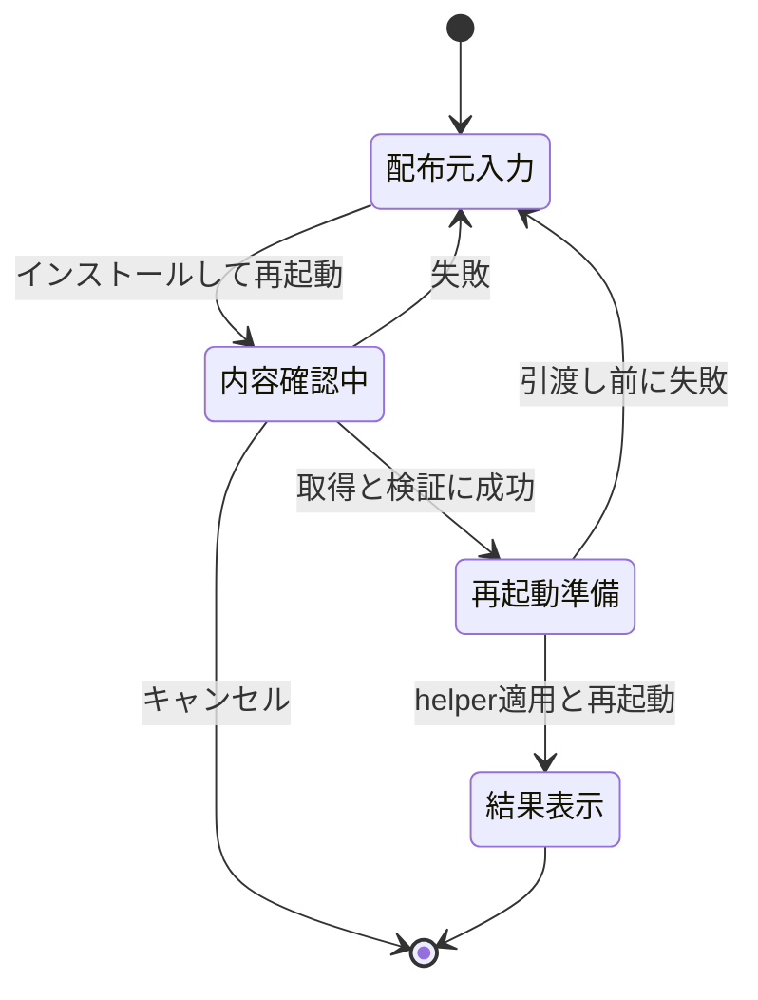

# Appletの管理・導入・更新

## 管理対象の定義

更新チェックは一覧の「バージョン」見出し横に1つ置き、検索や表示順に関わらず管理対象の全Appletを確認する。本体とcollectionの子ページは対象に含めない。行ごとのチェックボタンは置かず、各行のバージョン・最終確認時刻・更新操作・エラーを維持する。再起動は電源マークのアイコンを使う。「適用できる更新はありません。」という完了状態は管理画面へ表示せず、他の結果・失敗は保持する。

管理一覧の対象は、実際の配置フォルダーとmanifestを持つ外部Appletである。表示対象・操作可否をmainの共通ポリシーで決め、rendererへ一覧と操作可否を渡す。

| 対象 | 管理一覧 | 扱い |
| --- | --- | --- |
| Node／.NET／nativeの外部Applet | 含める | 無効・停止・開始待ち・起動エラーでも表示する |
| WebApplet提供元のNode Applet | 含める | 設定・更新・再起動・アンインストールを通常のAppletと同じ経路で提供する |
| WebAppletで追加したサイト | 含めない | `collection`で提供元と結び付く子ページ。独立したパッケージとして数えない |
| 他のAppletが提供するcollectionの子ページ | 含めない | 提供元のパッケージで管理する。子ページの既存設定・保存は維持する |
| 内蔵Default Shell | 含めない | 本体同梱領域。外観設定と本体更新で扱う |
| 未導入IDだけが残る設定・リボン項目 | 含めない | 設定値は保持し、インストール済み件数へ含めない |

名前やIDの接頭辞からWebサイト・権限・コマンド所有者を推測しない。既存の`sourceKind`、`collection`、manifestと検出元の対応を使う。WebApplet本体を名前で除外する特例は設けない。

表示対象とファイル操作可能な対象を分ける。開発起動、元のportable EXEが特定できない場合、本体所有の`extensions`直下に実フォルダーを持たない外部Appletでは、導入・更新適用・アンインストールを利用不可にし、理由を表示する。有効切り替え・再起動・設定やログへの移動まで一律に禁止しない。mainの表示モデルは対象ID・安全な状態要約・操作可否を渡し、ファイル操作のための任意パスをrendererに組み立てさせない。

manifestを読めないフォルダーや重複IDは、既存の検出エラーとしてログへ残す。操作可能な正常Appletへ偽装した行を作らず、管理画面に検出問題の案内と共通ログへの入口を出す。導入済みIDの競合判定では、正常な表示行だけでなく検出エラー・重複・実フォルダーも確認する。

## 画面構成

本体の設定カテゴリへ`applets`（表示名「Applet管理」）を追加する。左インデックスでは「一般」の直後に置く。`SettingsPage`と`SettingsPageLayout`を使い、Shell専用の本文を追加しない。

このページは管理用フォームであり、JSON切り替え、保存先切り替え、ページ全体のリセットを出さない。ファイル配置や有効状態を一括初期化する操作を、設定のリセットへ混ぜない。個別Appletの既存フォーム／JSON・保存先切り替え・リセットは維持する。

```text
Applet管理

[⌕ Appletを検索…]
3 / 3 Appletを表示                                      [並べ替えアイコン]

Applet名 [+]    バージョン          有効   状態      操作              移動
名前            v1.2.3 [更新確認]   ON     実行中    [再起動][削除]    [設定][キー][マウス][ログ]
                最終確認: 日時
名前            v2.0.0 → v2.1.0     OFF    停止中    [再起動][削除]    [設定][キー][マウス][ログ]
                [更新]
```

更新確認・設定への移動・再起動・削除はアイコンボタンにし、titleとアクセシブル名を付ける。設定には既存の設定画面アイコン、ショートカットにはキーボード、ジェスチャーにはマウス、ログには既存のログアイコンを使う。削除の名称と確認ダイアログでは「アンインストール」を使う。実装は[共通一覧UI](settings-list-editing.md)の表・操作寸法・余白を利用し、名称・版・状態の可読性を優先する。狭幅では表を横スクロールし、設定の4ボタンと操作の2ボタンはそれぞれ一行を保つ。

| 要素 | 表示・操作の契約 |
| --- | --- |
| Applet名 | `displayName`を少し大きい太字で表示し、IDを控えめに併記する。名前のクリックでも個別設定へ移動できる |
| バージョン | 共通`VersionDisplay`を使用し、横に丸い矢印の更新確認ボタン、下に最終確認日時を置く。現在版と照合できる更新候補だけ「→ 新しい版」を表示する |
| 有効無効 | 保存済みのenabledを表示。変更確定後に即時保存し、既存の起動・停止を適用する |
| 状態 | 「実行中」「停止中」「開始待ち」「起動中」「停止処理中」「エラー」。有効状態と別に表示する |
| エラー・開始待ち | エラーの安全な要約とログへの入口を表示。開始待ちの予定時刻・「今すぐ開始」の既存操作を引き継ぐ |
| 更新 | 確認結果・最終確認日時を対象行で確認する。通信失敗と更新なしを区別する |
| 再起動 | 行に直接置く。無効時と起動／停止処理中は押せず、押して有効化する挙動を追加しない |
| 移動 | 一番右の列に「設定」「ショートカット」「マウスジェスチャー」「ログ」の共通アイコンをこの順で一行に並べ、名称はツールチップで示す |
| アンインストール | ゴミ箱から対象名と削除範囲を示す確認ダイアログを開く |

検索は管理一覧の名前・正式名・IDだけを対象とする。設定横断検索とは別の画面内検索で、個別Appletの設定本文へ検索欄を増やさない。検索によって表示順の正本や操作対象IDを変えない。0件でもインストールボタンを表示し、総数と検索後件数を区別する。

Applet単位の状態変更中は対象行の競合する操作を無効にする。パッケージ交換を準備・確定している間は、共通更新と他のパッケージ変更を開始しない。対象に関係しない画面閲覧は可能とし、二重クリックをrendererだけで防がない。

追加・更新・状態変更の完了後に検索やスクロールを初期化しない。ダイアログを閉じたら元のボタンへフォーカスを戻す。削除により元の行が消えた場合は、インストールボタンなど残る操作へ戻す。

### 移動先と絞り込み

ショートカット・ジェスチャーの対象表示は、対象名の隣の×アイコンで解除する。Default Shellの共通ログでも対象選択の隣に×を置き、sourceだけを解除して検索文字列・ログレベルを維持する。

| 移動 | 到着する画面 | 初期表示 |
| --- | --- | --- |
| 設定 | `appletSettingsPageId(appletId)`で特定する既存の個別設定 | 同じ保存済み設定と編集基盤を使用する |
| ショートカット | 共通「ショートカット」設定 | `command.extensionId === appletId`のコマンド。未割り当てを含める |
| マウスジェスチャー | 共通「マウスジェスチャー」設定 | 同じ提供元IDのコマンド。未割り当てを含める |
| ログ | 共通ログ画面 | `scope: all`、`source: appletId`で開く |

提供元フィルターはコマンドの登録元を表す。割り当ての`when`や「そのAppletが表示中に使える」という実行条件とは分ける。IDの文字列前方一致、表示名の検索語代入、割り当て済み行だけの抽出では代用しない。AppDock自身が提供する管理コマンドも、IDにApplet名が含まれるという理由でそのAppletの提供コマンドへ含めない。

無効・停止・エラーのAppletも、manifestから取得できる宣言済みコマンドを表示する。実行時の利用可否は従来どおり判定し、設定画面への移動や割り当て追加を理由に自動起動しない。実行中だけ登録されるコマンドを停止後に推測生成しない。提供元が確認できない保存済み割り当ては全体画面に保持し、IDから所有者を推定して対象一覧へ紛れ込ませない。

移動時は前の文字検索を空、割り当て状態を「すべて」にする。ログはレベルを「すべて」、文字検索を空にする。以前の絞り込みが残って対象を見失う状態を避ける。ログに該当データがなければ対象を保ったまま0件を表示する。

到着先で「対象: Applet名」と「絞り込みを解除」を表示する。解除は提供元・文字検索・状態／ログレベルを初期化し、同じ共通画面で全体表示へ戻す。ログの対象表示は既存のsource選択と同じ状態を参照し、2種類の対象を持たない。通常の左インデックスからショートカット／ジェスチャーを開く場合は全体表示を基本とする。

ショートカットとジェスチャーの「実行順…」は従来の全提供元にまたがる操作契約を維持する。表示用フィルターで実行順や保存範囲を狭めず、競合する他Appletの割り当ても順序パネルで確認できるようにする。

### 移動要求の所有者

`NavigationCoordinator`と設定のmain側セッションへ、移動先カテゴリと対象Applet IDを持つ型付きの要求を追加する。次は設計上の区分であり、任意のURL・任意コマンドを受け取る汎用ナビゲーションAPIにはしない。

```ts
type AppletManagementDestination =
  | { kind: 'settings'; appletId: string }
  | { kind: 'shortcuts' | 'gestures'; appletId: string }
  | { kind: 'logs'; appletId: string };
```

要求には既存のnavigation request番号を使う。同じ設定カテゴリ内で別のAppletへ移動しても新しい要求として反映する。提供元フィルターをmainの表示状態に保持し、`ShortcutsEditor`／`GesturesEditor`へ受け渡す。Reactの初回mount時だけ読む初期値にはしない。

画面遷移前に既存の設定入力キューとflushを待つ。flush通信失敗・期限超過では選択ページ・対象フィルターだけを先に変更しない。確認済みの不正入力を扱う既存方針は[設定基盤](settings-foundation.md)を維持する。最新の移動だけを適用し、遅れて届いた前の要求で対象を戻さない。

移動時と適用直前に対象の存在を検査する。対象が削除されていたらエラーを示して管理一覧を再取得し、別のAppletや全体表示へ黙って置き換えない。停止や無効化は移動不可の理由にしない。

提供元フィルター・一覧検索・ダイアログのURLは一時的なUI状態であり、`settings.json`や共有設定へ保存しない。再起動後は既存のページ選択復元を利用する。パッケージ操作からの再起動は「設定 → Applet管理」へ戻し、復旧結果を確認できるようにする。

## 更新確認と更新元

管理一覧には「更新を確認」を置き、`PortableUpdates.check([id])`の確認専用処理へ接続する。確認だけでダウンロードしたコードを起動・配置したり、AppDockを再起動したりしない。新版が見つかった行は「更新」を主操作とし、再確認も行えるようにする。

更新の実行は既存の`installUpdates(id)`へ接続する。確認時の候補を無検証で流用せず、再確認・取得・展開・最終確認・再起動を維持する。同版再適用の可否、最低本体版、起動時確認、結果通知は[共通更新](updates.md)の契約を維持する。「更新を確認」は管理一覧への追加であり、フッター等の共通`VersionCheck`へ一律に確認ボタンを増やさない。

バージョン情報画面からApplet別の一覧を撤去し、「Appletの管理と更新」へのリンクを置く。本体の版・更新、まとめて更新、更新動作の設定、実行環境は残す。一括更新の対象集合は既存のファイル型Appletを正本とし、管理一覧に出さない子サイトを独立した候補に加えない。WebApplet本体は一括更新の対象としても通常どおり扱う。

Appletの更新元編集は個別設定に共通項目として配置し、既存の`AppletUpdateSource`を再利用する。`extensions.<id>.updateSource`の現在の保存場所・PC専用設定との分類を維持し、個別ページの表示位置を移すだけで別ファイルへ移さない。未指定ならmanifestの`updateRepository`、明示した空文字なら無効、保存済みの独自値はそのまま使う。

設定カタログとページ投影では更新元を個別Appletの編集対象に追加し、バージョン情報の旧Applet別項目から移す。旧検索アンカーは同じ対象の新しい位置へ解決する。フォーム／JSON／ページリセット／保存先切り替えで更新元の保存範囲が食い違わないよう、パス分類を1か所で共有する。

### ダイアログと入力

共通`SettingsDialog`に「配布元（URLまたはフォルダー）」、フォルダー選択アイコン、注意文、キャンセル、「インストールして再起動」を配置する。タイトルは「Appletをインストール」。内容確認専用ボタンと確認結果の一覧は置かず、確定操作から取得・検証・導入までを続けて実行する。

配布元はURLとWindowsパスを受け付けるため、`SettingsInput`に明示的に`commitOn="blur-or-enter"`を指定する。blur/Enterは欄内だけの確定とし、取得・導入は行わない。未確定入力のEscape取消とIME優先を保持する。明示的な導入操作では欄の現在値を取得し、遅れたblurに依存せず、指定した値を一度だけ検証する。

取得・検証中は入力と二重送信を無効にし、キャンセル/閉じる/Escapeを許可する。閉鎖時は取得を中止し、遅れて届いた導入計画も破棄して適用しない。適用処理へ移った後は閉鎖を禁止する。準備失敗は`AppletPackagePreviewResult`のerror、適用前の失敗とフォルダー選択失敗も画面内のerrorとして返し、設定ページ全体のerrorへ保存しない。失敗時は指定値を残して手動でやり直せるようにする。

導入ダイアログは`errorLayout="custom"`を選び、配布元の見出し横へ共通`SettingsError`を置く。アイコンの28pxの領域を確保し、エラー時だけ表示する。ホバー・フォーカス・クリックでアイコンのすぐそばに全文のツールチップを開き、画面端では位置と高さを調整する。長文はホイール、アイコンにフォーカスした状態の矢印/PageUp/PageDownで読める。Escapeはツールチップだけを閉じる。エラーはヒント表示設定に依存せず、入力のaria-describedbyと読み上げ用alertにも渡す。赤枠は入力の境界色だけを変える。エラーの有無・長さ・開閉でダイアログ、入力、フッター、確定ボタンの寸法と位置を変えない。本文は共通のスクロール領域に収め、入力・補足・注意文の間隔を分ける。他のダイアログは既定のinline表示を維持し、customを使う場合は呼出元がエラー表示とアクセシビリティを所有する。

配布元はHTTP(S)のfeed URL・末尾`/`の配布ベースURL・GitHubリポジトリ/Release URL・`github:owner/repo`、Windowsの絶対パス/UNCとする。ローカルではupdate.jsonと配布ZIPがあるフォルダーまたはupdate.jsonのパス、もしくはextension.jsonと実行エントリーのある展開済みAppletフォルダーを受け付ける。feedがあるフォルダーではfeedの検証を優先し、破損時に展開済み扱いへ切り替えない。相対パス、デバイスパス、file URL、任意のZIPへの直指定、認証情報付きURL、fragmentは受け付けない。

展開済みフォルダーは既存の上限付きコピー処理で専用TEMPへ複製し、ルート/配下のリンクを拒否する。コピー前後のmanifestのID・版、最低本体版、実行エントリー、宣言全体を検証する。配布パッケージでは従来どおりサイズ・SHA256・ZIP構造も検証する。元のフォルダーを移動・変更せず、検証でAppletを起動しない。

配布元は取得にだけ使用し、今後の更新元を上書きしない。既存の保存済みoverrideまたはmanifest宣言を継承し、宣言がなければ未設定を保持する。コードが実行されること、信頼できる配布元の指定と検証後の再起動を、確定前の注意文に表示する。

### 検証から適用まで



1. mainが専用TEMPへ配布物を取得/コピーし、配布形式に応じた整合性とmanifestを検証する。manifestのグローバルな宣言ID・種類の重複や上限も、既存の検出処理と同じ規則で確認する。この段階でAppletを起動せず、配置先・設定も変更しない。
2. main内に検証済みの導入計画を保持し、続けてその計画を適用する。計画IDはセッション・配布元・パッケージhash・導入先・対象IDに結び付け、rendererへ任意パスを返さない。
3. ダイアログ閉鎖、セッション破棄、適用前の失敗で計画を失効させ、未使用の専用TEMPを回収する。閉じたダイアログの遅い応答で導入しない。
4. 適用時にID重複・導入先の不存在・本体版・計画の所有者とhashを再検証し、共通パッケージ操作の排他を取得する。既に導入済みなら上書きせず、管理一覧の更新へ案内する。
5. 設定入力のflushとhelperのreadyを確認してから既存の終了・commit手順を使う。適用処理中は二重送信・ダイアログ閉鎖を防ぐ。
6. helperが新規配置を確定し、元の配布EXEを再起動する。起動前の復旧を経て、新しいAppletを既存の検出・初期設定・起動処理へ渡す。

新規導入は対象IDが未登録のため、既存の`UpdateTarget`を仮の現在版で生成して更新処理へ流さない。feedの場合は最初に`kind: applet`・有効なID・版を確認し、展開後manifestと照合する。展開済みフォルダーでもコピー前後のmanifestを照合し、検証したID・版を導入計画へ固定する。本体用feedを新規Appletとして受け付けない。

導入先は本体配置に属する`extensions/<manifest.id>`にmainが決定する。IDをWindowsの安全な単一フォルダー名として検証し、予約名・末尾の空白/ドット等も拒否する。rendererやfeedが指定する任意の配置先は受け付けない。同じIDが別名フォルダーにある場合も新規導入を拒否する。

新規Appletのenabled・開始遅延・初回ショートカットは既存の既定値を使う。同じIDの設定が残っている再インストールでは、その設定を保持し、保存済みOFFや解除済みの割り当てを上書きしない。初期登録の判定に必要な既存情報も保持する。

manifestのcapability宣言と、本体で許可されている操作を分ける。インストールを理由に既存のApplet/MCPの操作許可を自動変更せず、導入後も通常の共通権限検査を適用する。

通信・検証・引渡し前の失敗では配布元と原因をダイアログ内に残す。取消は失敗通知にしない。要求の応答が失われたときは操作IDで状態を確認し、新規導入を自動再送しない。再起動後は「配置に成功したか」と「Appletが起動したか」を分けて表示し、起動エラーを配置の自動取消や再インストールへ置き換えない。

## アンインストール

確認ダイアログに対象名・バージョンを表示し、確定ボタンを「アンインストールして再起動」とする。「このAppletの配置フォルダー内のファイルを削除します。設定と保存データは残ります」と削除範囲を示す。

| 削除するもの | 保持するもの |
| --- | --- |
| 対象Appletの検証済み配置フォルダー一式 | 共有／PC専用設定、登録素材、共有名簿、認証情報、Cookie・session、Window状態、ログ |
| トランザクション完了後の専用stage・復旧用退避物 | ショートカット、ジェスチャー、トレイ、リボンの保存参照、`appletOrder`、旧ID／保存先の互換参照 |

保存データの保持は[正規の保存区分](settings-sync.md)を対象とする。配置フォルダーへ独自にデータを置く旧Appletが確認された場合は、上の説明だけで通常削除を進めず、そのAppletの保存仕様を確認する。完全削除チェックボックスや保存データ掃除は追加しない。

WebApplet本体を削除する場合は、登録サイトを利用できなくなることを確認に追加する。サイトの登録内容・ID・アカウント・sessionは保持し、各サイトを個別の削除対象として列挙・削除しない。再インストール時に既存の情報を利用する。

使用中のShell Appletを削除する場合は、再起動後にDefault Shellへ戻ることを追加表示する。既存の欠落時fallbackを使い、保存されたShell指定・リボン配置を自動で書き換えない。内蔵Default Shellへの削除要求はmainとhelperで拒否する。

mainで対象のID・検出元・フォルダー・manifest・現在の版と内容hashを確認する。最終確定とhelper適用時にも一致を確認し、別のAppletや後から更新されたフォルダーを削除しない。停止・ファイル解放を確認できない場合は交換前に失敗とし、既存配置を保持する。

削除成功後は一覧から対象を除外する。残った設定参照は通常の未導入／利用不可として扱い、別コマンドへの代替実行や自動有効化をしない。失敗時は元の配置へ戻し、入力と結果を保持する。退避物だけの掃除に失敗した場合は「削除適用済み・後片付け待ち」として、削除そのものの再実行と区別する。

## パッケージ処理と中断復旧

新規導入・更新・削除の調整役をmainに置き、既存の取得・検証・helper実行部分を共通化する。実装上の名称は`AppletPackages`等を想定する。`AppletManagement`の有効・無効・再起動と連携するが、enabled変更とファイル交換を同じ操作へ押し込めない。

新規導入と削除は、Windows上の使用中ファイル・.NETホスト・Shellの寿命を既存の更新と同じ境界で扱うため、AppDock全体を終了・再起動して適用する。行の「再起動」は従来どおり対象Appletだけを再起動する。

helperのjob／journalに操作種別を追加し、交換前の状態を記録する。古いhelperへ新しい形式を渡さず、埋込helperとmainを同じ発行物として検証する。

| 操作 | 適用前の条件 | commit前の失敗・中断 | commit後の確認・後片付け |
| --- | --- | --- | --- |
| update | 対象配置とID・版・内容hashが計画と一致 | 旧配置へ復元 | 新版のhashを確認して退避物を整理 |
| install | 対象IDと配置先が存在しない | 自分の計画で作成した新規配置だけを取り消す | 新規配置のhashを確認してstageを整理 |
| uninstall | 対象配置とID・版・内容hashが計画と一致 | 退避した旧配置へ復元 | 配置先の不存在を確認して退避物を整理 |

操作種別で新規導入の「旧配置なし」と更新・削除の「旧配置あり」を記録し、旧ファイルがない状態を失敗と誤認しない。準備・退避・配置・commitの各段階と実際の存在状態を記録し、取り消せる対象の所有を確認してから復元する。

新形式では操作種別ごとに必須項目を分ける。installは新しい配布物のID・版・hashと「旧配置なし」、uninstallは旧配置のID・版・hashと「新しい配布物なし」、updateは両方を持つ。sourceを空パスや仮hashで埋めて現行の交換処理を通さず、不要なsource指定や矛盾する存在条件を形式検証で拒否する。

削除の退避フォルダーは、拡張検出に拾われるパッケージと並列に置かない。新形式では`<本体配置>/extensions/.transactions/<operationId>/`を予約し、その下の対象index別ディレクトリ内の`next`と`previous`を導入／更新の準備・退避に使う。予約フォルダー自身にmanifestを置かず、`ExtensionManager.discover()`でも`.transactions`を明示的に除外する。正規のApplet IDに使えない先頭ドットの名前とし、既存の同名フォルダーが本体所有と確認できなければ処理を止める。

同じボリューム内のrenameで確定できることを検証し、journalに復旧可能な絶対パスと所有情報を記録する。異なるボリュームへの移動を原子的なrenameとして扱わない。回収は検証済みoperationIdの作業物だけを対象とし、他のトランザクションや`extensions`全体を再帰削除しない。

この専用領域は実行中トランザクションの作業物であり、恒久的なAppletデータ・配布物のバックアップとしては使わない。現行のPC専用`update-transaction.json`と`update-result.json`を拡張し、別の復旧journalやインストール台帳ファイルを増やさない。設定・data・認証の保存先は変更しない。

復旧はAppletの検出・起動より前に行う。journal全件のパス・重複・操作種別・ID・ハッシュ・退避物の所有を検証してから1件目を変更する。reparse point／junction／symlink、root外・別配置・予約された本体領域への操作は拒否する。拒否時は必要なjournalと退避物を残し、危険な対象だけ無条件削除する復旧を作らない。

commit後に削除先へ別のフォルダーが作成されていた場合や、配置内容の一致を確認できない場合は、成功扱いで上書き・削除せず競合として停止する。復旧未完了なら通常のApplet起動を進めず、既存の復旧案内へ接続する。

新規導入・削除は設定の書き換えを伴わない。既存の設定・更新元・有効状態は起動時に読み取るため、共有設定との独自の二重書き込みトランザクションは追加しない。確定直前に入力flushを待ち、再起動までの既存保存処理を維持する。

## 並べ替え

`SettingsOrderDialog`を使い、ドラッグハンドル・上下ボタン・キーボード操作をそろえる。ダイアログには検索結果だけでなく管理対象の全Appletを表示する。ローカルの順序をOKで確定し、キャンセルでは保存しない。

保存先は既存の`appletOrder`を利用する。これは一覧・個別設定のインデックス・ホーム等の表示順であり、Appletの起動順、ショートカット／ジェスチャーの実行順、個別のリボン配置を変える操作にはしない。

保存時は最新の配列を正本にし、次の手順で管理対象の順序だけを置き換える。

1. 保存済みID列へ未記録の検出済みIDを既存の順で補い、基準列を作る。未導入ID・子ページIDを取り除かない。
2. 管理対象IDだけを抜き出し、ダイアログ開始時から追加・削除・別の並べ替えがないか確認する。対象集合または対象同士の順序が変わっていれば競合として拒否する。
3. 最新の基準列のうち管理対象が占める位置へ、新しい対象順を順番に入れる。子ページ・未導入IDの位置と相互の順序は保つ。
4. 最新設定へ`appletOrder`だけを合成して既存のrevision付き保存を行う。別の設定項目の更新を古い値へ戻さない。

新規導入後のAppletは、既存の保存順を保って未記録項目として末尾へ現れる。再インストールしたIDに保存順が残っていれば、その位置を使う。

## 操作契約・通知・共通部品

管理画面は本体専用の`SettingsPage`接続を使う。mainが現在のページと対象に対して発行したaction IDから、状態変更・移動・確認・導入計画作成／破棄／確定・削除・並べ替えを呼ぶ。rendererから任意パス、任意のコマンドID、helper jobをそのまま受け取らない。

各状態変更は共通`AppletManagement`へ接続する。管理画面での直接設定編集による有効切り替え、外部公開用コマンドと異なる再起動、Shell専用の導入処理を増やさない。新規導入・削除の外部公開は本機能追加せず、既存のMCP／Applet権限と公開コマンドの範囲を維持する。

計画IDとoperation IDで二重確定を防ぎ、実行中の同じ要求は同じ結果に結び付ける。結果不明時は現在のoperation／再起動結果を照会し、設定・パッケージの変更を自動再送しない。旧connection、別ページ、別セッションからの計画確定を拒否する。

入力不正・内容確認の失敗はダイアログ内へ表示する。最終的な処理失敗は共通ErrorReporter、通常の確認・取消・適用結果は既存の更新通知・情報通知へ接続し、同じ失敗を複数経路から通知しない。進捗は固定された状態欄や既存ステータスバーを使い、行全体・本文の高さを一時メッセージで動かさない。URLの認証情報・クエリ等を生のまま通知やログへ出さない。

ダイアログは既存の`SettingsControlsProvider`配下に置く。`SettingsDialog`／`SettingsModal`のnative dialogと共通preloadのモーダル処理を利用し、独自のbackdropやz-index調整を加えない。確定前の検証、一時入力、IME、処理中の二重送信防止、失敗後の入力保持、フォーカス復帰は[一覧形式の設定編集UI](settings-list-editing.md)に合わせる。
