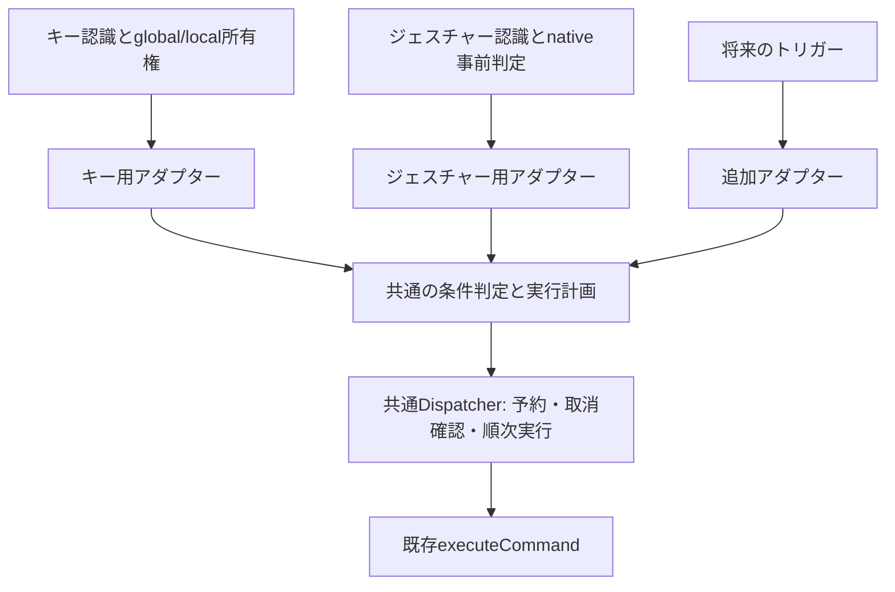

# トリガー共通の条件判定・コマンド実行基盤

状態: 段階Aの基盤接続、段階Bのキージェスチャー設定・保存・公開編集API、段階Cのキー外部条件は実装済み。本書は共通基盤の内部契約と追加規則を定義し、入力ごとの操作は[キージェスチャー](keybindings.md)と[マウスジェスチャー](gestures.md)を正本とする。

## 目的と実装する段階

入力を認識する処理から、「いつ・どこで」の判定、条件に一致したコマンドの選択、順次実行を分離する。キージェスチャーとマウスジェスチャーを同じ基盤へ接続し、別のトリガーを追加する場合にも同じ規則を使う。

| 段階                    | 対象と決定                                                                                                          |
| ----------------------- | ------------------------------------------------------------------------------------------------------------------- |
| A: 基盤の接続           | 実装済み。共通条件モデル、条件判定、保存順の選択、first/all、重複除去、再入防止、取消、既存コマンド実行への接続     |
| キージェスチャー        | `keybindingOptions.executionMode`を共通基盤へ渡す。欠落時はallとして従来の動作を保つ                                |
| Aのマウスジェスチャー   | 現在の`gestures.executionMode`を共通基盤へ渡す。既存のfirst/all、条件、待機表示、入力捕捉、前面化を保持する         |
| B: キージェスチャー設定 | 実装済み。表示名の変更、折りたたみの「動作設定」、実行方法の保存・JSON・リセット・公開編集APIを共通基盤へ接続       |
| C: キーの外部条件       | 実装済み。desktop/browser/exeとglobal/exeのデスクトップ除外、押下時の前面対象、条件に一致した行での元入力制御を接続 |
| 将来のトリガー          | トリガー用のアダプターから同じ基盤を呼ぶ。今回、新しいトリガーや汎用トリガー設定画面は追加しない                    |

段階Aでは新しい設定項目を先行追加しない。既存の割り当て・安定行ID・保存順・初期割り当ての適用済み記録を保持し、自動移行や設定ファイルの書き換えを追加しない。

## 共通基盤への接続

入力単位の`inputExecutionModes`は各方式の全体`executionMode`より優先し、未指定なら全体値をその都度使用する。TSは`input-execution.ts`で実効値を解決してから既存の計画へ渡す。マウスのnative待機表示と解放時の選択も同じ辞書を使い、最終計画との行ID一致を維持する。キーの別名が同じ物理入力としてまとめて通知された場合は1つの計画のまま、通知順で最初の明示指定を採用し、指定なしなら従来の全体値を使う。キーとタッチパッドの入力捕捉・元入力ブロック判定には実行方法を混ぜない。

`ConditionEnvironment.excludedProcesses`は各トリガー全体の除外、`CommandCondition.excludedProcesses`はグローバル行に追加する除外を表す。共通判定は両方の集合のいずれかに一致すればfalseとし、保存データを合成しない。除外があり対象プロセスが不明ならfalse。旧設定の欠落は空として扱う。

キーのnative事前判定も同じ除外と条件を使い、一致行だけから元入力のブロックを合成する。タッチパッドは既存の専用キー規則を保ち、保存行のプロセス除外だけをInputHostへ投影する。全体の除外または同じジェスチャーの全保存行の追加除外に一致すれば元入力を通し、それ以外では条件不一致・利用可能コマンド0件でも専用キーをブロックする。投影が変わったときはshortcutRevisionを更新し、古い通知を採用しない。ローカルrendererのキー入力では本体プロセス名を渡し、外部入力ではnativeが押下時に取得した対象を使う。

[CommandDispatcher](../src/main/core/command-dispatcher.ts)の単一インスタンスがキーとジェスチャーの順次実行・再入防止を担い、最終的な実行は[index.ts](../src/main/index.ts)の`executeCommand`へ集まる。[ShortcutDispatcher](../src/main/core/shortcut-dispatcher.ts)は内部の互換アダプターであり、独立した実行ループを持たない。

| 入口・処理                                                                                 | 共通基盤との関係                                                                                                                                                |
| ------------------------------------------------------------------------------------------ | --------------------------------------------------------------------------------------------------------------------------------------------------------------- |
| [keybindings.ts](../src/shared/keybindings.ts)の`planKeybindings`                          | 共通条件判定と実行計画へ渡す。`matchesWhen`、`resolveKeybindings`も同じ実装への互換アダプター。キーの正規化・物理キー別名・global/localの振り分けはキー側が所有 |
| [gestures.ts](../src/shared/gestures.ts)の`nativeGestureRows`、`planGestureCommands`       | 保存済み条件のnative投影を作り、開始対象の事実から共通の実行計画を求める                                                                                        |
| [InputCaptureManager](../src/main/core/gestures.ts)                                        | session・revision・settingsKey・文脈を検証し、nativeの選択行ID列と共通計画の一致を確認する                                                                      |
| [GestureEngine.cs](../dotnet/AppDock.InputHost/GestureEngine.cs)の対象判定・待機表示の選択 | フック内で必要な事前判定を維持し、共通規則に対応するnative評価器を使う                                                                                          |
| index.tsのローカルキー入口                                                                 | 同じ`prepareShortcut`と`dispatchShortcutPlan`を経由する。PageHostの入力時contextを保持                                                                          |
| [GlobalHotKeyManager](../src/main/core/global-hotkeys.ts)                                  | 入力の登録・状態管理に専念し、通知を必須のdispatch callbackから共通入口へ渡す                                                                                   |

「いつ・どこで」は割り当てと入力に対する条件であり、コマンド自体の実行権限にはしない。パレットや公開APIでの直接実行へ入力割り当ての条件を適用しない。既存の公開可否・操作許可・Appletの生存確認は、各APIと既存の実行経路で引き続き検証する。

## 全体の流れと責務



| 所有者                     | 責務                                                                                                         |
| -------------------------- | ------------------------------------------------------------------------------------------------------------ |
| トリガー                   | 入力の認識、対象の取得、入力を通すか止めるか、必要な情報の取得可否、イベントとsessionの生存確認              |
| 共通の条件・計画モジュール | 保存形式の違いを正規化し、条件・利用可能性・保存順から実行対象を一度だけ決める。副作用と非同期処理を持たない |
| 共通Dispatcher             | 全トリガーで共有する実行中コマンドの予約、同じ入力の再入防止、実行前の取消確認、順次実行と解放、失敗の報告   |
| 既存executeCommand         | 本体・カスタム・Appletなどのコマンドを実行する。入力由来の実行情報を既存の前面化・キー送信へ渡す             |

`src/shared/command-conditions.ts`に条件モデルと評価、`src/shared/command-execution.ts`に保存順の計画を置く。`src/main/core/command-dispatcher.ts`が予約・順次実行を所有する。互換ラッパーにも別の選択・実行ループを持たせない。

## 共通モデルと入口

以下は内部契約を簡略化した型であり、外部APIや保存JSONの追加ではない。

```ts
type CommandExecutionMode = 'first' | 'all';
type CommandScope =
  'global' | 'app' | 'pages' | 'owner' | 'applets' | 'desktop' | 'browser' | 'exe';

interface CommandCondition {
  scope: CommandScope;
  pageOrAppletIds: readonly string[];
  processes: readonly string[];
  excludeDesktop: boolean;
}

interface TriggerContext {
  host: { focused?: boolean; pageId?: string; appletId?: string };
  target?: {
    window: string;
    processName?: string;
    windowClass?: string;
    desktop?: boolean;
  };
}

interface TriggerBinding {
  id: string;
  command: string;
  enabled: boolean;
  when: CommandCondition;
}
```

- 保存済みの`Keybinding.when`と`GestureBinding.when`を自動変換しない。キーには任意のprocesses/excludeDesktopを追加し、`appletIds`を内部の`pageOrAppletIds`へ投影して、古いApplet全体の指定と現在のページIDの意味を保つ。
- `planCommandBatch`は、入力に対応する行を保存順で並べた配列、contextのスナップショット、利用可能コマンドと登録元ID、条件評価用の環境、executionModeを受け取る。選択したコマンドIDと対応する行IDを返す。
- `CommandDispatcher.dispatch`は計画、入力の識別子、入力由来の実行情報、取消確認を受け取る。任意の外部コードを実行するcallbackの公開入口にはしない。
- 計画は同期処理にする。Shell/PageHostのキー処理も、処理対象の有無を同期的に返せる。実行中で省略される場合も、既存の入力所有権とイベント消費の判断を変えない。
- 入力の識別子は種類と正規化した操作から作る。キーは同じ押下の物理キー別名をまとめ、global/localの二重配送を所有権で防ぐ。ジェスチャーは現在の操作単位の再入防止を維持し、session IDだけで毎回別の入力として扱わない。
- 取消確認と実行情報はmain内の契約とする。rendererや公開APIから任意のHWND・session・取得済みcontextを指定して入力由来の権限を作れないようにする。

## 「いつ・どこで」の共通判定

判定に必要な状態が不明なら一致しない。`false`と未取得を区別し、取得できなかった状態を「どこでも」へ広げない。`global`だけは対象情報を要求しないが、`excludeDesktop`が有効ならdesktopの判定情報を必要とする。

| 条件           | 判定に使う情報と意味                                                                               |
| -------------- | -------------------------------------------------------------------------------------------------- |
| global         | 場所の限定なし。入力の許可・除外プロセス・一時停止などの開始条件は別途満たす必要がある             |
| app            | 実Windowと表示Surfaceに基づいて、AppDockが管理する対象へフォーカスしている                         |
| pages          | appを満たし、有効な本体ページまたはAppletページがある。従来のApplet IDによる判定も保持             |
| owner          | appを満たし、表示Appletがコマンドの登録元IDと一致する。コマンドIDの接頭辞では推測しない            |
| applets        | appを満たし、指定ページIDまたは従来のApplet全体IDが一致する                                        |
| desktop        | nativeがWindows Shellのデスクトップ面と確認した対象。フォルダー画面やタスクバーを含めない          |
| browser        | 取得した実行ファイル名が評価環境のブラウザ一覧に一致し、設定時はChromiumのWindow class条件も満たす |
| exe            | 取得した実行ファイル名がその行の一覧に一致する。現在と同じ大文字小文字の扱いを保つ                 |
| excludeDesktop | global/exeの追加条件。desktopがfalseと確認できる場合だけ通す。未取得なら通さない                   |

キーとジェスチャーは上記の全条件を選べる。キーは押下時の前面Window、ジェスチャーは開始した場所のWindowを対象とする。将来のトリガーも、取得できるcontextと評価環境を宣言し、必要な状態を提供できない条件を有効化しない。

ブラウザ一覧・Chromium条件は`Settings.commandTriggerOptions`から全入力の評価環境へ投影する。方式別の保存値は参照せず、未指定時は共通の既定値を使う。ジェスチャー全体の`excludedProcesses`は開始可否の検査として条件判定より前に適用し、コマンド選択で回避できないようにする。

キーのnative投影は、有効で利用可能な外部条件の行と入力ブロック指定をキー単位で渡す。`CommandTargetCapture`が前面対象の事実を取得し、既存のnative条件評価器で一致した行だけからブロックを合成する。first/allで選ばれなかった行も入力契約の合成対象であり、不一致の行は含めない。条件付きキーとAppDockのローカル行が重なる場合は、native所有者から元入力を通したまま通知し、既存のローカル経路との二重実行を防ぐ。mainも同じ押下対象で共通計画を求め、古いrevisionや不正な対象は実行しない。

## 対象を決める順序

1. トリガーが、該当操作の行を保存順で取り出す。global/localの入力所有権、記録中・一時停止などの受付条件を検査する。
2. 同じイベントの設定・コマンド一覧・contextをスナップショットとして確保する。
3. 共通計画で、無効行、利用不能コマンド、条件不一致を除く。ownerの判定にはそのコマンドの登録元情報を使う。
4. 同じコマンドIDを重複除去し、最初に一致した行の位置を保つ。
5. `first`なら先頭1件、`all`なら全件を選ぶ。ここで計画を固定する。
6. 共通Dispatcherが、実行中のコマンドを省略し、残るバッチ全体を最初の非同期処理より前に予約する。
7. 各コマンドの直前に停止・取消を確認し、既存の`executeCommand`で順番に実行する。最後に必ず予約を解放する。

`first`は、先頭が実行中・失敗・取消になっても2件目へ繰り下げない。`all`では個別コマンドの失敗を記録して次へ進むが、バッチの取消・終了時は後続を止める。再入防止は全トリガー共通のコマンドID単位とし、別の入力経路から同じコマンドを同時実行しない。自動再試行・暗黙の待ち行列・固定待機を追加しない。

たとえば保存順が`A（条件不一致）, B, B, C`なら、firstはB、allはB→Cとなる。Bが実行中の場合、firstは実行0件、allはCだけとなる。待機表示の計画を、実行中コマンドに合わせて別の候補へ差し替えない。

結果は実行件数・失敗件数に加え、必要な場合にbusyによる省略とバッチ取消を区別できる内部結果とする。通常の成功通知は追加せず、失敗は既存のエラー報告へ接続し、正常な取消を失敗として通知しない。

## 入力時のcontextと取消

条件を評価する時点と、後続コマンドを止める条件を分ける。どちらのトリガーでも、途中で条件を再評価して別のコマンドへ選び直さない。

| トリガー           | contextを決める時点                                                                             | 実行中の扱い                                                                                                                                           |
| ------------------ | ----------------------------------------------------------------------------------------------- | ------------------------------------------------------------------------------------------------------------------------------------------------------ |
| キージェスチャー   | 押下時。native globalは押下元HWNDとmainの表示状態を照合し、不一致ならローカル条件を成立させない | 最初に選んだバッチを維持。1件目がページを開いても後続の条件を選び直さない。終了・記録開始・共通オーバーレイなど現在の停止条件を保つ                    |
| マウスジェスチャー | 開始対象を確定し、必要なアクティブ化と設定同期を終えた時点                                      | 生存session、開始HWND、設定・コマンド構成のrevision、表示contextを確認。無関係な前面移動・設定変更・一時停止・記録開始・入力プロセス切断で後続を止める |
| 将来のトリガー     | アダプターが明示するイベント確定時                                                              | 共通停止条件に、対象消失などそのトリガー固有の取消条件を加える                                                                                         |

ジェスチャーから本体を開く処理は、[現在の前面化契約](gestures.md#本体を開くコマンドの前面化)を保持する。`showWindow(invocation)`への開始元情報、表示前準備と表示後の前面化、生存session、本体所有HWND、1.5秒以内・1回限りの制約を保つ。本体へ前面を移した場合は元の対象向けの後続を止め、開始時から同じ本体HWNDなら後続実行を維持する。通常のAppletコマンドには本体前面化を追加しない。

## InputHostとの境界

条件の共通化で、フックからmainへの同期RPCやコマンド実行待ちを追加しない。nativeは右押下を捕捉する前に、実際の対象HWND、プロセス、Window class、デスクトップ面、投影されたローカル条件を評価する必要がある。

- TypeScript側の条件モデル・保存順の選択規則を正本とし、InputHostには同じ規則のnative評価器と必要なデータを投影する。TypeScript関数をC#から直接共有できるという前提にはしない。
- 設定同期時に、利用可能コマンドと登録元、対象Windowに対応するローカル条件、条件環境、実行方法を同一構成のrevisionへ結び付ける。非アクティブ対象の準備用行は、現在と同じく捕捉準備だけに使い、実行対象として承認しない。
- 開始時に取得する外部対象の事実をnative内で固定し、本体が生成・所有する入力プロセスの接続からmainへ渡す。必要な事実が現プロトコルに不足する場合は、開始対象のsnapshotを内部メッセージへ追加する。公開APIにはしない。
- 待機表示とnativeの送信候補は、同じcontext、操作、保存順、重複除去、first/allで選ぶ。1段階・2段階の完全一致と3方向目の取消は認識器の契約として維持する。
- mainは生存sessionとrevision、現在の割り当てへの所属を検証し、同じsnapshotから共通計画を求める。nativeが渡した行ID列が、その計画の選択行ID列と一致することを確認する。不一致・未知行・古い構成は実行せず、別の候補に読み替えない。
- TypeScriptとC#で同じ条件・選択fixtureを読み、結果の一致を検査する。入力捕捉、表示、最終実行の一致を別途Windows試験で確認する。

元のキー入力を止めるかどうかは、コマンド選択と別の入力契約である。globalの`blockOriginalInput`は、現在どおり有効かつ利用可能なglobal割り当て全体で合成する。firstで選ばれた1件やbusyの有無だけを見て変えない。保護キー、物理キー別名、押下・解放の対、右クリックの復元、ホイールの積算・期限も入力側の責務として保持する。

共通の条件・選択fixtureは`tests/fixtures/command-conditions.json`に置く。本体をbuildした後、両評価器を次の入口で確認する。native側の試験は配布物と同じ`CommandConditions.cs`を直接コンパイルする。

```powershell
.\dev.bat exec node --test tests/command-execution.test.cjs
dotnet run --project tests/CommandConditionsTests/CommandConditionsTests.csproj -c Release -- tests/fixtures/command-conditions.json
```

## 入口の接続と追加規則

段階Aでは、InputHostのglobal通知、通常のローカルキー、rendererのキー通知、Shellのキー処理、PageHost/Webページのキー処理を、同じキー用アダプターへ集約する。`dispatchShortcut`と現存するresolver直呼びの全箇所を確認し、キー入口だけ実行方法を適用し忘れる構造を残さない。GlobalHotKeyManagerのdispatch callbackなしの独自ループも解消し、試験用backendでも共通Dispatcherを使う。

キーのアダプターは正規化した操作と、入口が実際に観測したcontextを受け取る。PageHostが渡せるページ情報を、呼び出し時の別のアクティブページで上書きしない。remoteページへ新しいpreloadや任意コマンド実行権限を注入しない。

新しいトリガーを追加する際は、次の4点を実装する。

1. 操作と入力の識別、保存行から共通`TriggerBinding`へのアダプター。
2. イベント確定時の信頼できるcontext、取得可能な情報、必要な条件環境。
3. first/allの取得元と、対象の生存・取消・入力由来の実行情報。
4. 同じ共通計画・Dispatcherへの接続と、その入口の入力試験。

独自の条件switch、先頭1件の切り出し、重複除去、コマンド実行ループを追加しない。条件の追加は共通モデル・評価器・対応トリガーの情報取得・必要なnative投影・fixtureを同時に更新する。トレイなどの既存の単一コマンド実行は、現在の`executeCommand`への接続を保ち、今回まとめて割り当て形式を変更しない。

## キージェスチャー設定

段階Bでは以下を実装した。実行方法はキー用アダプターの共通入口で読み、global・renderer・Shell・PageHostの各経路へ適用する。

| 場所                                   | 表示・動作                                                             |
| -------------------------------------- | ---------------------------------------------------------------------- |
| 設定インデックスと設定ページのタイトル | 「キージェスチャー」                                                   |
| 割り当て一覧                           | コマンドトリガーへ集約。機能設定ページには一覧を置かない               |
| 機能設定のSection                      | タイトルなしで常時表示し、続いて「ジェスチャー共通の設定」を置く       |
| 実行方法の項目                         | 「条件に一致したコマンドの実行方法」                                   |
| 選択肢の表示順                         | 「最初の1つ」（first）、「すべて」（all）                              |
| 項目のhint                             | `操作と「いつ・どこで」の条件に一致したコマンドを、登録順に選びます。` |
| 初期値                                 | すべて。ジェスチャーとは独立して保存・変更する                         |

実行方法の`SettingsField`、select、ラベル、選択肢、hintは`CommandExecutionModeField`で共有し、ジェスチャーと同じ見た目・アクセシビリティにする。検索項目・アンカー・設定カタログにも登録する。ページID`shortcuts`と設定を開くコマンドIDは変えない。共通のページ名を参照する設定を開くコマンドの表示名も更新し、無関係な「ショートカット」表記を一括置換しない。

保存は新しい任意項目`Settings.keybindingOptions?: { executionMode: 'first' | 'all' }`とする。既存の`keybindings`配列と旧`shortcuts`マップを別用途のオブジェクトへ変更しない。欠落時はall、不正な値は検証エラーとし、空の割り当てやカスタム条件を保持する。既定値allは既存の差分保存方式に従って省略できるようにする。

段階Aのキー用アダプターの固定allを、この値の取得に置き換える。既存のkeybindingsと同じ共有Settingsとして保存し、設定カタログのshortcutsページ投影・フォーム/JSON・ページリセット・外部更新を一緒に接続する。選択は共通の確定後即時保存へ渡し、画面だけの状態にしない。リセットはキーの実行方法と共通ブラウザ設定を戻し、割り当てや他方式の実行方法を変更しない。

公開編集は`shortcuts.get`に有効なoptionsを追加し、`appdock.shortcuts.update`へジェスチャーと同型の`{ kind: 'configure', changes: { executionMode } }`を追加する。割り当て操作との原子的保存、expectedRevision、dryRun、現在のcommand/settings/shortcut編集の許可を維持する。一般の設定APIの公開範囲も確認し、別の書き込み経路を作らない。API/MCPの説明にある「同じキーの全件を実行」の固定表現を更新する。

## 実装順と完了条件

段階Aは、共通条件と選択の純粋関数、共通Dispatcher、キー全入口、native投影とジェスチャー入口の順に接続する。途中の互換アダプターを含めて全入口を照合し、独立した旧選択処理を残さず、次の検証が揃った時点で完了とする。

| 検証                    | 段階Aで確認する内容                                                                                                                |
| ----------------------- | ---------------------------------------------------------------------------------------------------------------------------------- |
| 条件・計画の単体試験    | 全scope、ownerの登録元、ページ/旧Applet指定、無効・利用不能・不明状態、保存順、重複除去、first/all、firstのbusy/失敗時の非繰り下げ |
| Dispatcherの試験        | バッチ全体の事前予約、SendInputによる再入、別トリガーの同一コマンド、個別失敗後の続行、取消・終了、finallyでの解放                 |
| キー入口の回帰          | global/local/renderer/Shell/PageHostの全経路、押下時contextの固定、物理キー別名、入力所有権、blockOriginalInput、記録中の抑止      |
| TypeScript/nativeの一致 | 共通fixtureによる条件と選択の一致、準備用行の非実行、改変/古い行ID・revision・contextの拒否、必要情報欠落時の非実行                |
| Windows入力・固定EXE    | 1/2段階、クリック/ホイール/キー、待機表示と実行のfirst/all一致、右クリック復元、対象変更取消、前面化と同一HWNDでの後続維持         |
| 保存・公開契約          | 段階Aで設定・既定値・保存形式・公開Schemaが変わらず、既存の条件と初期割り当て記録を保持すること                                    |

段階Bでは上記に加え、表の正確な文言・順序・hint・初期折りたたみ、両テーマと狭い画面、共有設定への保存・再起動・JSON・リセット・外部更新、APIの権限/revision/dryRun/原子的保存を確認する。

実装時は影響に応じた型検査・build・回帰、発行前レビュー、版更新、固定EXEの確認を[共通手順](development-workflow.md)に従って実施する。段階Aは設定追加のない内部整理としてパッチ更新、段階Bは設定項目追加のためマイナー更新とする。実入力、UAC、ロック画面などの確認範囲は[検証記録](../VERIFICATION.md)で試験条件と分けて記載する。
