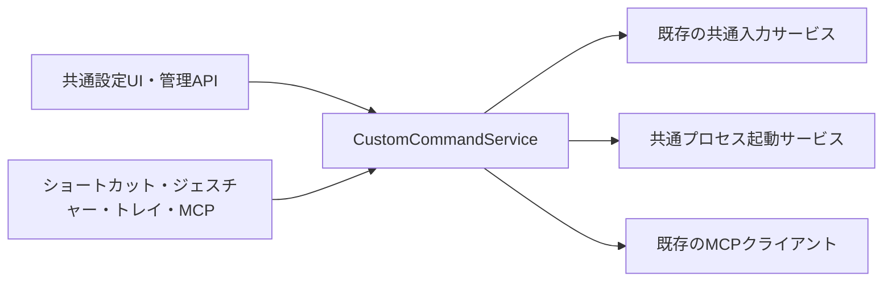

# カスタムコマンドの種類・共通説明文の拡張設計

状態: A〜Dの実装・検証・ローカル発行を完了。AppDock 0.62.1／WindowsTools 0.2.0。更新日: 2026-10-18。実測・未確認は各repoのVERIFICATIONを正本とする。[段階的な実装計画](custom-command-types-implementation-plan.md)と併せて使う。

## 目的と範囲

既存の[カスタムコマンド基盤](custom-commands-design.md)に、本体提供のキー送信・プロセス実行を追加する。既存のMCP実行も同じ画面・共通項目で扱い、登録したすべての種類に任意の説明文を付けられるようにする。

| 利用者が選ぶ種類 | 種類ID | 方針 |
| --- | --- | --- |
| キーを送信する | `appdock.input.sendKeys`（新規） | 本体の既存入力サービスを使用する |
| コマンド／プロセスを実行する | `appdock.process.start`（新規） | 本体の共通プロセス起動サービスを使用する |
| MCPツールを実行する | `appdock.mcp.call`（既存） | 現在のMCPクライアント・ジョブ・公開条件を維持する |
| Appletが提供するその他の種類 | 現在の種類ID | 同じ共通説明文を付けられる |

WindowsToolsのキー送信機能は、本体側の対応・検証が完成した後に撤去する。**WindowsToolsの設定移行は行わない。** 旧定義のインポート、旧IDの互換エイリアス、割当の自動付替え、起動時の変換を作らない。必要なコマンドは新しく登録し、必要な入力へ割り当てる。

**既存のカスタムコマンド設定も作り直してよいものとし、旧保存形式との互換維持・設定移行は実装しない。** 保存形式は新しい1種類に揃える。共通のdefinition・共通UI・共通APIと、各種類のconfigを使い、旧形式のための分岐や別の編集画面を増やさない。

この設計では単独キーと修飾キーの組合せを「キー入力」とする。任意の文章入力、キー列のマクロ、複数コマンドの連結、プロセス終了待ち・標準出力取得・プロセスツリー管理は別の拡張とする。

## 現在の実装と再利用する部分

| 現在の状態 | 拡張方針 |
| --- | --- |
| 種類のdescriptorには`description`があるが、個別定義にはない | 共通の定義項目に追加する。種類の説明とは別に保持する |
| `CustomCommandService.publicCommands()`と`AutomationCommand`は個別の説明文を返さない | 保存した説明文を公開カタログへ投影する |
| WindowsToolsはすでに`input.sendKeys`を使用している | `NativeInput`／`AppDock.InputHost`を使い、送信エンジンを新設しない |
| `input.sendKeys`はApplet向けで、`sendInput`許可がある | Appletの既存許可を維持し、保存したキー送信をMCPから実行するためのMCP側許可を追加する |
| プロセス起動用の汎用共通APIはない | 独立した共通サービスとApplet向けAPIを追加する |
| MCP実行種類は登録・実行・状態取得まで実装済み | 種類を作り直さず、説明文と共通の表示を適用する |

本体・Node/.NET/nativeの種類、保存、共通API、ショートカット、ジェスチャー、トレイ、MCPは既存の単一カタログと実行経路へ接続する。種類ごとの保存ファイルや実行用HTTPループバックを増やさない。

## 全種類共通の説明文

### 保存と編集

`CustomCommandDefinition.description`を文字列として追加する。個別コマンドの用途、実行されること、対象、使用条件を書く任意項目とし、すべての本体／Applet種類に適用する。

- 未入力は空文字列。最大1,000 UTF-16コード単位（JavaScriptの`string.length`）とする。
- 複数行を許可し、CRLF／CRはLFへ正規化する。改行・タブ以外のC0制御文字とDELを拒否する。
- HTMLとして解釈せず、プレーンテキストとして表示する。本文の途中の改行・空白を維持する。
- 新規追加で省略した場合は空文字列。更新で省略した場合は現在値を保持し、明示的な空文字列で消去する。
- 種類の`description`を自動コピーしない。コマンドの説明を、種類の説明、下流ツールの説明、実行設定と混同しない。
- 説明文だけの変更は、commandId・typeId・owner・configVersion・typeRevision・入力割当を変更しない。実行中の処理も取り消さず、次回の一覧取得へ反映する。

共通の追加／編集ダイアログで「名前」の次に「説明」を置き、その後に種類別の設定を表示する。種類を切り替えても名前と説明は保持する。公開ONの場合に外部AIへ説明が渡ることを短く案内する。JSON編集と`appdock.customCommands.update`でも同じ項目を扱う。

説明文の例: 「ブラウザーで新しいタブを開きます。ブラウザーが最前面のときに使います。」。引数や実行ファイル、接続先tokenを説明へ自動展開しない。

### 保存形式を1つに揃える

**保存ブロックは`customCommands.version = 2`だけを現行形式とする。** 定義ごとにdescriptionを保存し、configVersionは種類ごとに保持する。種類の登録RPCとSDKのhandler契約を、保存ブロックの版に連動させて作り直さない。

version 1の専用reader、説明の自動補完保存、旧定義の変換、旧IDとの対応表を追加しない。既存のMCP実行カスタムコマンドも、新形式で必要な分を作り直してよい。新規add要求では任意項目のdescription省略を空文字列として扱うが、これは新形式の入力既定値であり旧設定の移行ではない。

未対応の保存版は、既存の一般的な未知版保持の仕組みで保持し、実行しない。読込や無関係なページ保存で、自動的に変換・消去しない。利用者がカスタムコマンドページのJSON編集で**新形式の一覧を明示保存したときだけ**、共通の形式検証・expectedRevision・原子的保存を通して置き換えられるようにする。移行用の別API・別ファイル・完了フラグは作らない。

作り直した定義には新しいUUIDを付け、必要な割当を選び直す。既存の割当は自動で書き換えず、解決できないIDは既存の利用不可表示とする。MCP接続先・認証・操作許可・他の設定は、この一覧の作り直しの対象に含めない。

旧本体との混在利用は対応範囲とせず、共有設定を使うPCは本体を更新してから新形式を保存する。0.61.0はversion 2を未知版として保持し、実行しないことを更新案内に記す。新しい保存版を使うため、version 1のまま未知キーを追加して旧本体の設定読込を失敗させる構成も避けられる。

### MCPへの公開と説明文の効果

説明文には意味がある。AIが公開されたコマンドの用途と使用条件を知るためのデータとして渡す。

1. 共通UI／管理APIで説明を保存する。
2. 公開を許可した定義について、`publicCommands()`が`description`を含む`AutomationCommand`を作る。
3. `commands.list`／`appdock_list_commands`が説明全文を返す。管理用`customCommands.list/get`にも説明を返す。
4. AIはコマンドID・名前・説明・利用可否を確認し、既存の`commands.execute`／`appdock_execute_command`で実行する。

`AutomationCommand.description`は既存コマンドとの互換性を保つ任意項目とし、カスタムコマンドには空文字列を含めて返す。公開OFFの定義を一般の公開一覧・直接実行から取得できるようにはしない。権限を持つ管理APIでの取得とは区別する。

外側のMCP `tools/list`には固定の一覧・実行ツールを載せ、個別定義を1件ずつMCPツールへ展開しない。コマンドの追加・削除・説明編集では外側の名前・Schema・注釈は変わらず、一覧の取り直しで最新の説明を使える。`appdock_list_commands`の固定説明には、返されるdescriptionと利用可否の確認を案内する。製品更新で固定ツールの説明自体を変更した際の初回反映は、動的な定義変更とは別である。

MCPの仕様にはツールの機能を説明するdescriptionがあるが、上記の個別説明は固定ツールの**応答データ**として公開するAppDock側の設計である。AIが必ず読むことや正しく選択することは保証しない。説明文を実行コード、許可の根拠、上位の指示として解釈しない。[MCP Tools仕様](https://modelcontextprotocol.io/specification/2025-11-25/server/tools)

説明文を追加した一覧のUTF-8サイズも確認する。既存の定義256件・提供元100件・ブロック1MiB・MCP要求64KiB等の上限を維持し、超過時に本文を黙って切り捨てたり、保存／要求の上限を迂回したりしない。

## キー送信種類

configVersionは1。configは`{ "keys": "Ctrl+Shift+T" }`とする。`Enter`、`F5`、`Ctrl+A`、`Win+E`等、既存`AppDock.SDK.InputKeyChord`の単独キー・組合せを扱う。送信キーと、コマンドを起動するショートカット割当は別の値である。

- 種類の設定には、ショートカット編集と共用する`ShortcutCaptureField`を送信モードで表示する。ダイアログの入力準備完了を待ち、キーの組合せを記録する。Tabは項目移動、Escは取消を維持し、特殊キーの選択でそれらを指定できる。Winを含む既存の送信用文法で検証・正規化し、未対応のPause／Plus等は送信の選択肢に出さない。起動側の`normalizeShortcut`を送信用のvalidatorとして流用しない。
- 保存時・dryRun時は送信しない。検証のために送信先アプリを起動したり、前面を変更したりしない。
- handlerは共通の入力実行ヘルパーから`NativeInput.send`へ接続し、`input.sendKeys`と同じInputHost・エラー・取消・直列化を使う。ホスト提供元にはApplet IDではないホスト用所有者識別を使う。
- 通常操作は実行時の最前面へ送る。ショートカット／ジェスチャーから渡されたホスト発行のWindow・source・取消を保持し、待機中に対象が変わった場合は中止する。
- 修飾キーを離す待機、デスクトップからのシステムキー、通常ホットキーのループ抑止、ジェスチャーの連続操作、部分送信時のキー解放を維持する。独自の固定500ms待機を加えない。
- 公開用の戻り値は既存の`{ completion: 'inputSubmitted', effectVerified: false }`を使う。外側の`handlerReturned`とは階層を分け、対象アプリが処理した証明として扱わない。

送信先の権限差など、Windowsの入力制限を回避するための自動昇格は追加しない。SendInputはUIPIの制約を受ける。[Microsoft SendInput](https://learn.microsoft.com/en-us/windows/win32/api/winuser/nf-winuser-sendinput)

## コマンド／プロセス実行種類

### 最初の範囲

初期の共通サービスは**プロセスの起動**を扱い、GUIアプリの終了を待たない。起動を確認してhandlerを返すため、カスタムコマンド全体の30秒制限を無制限へ変更する必要はない。CLIの終了コード・出力を必要とする実行種類は、後から別の完了契約として追加できる。

configVersionは1。次の3モードを、1つの「コマンド／プロセスを実行する」種類の入力で選択する。

| モード | 設定 | 起動方法 |
| --- | --- | --- |
| `executable` | 実行ファイルの絶対パス、引数配列 | `spawn(file, args, {shell:false})`。引数を1本のシェル文字列へ結合しない |
| `cmd` | コマンド文字列 | システムのcmd.exeを明示起動。`/d /s /c`とcmd専用の引数組立てを使う |
| `powershell` | スクリプト文字列 | Windows PowerShellを`-NoProfile -NonInteractive -EncodedCommand`で明示起動。本文はUTF-16LEのBase64とし、実行ポリシーは変更しない |

全モード共通の任意項目は絶対パスの`workingDirectory`と`showConsole`（既定false）。作業フォルダー未指定時はexecutableの親フォルダー、シェルモードではAppDockの実EXEのフォルダーとし、起動元cwdに依存させない。showConsoleはコンソールの表示指定で、起動するGUIアプリのウィンドウを隠す指定ではない。

直接起動は`.exe`を対象にする。`.bat/.cmd`やシェル構文を直接モードから暗黙に解釈しない。cmdモードの文字列は明示的なプログラムとして扱い、保存値へ実行要求の任意引数を補間しない。cmd専用の未加工引数と、通常のargvを分ける。ネイティブworkerは前者にProcessStartInfo.Arguments、後者にArgumentListを使い、空白・引用符・Unicode・`&|<>%^!`を含む入力をfixtureで照合する。[Microsoft cmd](https://learn.microsoft.com/en-us/windows-server/administration/windows-commands/cmd)

モードの値、`workingDirectory`、`showConsole`を共通項目とし、モード別の入力名は`executable`＋`arguments`、`command`、`script`とする。選択していないモードの項目は保存せず、未知項目も拒否する。

実行ファイル／作業フォルダーは4,096文字以内、引数は64件以内・各4,096文字以内、シェル本文は8,192文字以内、config全体は既存16KiB以内とする。cmdはさらに、組み立てた実行文字列を8,191文字以内に制限する。NULを拒否し、構築したWindowsのコマンドライン長も起動前に検査する。保存時の形式検証と起動直前の実在・アクセス確認を分ける。[cmdの上限](https://learn.microsoft.com/en-au/troubleshoot/windows-client/shell-experience/command-line-string-limitation)、[EncodedCommandの符号化](https://learn.microsoft.com/en-us/powershell/module/microsoft.powershell.core/about/about_powershell_exe?view=powershell-5.1)

### 共通APIと寿命

`ProcessLaunchService`を本体へ置き、本体handlerとApplet向けの`processes.start`が同じ検証・許可・起動処理を使う。Node/.NET/nativeは既存のAppDockApi呼出しを使えるため、同じ機能のSDK専用実装を追加しない。

`processes.start`の入力は上記config。公開結果は`{ completion: 'processStarted', effectVerified: false }`とし、OSの起動受付を確認してから返す。PID・実行ファイル・引数・環境変数・標準出力を公開結果へ自動添付しない。PIDは必要な内部診断にだけ使用する。

- 専用のAppDock.ProcessHostへprivateなJSON-lines pipeで要求し、Process.Startの成功応答までを起動待機とする。workerの準備とファイル・cwd確認を待った後、取消・呼出し元の許可を再検査する。ファイル未発見や権限不足は安全な原因と対処へ変換する。
- 起動先の標準入出力はNULへ向け、workerのRPCを継承させない。workerは本体終了時に停止し、起動済みアプリを一括終了しない。CreateNoWindowでコンソールだけを制御し、GUIを隠さない。Nodeのdetached起動ではWindows PowerShellが本文を実行しない実測があったため、ネイティブ起動へ集約した。実測はVERIFICATIONへ記録する。
- 取消は起動前に検査する。起動済みプロセスの終了、強制kill、終了待ちへの取消は初期契約に含めない。許可のOFFや定義削除は新規起動を止め、起動済みアプリの効果を戻さない。
- 起動受付の前後で接続が失われ、開始の有無を確認できない場合は`OUTCOME_UNKNOWN`。自動再送しない。再入力は別の起動要求である。
- AppDockと同じユーザー・実行権限で起動する。種類の設定にrunasや自動UACを設けない。AppDockが既に昇格中ならその権限を継承し得ることを案内する。
- 環境変数の上書き、秘密値の参照、ファイル関連付け、URL起動、サービス／タスク登録は初期対象外。通常の親環境は継承するが、メモリー内のMCP tokenや接続先の秘密を起動引数・環境へ追加しない。

設定は既存どおり共有のcustomCommandsに保存する。PCごとに実行パスが異なり起動できない場合は、利用者がパスを修正する。実在・アクセスの確認は起動直前に行い、一覧取得でUNCを同期走査しない。別ファイルや同名プログラムへ自動置換しない。PC別のカスタムコマンド設定切替はこの拡張では設けない。

## 実行許可と公開

保存型コマンドのすべての外部実行は、種類のautomation宣言、定義のautomation=true、既存のread／execute、種類固有の許可を満たす。新規定義の外部公開は既定OFF。管理用のread／write／manageCustomCommandsは、実行許可の代わりにはならない。

| 保存型コマンドの種類 | Appletからの実行 | MCPからの実行 |
| --- | --- | --- |
| キー送信 | 既存の`sendInput`と共通read／execute。既存Appletの保存済み許可を保持 | `allowExecute`と新規`allowSendInput`（初期OFF） |
| プロセス起動 | 新規`runProcesses`（初期OFF）と共通read／execute | `allowExecute`と新規`allowRunProcesses`（初期OFF） |
| MCPツール | 現行のread／execute／useMcpと下流の公開条件 | 現行のallowExecute／allowUseMcpと接続先・ツールの公開条件 |

`input.sendKeys`と`processes.start`の生の共通APIはApplet向けとし、外部MCPは公開済みの保存型コマンドを使う。任意キーや実行文字列を受け取る新しいMCPツールを公開しない。MCPに公開する外側ツールは既存の固定入口を使える。

既存Appletの`input.sendKeys`直接呼出しに必要なsendInput許可は、そのまま維持する。上表のread／execute／公開条件は保存型コマンド経由の条件であり、この既存APIへ新たな公開フラグを要求するものではない。

元の呼出し元originと直接のapiCallerをホスト発行の文脈として保持する。MCP→Applet→保存型コマンドでもMCPの許可を失わせず、関与するAppletの許可も検査する。種類固有の検査は、信頼した本体providerのフックと共通操作ヘルパーへ置き、config・説明文・ID接頭辞から許可を推測しない。

公開一覧の実行可否も呼出し元の許可に応じて投影し、実行直前に再検査する。ローカルで利用可能なキー送信が、MCP許可OFFでも外部一覧で実行可能と表示される状態を作らない。管理許可がOFFでも、公開済みの実行可能コマンドは説明を含めて一般の一覧から利用できる。

操作の許可画面は、既存sendInput行のMCP列を有効にし、プロセス起動のApplet／MCP列を追加する。前提不足で保存済みON/OFFを消したり、ほかの許可を連動ONにしたりしない。これらの許可は従来どおりPC専用で保存する。

種類handlerが共通サービスの安全な既知エラーを返した場合、実行前拒否を一律`OUTCOME_UNKNOWN`へ変換しない。未知の生例外は公開せず、最終失敗は[共通エラー報告](error-reporting.md)へ接続する。共通監査へ説明・config・引数・スクリプト・出力本文を記録しない。

## WindowsToolsのキー送信機能の撤去

本体のキー送信種類が完成し、必要な新規登録・入力・MCP経由の確認が終わってから行う。

| 撤去するもの | 維持するもの |
| --- | --- |
| manifestのshortcuts設定、keysセクション、キー送信の説明 | ウィンドウ操作8件と既存ユーティリティ4件の計12固定コマンド |
| `Shortcut`の一覧解析、`send.<id>`の動的生成、キー件数のUI | フォルダーを開く、消灯予約／取消、自動ロック、各設定 |
| WindowsToolsのSendAsync接続、専用の設定／protocol／GUI試験 | 本体のinput.sendKeys／InputKeyChord／NativeInput／InputHostと他の利用者 |

旧`at365.windows-tools.send.<id>`は登録しない。旧IDを新UUIDへ付け替えず、残っているショートカット・ジェスチャー・トレイの参照は、既存の「現在利用できないコマンド」として保持する。機能撤去時の案内には、新しい種類で作成して必要な割当を選び直す手順を記す。

旧shortcutsの読込・変換・削除処理を追加しない。保存済みの不要キーの保持や通常保存時の正規化は既存設定基盤の契約に従う。旧データの自動清掃、変換用ファイル、移行完了フラグを作らない。

固定コマンドの登録方法を見直す場合も、キー送信を消したことを理由に固定コマンドを落とさない。dynamic-commands capabilityは実際の登録方式を確認して必要性を判断し、無関係な機能の改名は行わない。

## 主な実装影響先

| 対象 | 変更する責務 |
| --- | --- |
| `src/shared/custom-commands.ts`、設定codec | 単一のversion 2、説明文、上限、一般的な未対応版保持 |
| `src/main/core/custom-commands.ts` | CRUD／JSON編集、説明投影、実行中の変更判定、種類別の許可フック |
| `src/main/core/automation-commands.ts`、`appdock-api.ts` | 一般一覧の説明・実行可否、共通操作の許可、既知エラー |
| 本体提供種類と`src/main/index.ts` | キー送信・プロセス起動の登録、共通サービスへの接続 |
| `NativeInput`、`InputKeyChord`、`InputSender` | 既存機構の再利用、保存時の共通文法検査と実入力の整合 |
| 新規ProcessLaunchService、共有型 | 検証、実行モード、起動受付、子の寿命、Applet共通API |
| 権限型・AutomationService・権限画面 | MCP入力送信、プロセス起動の独立したPC専用許可 |
| カスタムコマンド共通画面 | 説明文、キー送信・プロセスの入力部品、現在のMCP入力の保持 |
| WindowsToolsのmanifest・C#・文書・試験 | キー送信機能の撤去、12固定コマンドの維持 |

実装時の対象版は[共通手順](development-workflow.md)で確定する。本体は設定項目と保存形式の追加を含むためマイナー更新、WindowsToolsも設定項目削除のため自身のマイナー更新が必要になる。設計だけの段階では版更新・発行を行わない。
