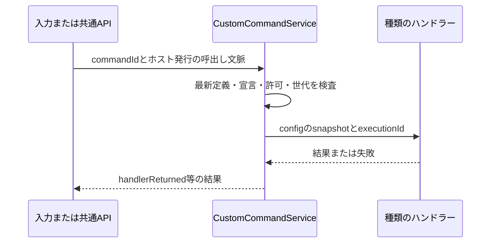

# カスタムコマンド

名前・説明・種類別の設定を保存し、パレット・ショートカット・ジェスチャー・トレイから実行する。保存ブロックはcustomCommands.version = 2。実行と管理は同じ共通API・権限・revision検査を使う。

## 用語と責務

登録済み一覧は名前・種類・提供元・有効・操作・移動を別々の列にする。状態と外部公開の専用列は置かず、利用できない理由は名前の下、公開はタイトル横の共通アイコンで示す。操作見出しは左寄せとする。[共通一覧UI](settings-list-editing.md)の移動ボタンで、同じコマンドの割り当て設定へ移動できる。

| 要素 | 内容 |
| --- | --- |
| 種類（type） | 安定したtypeId、設定Schema、表示情報、外部公開可否を宣言する単位 |
| 提供元（provider） | 種類を宣言して実行ハンドラーを提供する本体またはApplet |
| 定義（definition） | 利用者が保存する1つのカスタムコマンド。種類と固定設定を参照する |
| 実行（execution） | 1回の実行文脈。呼出し元、提供元世代、取消、結果を持つ |
| CustomCommandService | 種類・定義の照合、CRUD、状態投影、実行前検査を行う本体サービス |

本体が定義の保存を所有し、提供元が種類固有の実行を所有する。設定Schemaの検証は本体で行う。保存やdryRunのためにハンドラーを呼ばない。

## 保存形式と識別子

共有settings.jsonの任意ブロック`customCommands`を追加する。ルートの既存`schemaVersion: 1`は維持し、このブロックに独立したversionを持たせる。

```json
{
  "customCommands": {
    "version": 2,
    "items": [
      {
        "id": "a6323167-2370-4da8-a038-c63df70013e1",
        "title": "確認用の操作",
        "description": "設定した内容を返す確認用の操作です。",
        "typeId": "test.custom-command.echo",
        "owner": { "kind": "applet", "id": "test.custom-command" },
        "configVersion": 1,
        "config": { "message": "sample" },
        "enabled": true,
        "automation": false
      }
    ]
  }
}
```

これは検証用種類を使った保存ブロックの例で、settings.json全体の例ではない。

| 項目 | 契約 |
| --- | --- |
| id | 小文字のUUID。作成時に発行し、名称・設定変更で変えない。公開APIの新規作成では呼出し元がUUIDを用意する |
| commandId | `appdock.custom.<id>`として本体が生成する。保存データには重複して持たない |
| title | 前後空白を除いて1～100文字。表示名の重複は許可し、識別に使わない |
| description | 全種類共通の任意の説明。省略時は空文字、1,000 UTF-16コード単位以内。改行はLFへ揃え、公開コマンド一覧にも返す |
| typeId | 種類宣言のID。作成後は変更不可。別種類への変更は別定義の作成として扱う |
| owner | 作成時に本体が宣言から設定する。CRUD入力では指定・変更不可。実行時は現在の宣言との一致を必須とする |
| configVersion | 種類が宣言する設定形式の版。各種類は1つの版だけを扱う。版の更新は全configと同時に明示保存し、IDを保持する |
| config | 種類のSchemaに一致するJSONオブジェクト。実行可能な関数や実行文脈を保持しない。種類が宣言したスクリプト文字列はデータとして保存し、基盤自体で評価しない |
| enabled | 定義を実行可能にする指定。省略時true。提供元の起動・許可とは別 |
| automation | 外部のcommands.list/executeへの公開指定。省略時false。種類の宣言を超える公開は不可 |

本体提供のownerは`{kind: 'host'}`、Applet提供は`{kind: 'applet', id: '<実際のApplet ID>'}`とする。保存ownerは未導入時の表示を保つための情報でもあるが、権限の証明には使わない。typeIdと現在のmanifest、本体の登録情報を照合する。

itemsの配列順は管理一覧の順序だけを表す。ショートカットやジェスチャーの実行順は既存の割当順を使う。名前変更や並べ替えでcommandIdと割当を変えない。

このブロックは常に共有する。Appletごとの端末専用設定モードからは独立し、DeviceSettingsStoreで共有へ振り分ける。別PCで未導入の種類は保持して利用不可にする。提供元の有効状態は既存の端末別設定を使う。

未対応の保存版は読込だけで変換・削除せず、実行と通常の定義編集を停止する。設定ページのJSON編集からversion 2の新しい一覧を明示保存できる。

### 上限と入力検証

| 対象 | 初期上限 |
| --- | --- |
| 保存定義 | 全体256件、1提供元100件 |
| 種類宣言 | 1Applet16件、全提供元合計256件 |
| typeId | 既存の公開IDに使える文字で200文字以内。本体はappdock名前空間、Appletは自身のID配下 |
| config | UTF-8 JSONで16KiB、入れ子16段、JSON値2,048個以内 |
| configSchema | UTF-8 JSONで32KiB、入れ子32段。外部参照、非同期検証、コード評価を禁止 |
| 1回の管理更新 | 32操作以内。MCPでは既存の要求本文64KiB制限も適用 |
| 一覧 | 1ページ最大50件。config/Schema全文を含めない |
| 実行結果 | JSONオブジェクト64KiB以内。画像・音声bytes・任意ファイル参照は結果に含めない |

settings.json全体と設定ページJSONは既存codecの1MiB制限も受ける。個別上限内でも保存全体の上限を超える場合は保存前に拒否する。prototype系キー、重複ID、他提供元へのなりすまし、予約済みcommandIdとの衝突を拒否する。

## 種類の宣言とハンドラー登録

Appletは新しいcapability `custom-commands`と、manifestの`customCommandTypes`を宣言する。本体提供の種類も同じ内部descriptorへ登録する。本体の処理に特定のApplet IDや種類別if分岐を追加しない。

```json
{
  "capabilities": ["custom-commands", "appdock-api"],
  "customCommandTypes": [
    {
      "id": "test.custom-command.echo",
      "title": "確認用の種類",
      "description": "検証環境で設定した値を返します。",
      "configVersion": 1,
      "automation": true,
      "configSchema": {
        "type": "object",
        "properties": { "message": { "type": "string", "maxLength": 100 } },
        "required": ["message"],
        "additionalProperties": false
      },
      "fields": [
        { "key": "message", "title": "確認用の値", "type": "string", "default": "sample" }
      ]
    }
  ]
}
```

例はmanifestの関連部分だけを示す。minimumHostVersionは実装版を指定する。automationは省略時false。この宣言は「この種類の定義を利用者が外部公開できる」という上限であり、定義を自動公開しない。

configSchemaはJSON Schema 2020-12とdraft-7の共通部分に限定し、SDKのAjv検証器を再利用する。型、properties/required/additionalProperties、items、数値/長さ/件数の境界、enum/const、allOf/anyOf/oneOf/not、ローカル`$defs`/`$ref`を扱う。循環参照・外部参照・pattern/format・未知keywordは宣言時に拒否し、ネットワークからSchemaを取得しない。許可したdialect宣言はSchema位置だけで除去して検証する。Schemaは宣言時に上限検査・コンパイルし、実行ごとに再コンパイルしない。

fieldsは既存の設定入力部品を使うための表示宣言。第1段階ではconfig直下のstring/number/boolean/select/jsonを対象とする。required、上限、許容値の正本はconfigSchemaで、fieldsの型・既定値との矛盾は宣言エラーにする。動的なリモートSchemaからフォームを生成する処理は第4段階で設計する。fieldsがない部分は検証付きJSON入力で編集する。

### SDKとRPC

| 入口 | 予定する契約 |
| --- | --- |
| 本体内部 | 種類descriptorと、config・実行文脈を受けるasyncハンドラーを登録する |
| Node | `context.customCommands.register(typeId, handler): Promise<void>` |
| .NET | `context.CustomCommands.RegisterAsync(typeId, handler, token)` |
| 登録RPC | `host.customCommands.register`。自身が宣言したtypeIdのハンドラーを、現在の実行世代へ結び付ける |
| 実行RPC | ホストから提供元へ`customCommand.execute`。definitionId、typeId、configVersion、config、ホスト発行executionIdを渡す |

Nodeのハンドラーは`(config, invocation) => Promise<JsonObject | void>`、.NETはJsonElementと実行文脈/取消tokenを受ける非同期ハンドラーとする。実行元・Window・所有者はホスト発行の文脈から取得し、保存configから受け取らない。

登録はactivate中に許可する。manifestにない種類、別の提供元の種類、同世代の重複登録を拒否する。SDKはローカルのハンドラーを準備してから登録要求し、失敗時に戻す。停止/異常終了で登録を失効させ、次の起動世代が改めて登録する。保存定義は消さない。

外部公開宣言やSchemaを登録RPCの引数で書き換えない。新しい種類の宣言は、通常のApplet導入/更新で反映する。Node/.NETの既存登録APIは変更せず、新しいSDKサービスを追加する。.NETは既存IExtensionContext実装を壊さない既定実装とAssemblyVersionの互換方針を保ち、新APIを使うAppletだけに対応Runtimeと最低ホスト版を要求する。

## 状態とカタログへの投影

CustomCommandServiceが、保存定義と宣言/ハンドラーの現在の状態から単一のカタログを作る。ローカルUIと外部APIの別々の一覧を独立保存しない。

| 条件 | 表示・動作 |
| --- | --- |
| enabled=false | 定義を表示し、実行不可 |
| 種類が未導入 | 保存名・所有者情報を保持し、種類未導入と表示 |
| 宣言はあるが提供元停止/ハンドラー未登録 | 提供元の状態を表示し、実行不可。自動有効化しない |
| configVersion未対応/Schema不一致 | 定義を保持して修正が必要と表示。旧設定を勝手に変換しない |
| 宣言と保存ownerが不一致 | 利用不可。別の提供元へ自動的に付け替えない |
| 条件を満たす | available=true。実行時にも同じ条件を再検査 |

外部カタログには、現在の宣言がautomation=trueかつ保存定義がautomation=trueの項目だけを載せる。公開条件を満たした停止中/無効な定義はavailable=falseと理由を返す。種類が不明で公開上限を確認できない定義は、管理APIからだけ確認できる。

UIのextensionId/外部のappletIdには実際の提供元IDを投影し、本体提供はnullとする。`appdock.custom.*`というIDから本体所有と推測しない。owner条件は提供元の実際の表示・フォーカスに従う。

既存automationCommandsのmanifestコマンド向けフィルターは維持する。新しい定義はCustomCommandServiceで公開判定してから同じカタログへ合流し、既存のApplet ID接頭辞フィルターへ無理に通さない。合流時にcommandIdの衝突を検査する。

削除・利用不可で既存の割当、ピン、トレイ参照を自動削除しない。実行不能な割当として保持し、有効なOSホットキー登録から外す。後に同じIDが同期等で戻った場合だけ再照合する。別IDを同名で作っても割当を継承しない。新規割当では、その入口のassignableCommandsと既存の公開範囲を守る。

## 保存・更新・互換性

1. 操作許可、callerの所有範囲、期待revision、種類宣言とSchemaの識別情報を検査する。
2. 最新設定のコピーへ指定操作だけを適用し、最終状態を検証する。途中状態は保存・公開しない。
3. dryRunなら変更予定と現在revisionを返す。保存、ハンドラー登録、実行、入力割当を行わない。
4. 通常更新は共通の設定保存経路で原子的に保存する。保存前の外部変更/許可変更/宣言変更を再照合する。
5. 保存後の設定をカタログへ投影し、既存の変更通知からUI・入力登録を更新する。

保存前の失敗は設定・カタログとも旧状態を保持する。保存後のOS登録/表示反映失敗は保存成功と区別して状態を返し、保存をなかったことにしない。実行許可の最終判定はカタログキャッシュだけに頼らず、最新の保存値を見る。

外部同期も同じ検証・投影へ通す。端末間の三方向マージは追加せず、現在の「届いた有効な設定を採用する」規則を使う。自端末設定や別ページの内容を共有側へ書き戻さない。

初回読込だけで保存しない。未知の種類/設定版は構造・サイズを検査して保持し、実行とconfig編集を停止する。名前変更、削除、無効化は可能とし、有効化・公開追加・config変更は対応する宣言が確認できるまで拒否する。

提供元の更新で旧configVersionが使えなくなった場合は、旧値を参照できる読み取り専用表示と、現行形式の新しい入力を分ける。利用者が現行Schemaに合う全configとconfigVersionを明示保存したときだけ更新する。自動変換は行わず、定義IDと割当は保つ。

未知のcustomCommands.versionはブロック全体を保持し、この機能を読み取り専用・実行不可にする。他ページの保存で消さないようcodecを設計する。JSON破損や既知形式の構造不正は、既存の正常世代/復旧の規則へ渡す。

## 共通APIとMCPの固定入口

管理用の読取り4操作と、既存commands.executeから呼ぶ管理コマンドを追加する。操作名は単一の操作カタログに宣言する。Appletは既存`context.appdock.call`/`AppDock.CallAsync`、MCPは対応する固定ツールを使う。

| 共通API / コマンド | 主な入力 | 結果 |
| --- | --- | --- |
| `customCommands.types.list` | ownerId?、cursor?、limit? | 種類の概要、owner、configVersion、公開上限、状態、typeRevision、nextCursor |
| `customCommands.types.get` | typeId | 1種類のSchema・fieldsを含むdescriptor、typeRevision |
| `customCommands.list` | ownerId?、cursor?、limit? | 定義の概要とcommandId/状態、設定revision、nextCursor。configは含めない |
| `customCommands.get` | id | 1定義のconfigを含む内容、設定revision、種類のtypeRevision、利用不可理由 |
| `commands.execute`の`appdock.customCommands.update` | expectedRevision、operations、dryRun? | validated/settingsSaved、revision、変更ID、投影状態 |
| `commands.execute`の`appdock.custom.<UUID>` | args省略または空object | handlerReturned、effectVerified:false、任意の制限付きresult |

対応MCP名は`appdock_list_custom_command_types`、`appdock_get_custom_command_type`、`appdock_list_custom_commands`、`appdock_get_custom_command`とする。新しい種類や定義を追加しても、この4ツールと既存実行ツールの名前・Schema・注釈は変えない。管理更新の入力Schemaも種類IDをenumにせず、取得したdescriptorで詳細を検証する。

ownerIdは省略時にcallerが読める全提供元、nullで本体、文字列で実際のApplet IDを指定する。管理コマンドのpermission分類に`customCommands.write`を追加し、専用の検証/保存へ接続する。一般コマンドの空args制約と既存permission分類は維持する。

一覧cursorはcallerの範囲・filter・一覧世代へ結び付ける。途中で対象一覧が変わったらSTALE_CURSORを返して先頭から再取得させる。limitは既定20、1～50。typeRevisionは表示/Schema/公開上限を含むdescriptorの識別情報で、設定revisionとは別。configの作成・変更と公開追加では期待typeRevisionを必須とする。

### 管理更新の操作

| op | フィールドと効果 |
| --- | --- |
| add | itemにid、typeId、title、configVersion、config、任意enabled/automation、外側にexpectedTypeRevision。ownerは本体で設定。既存IDは拒否 |
| update | id、changesにtitle/enabled/automation/config/configVersionの必要なもの。config変更時は全configを置換し、暗黙の深いmergeをしない。configVersion変更は全config・expectedTypeRevisionとの同時指定を必須とする |
| remove | id。存在しないIDはNOT_FOUND。参照する割当は保持 |
| reorder | idsにcallerが管理可能な現在の全IDを1回ずつ指定。表示順だけを変更 |

操作配列は順に評価して最後に1回保存する。重複するadd、削除後のupdate、種類/owner変更、対象範囲外、最終ID集合と一致しないreorderを拒否する。Appletのreorderは自身の定義が占める位置だけを入れ替え、他提供元の順序を保持する。

```json
{
  "id": "appdock.customCommands.update",
  "args": {
    "expectedRevision": "取得した設定revision",
    "dryRun": true,
    "operations": [
      {
        "op": "add",
        "expectedTypeRevision": "取得した種類のtypeRevision",
        "item": {
          "id": "a6323167-2370-4da8-a038-c63df70013e1",
          "typeId": "test.custom-command.echo",
          "title": "確認用の操作",
          "configVersion": 1,
          "config": { "message": "sample" },
          "enabled": true,
          "automation": false
        }
      }
    ]
  }
}
```

revisionは既存SettingsCommandsと同じepoch付きの不透明な値を使い、ホスト再起動前のrevisionを受け入れない。応答消失後は同じUUIDをget/listで確認し、addを新しいUUIDで自動再送しない。dryRun成功は後の保存を予約せず、保存時にも再検査する。

### 許可と所有範囲

操作の許可画面に「カスタムコマンド定義の閲覧・編集」`manageCustomCommands`を追加し、MCP列とApplet列を独立してPC専用保存する。新規・省略時はOFF。設定UIだけが許可自体を変更できる。

| 操作 | 必要条件 |
| --- | --- |
| 管理用types/list/get | read + manageCustomCommands。定義のconfigを読める権限であることをUIに示す |
| 管理更新 | read + execute + write + manageCustomCommands |
| 公開コマンド一覧 | 既存read。管理権限なしでも公開された定義の概要は見える |
| 公開コマンド実行 | 既存read + execute、種類/定義の公開条件、提供元と種類固有サービスの許可 |
| ローカル設定UI | 本体mainFrameの設定ページsession/route検査。外部API用の許可とは分離 |
| ハンドラー登録 | 自身のmanifest宣言 + custom-commands capability + 現在のApplet実行世代 |

Appletの管理読書きは自身が提供する種類・定義だけに限定する。ownerIdを別Appletへ指定して範囲を拡大できない。Appletからのaddはautomation=falseだけを認め、updateでautomationを変更させない。公開設定はローカルUIまたは管理を許可したMCPから変更する。型のmanifest宣言も必須とするため、runtime登録だけで外部アクセスを付与する現行の制限を解除しない。

管理APIはconfigを取得できるため、通常のsettings.getや一般のcommands.listへ同じ情報を追加しない。秘密はPC専用の参照先に分ける。configの任意文字列に秘密が混ざらないことを汎用の文字列検査だけで保証せず、種類提供元が保存/公開に適したSchemaを定める。

## 実行経路と寿命



1. 既存のexecuteCommandでカスタムIDを明示的に解決し、サービスへ渡す。通常のApplet実行や設定コマンドへのfallbackで推測しない。
2. 最新のenabled、宣言、owner、configVersion、Schema、公開条件、許可、提供元世代を検査する。停止中Appletを自動有効化・起動しない。
3. 定義と種類の検証済みsnapshot、実行元、既存のgesture session/Window等をホストの実行文脈へ結び付ける。値をリクエストから偽装できないようにする。
4. 提供元へconfigを渡す。MCP等の外部起点は新しいカスタム実行文脈で保持し、内側のサービスからローカル起点へ格上げできないようにする。
5. 応答を検証し、実行文脈を破棄する。返り値は応答の確認であり、外部への効果確認とはしない。

同一commandIdの実行中の追加要求はBUSYとし、暗黙にキューへ積まない。異なるIDについては既存dispatcherと共通APIの直列化/再入制約を保つ。`BUSY`/`SELF_CALL`を解除してハンドラーから任意コマンドを再帰実行する仕様にはしない。

ハンドラー待機は最大30秒。Node/.NETのRPC期限と取消を整合させ、タイムアウトで待機を終えても外部効果の停止を保証しない。長時間ジョブはサービスで受付/状態取得へ分け、全コマンドのタイムアウトを無制限へ変更しない。

| 変更・障害 | 実行中と次回実行の扱い |
| --- | --- |
| 名前・表示順変更 | 実行中は継続、次回表示へ反映 |
| config変更 | 実行中は開始時snapshotで継続、次回から新設定。混在した値を渡さない |
| 無効化・削除・公開解除・必要許可の取消 | 対象の実行へ取消を通知し、新規受付を止める。既に発生した効果は戻さない |
| 提供元停止・更新・異常終了 | 旧世代を失効、取消、未確定なら結果不明。新世代で自動再実行しない |
| gesture取消・対象Window失効 | 既存CommandContextsと同じ取消・対象検査を使う |
| 切断・タイムアウト | 結果不明を明示し、自動再送しない |

通常の設定受信でも同じ規則を適用する。保存済みの定義や名前が戻っても、過去の実行を再開しない。

### 結果とエラー

成功応答の外形は`{id: commandId, completion: 'handlerReturned', effectVerified: false, result?: JsonObject}`。resultは明示的に外部へ返すための値だけとし、生の例外、認証、全configを自動で付けない。voidならresultを省略する。

現在のAppDockApiは通常ハンドラーの戻り値を破棄するため、新しいカスタム経路だけで検証済み結果を取り込む。管理コマンドの非空argsも専用の許可/Schema検証へ分岐し、既存の通常コマンドへ任意argsを許可する変更は行わない。

主なエラーはINVALID_ARGUMENT、NOT_FOUND、CONFLICT、STALE_CURSOR、TYPE_CHANGED、TYPE_UNAVAILABLE、UNSUPPORTED_CONFIG_VERSION、PERMISSION_DENIED、BUSY、CANCELLED、OUTCOME_UNKNOWN。既存APIのエラー分類に合わせて同義コードを整理してよいが、入力不正、競合、実行前拒否、実行後の結果不明を区別する。

種類の内部処理が失敗した場合は安全な公開メッセージへ変換する。共通ログはcommandId・typeId・提供元・実行元・要求ID・状態・所要時間だけを記録し、config/結果本文/生の例外を記録しない。最終失敗は[共通エラー報告](error-reporting.md)、継続した利用不可は[共通警告](warning-notifications-design.md)へ接続し、重複通知と取消の誤通知を避ける。

## 設定UIとJSON編集

本体の設定カタログに「カスタムコマンド」ページを追加する。本体rendererの既存SettingsPageHost/SettingsPageModelへ接続し、Shell専用の保存経路や別Windowを追加しない。

- 一覧は名前、種類/提供元、利用可否、有効状態、外部公開状態を表示する。config全文や秘密参照の値を一覧へ出さない。
- 追加/編集は既存のSettingsListTable、SettingsDialog、設定入力部品を使う。種類、名前、種類別設定、公開設定を1登録としてOKで保存する。
- 有効状態の変更は即時保存。削除は参照が保持されることを説明する共通確認を使う。並べ替えは共通ダイアログで確定し、実行順とは区別する。
- 一時入力はダイアログ内だけに保持し、キャンセル/画面破棄で破棄する。全体の未保存状態、全体保存/破棄ボタンを追加しない。
- 種類がない、停止中、未導入、設定版不一致の状態を区別し、画面を開いただけでは提供元を起動しない。
- 種類が外部公開を認めない場合は公開操作を無効にして理由を示す。公開ONの保存はコマンド実行ではない。
- IME、Enter/blur、Escape、Tab、失敗後の入力保持、明暗、狭幅、長い名前、連続追加後のスクロール/フォーカスを既存の一覧編集規則へ合わせる。

種類descriptorをフォーム表示開始時に固定し、保存時にtypeRevisionを照合する。種類の更新で入力部品が変わっても、一時入力を無断で初期化しない。競合時は入力を保持して再確認させる。

このページのJSON投影はcustomCommandsの管理可能フィールドだけとし、ownerは変更不可。JSON入力もCRUDと同じ検証・保存経路へ変換し、他ページの設定や許可を更新できないようにする。更新中は対象before値を検査し、無関係な外部編集を上書きしない。検索索引は静的な項目説明だけを含み、config値を索引化しない。

保存モードのツールバーは「共有」と分かる固定表示にし、Appletの保存先切替を流用しない。共有モードを選んだ既存Applet設定と端末専用のApplet設定は、ページから変更しない。

### 保存と編集

`CustomCommandDefinition.description`を文字列として追加する。個別コマンドの用途、実行されること、対象、使用条件を書く任意項目とし、すべての本体／Applet種類に適用する。

- 未入力は空文字列。最大1,000 UTF-16コード単位（JavaScriptの`string.length`）とする。
- 複数行を許可し、CRLF／CRはLFへ正規化する。改行・タブ以外のC0制御文字とDELを拒否する。
- HTMLとして解釈せず、プレーンテキストとして表示する。本文の途中の改行・空白を維持する。
- 新規追加で省略した場合は空文字列。更新で省略した場合は現在値を保持し、明示的な空文字列で消去する。
- 種類の`description`を自動コピーしない。コマンドの説明を、種類の説明、下流ツールの説明、実行設定と混同しない。
- 説明文だけの変更は、commandId・typeId・owner・configVersion・typeRevision・入力割当を変更しない。実行中の処理も取り消さず、次回の一覧取得へ反映する。

共通の追加／編集ダイアログで「名前」の次に「説明」を置き、その後に種類別の設定を表示する。種類を切り替えても名前と説明は保持する。公開ONの場合に外部AIへ説明が渡ることを短く案内する。JSON編集と`appdock.customCommands.update`でも同じ項目を扱う。

説明文の例: 「ブラウザーで新しいタブを開きます。ブラウザーが最前面のときに使います。」。引数や実行ファイル、接続先tokenを説明へ自動展開しない。

### 保存形式を1つに揃える

**保存ブロックは`customCommands.version = 2`だけを現行形式とする。** 定義ごとにdescriptionを保存し、configVersionは種類ごとに保持する。種類の登録RPCとSDKのhandler契約を、保存ブロックの版に連動させて作り直さない。

version 1の専用reader、説明の自動補完保存、旧定義の変換、旧IDとの対応表を追加しない。既存のMCP実行カスタムコマンドも、新形式で必要な分を作り直してよい。

未対応の保存版は、既存の一般的な未知版保持の仕組みで保持し、実行しない。読込や無関係なページ保存で、自動的に変換・消去しない。利用者がカスタムコマンドページのJSON編集で**新形式の一覧を明示保存したときだけ**、共通の形式検証・expectedRevision・原子的保存を通して置き換えられるようにする。

作り直した定義には新しいUUIDを付け、必要な割当を選び直す。既存の割当は自動で書き換えず、解決できないIDは既存の利用不可表示とする。MCP接続先・認証・操作許可・他の設定は、この一覧の作り直しの対象に含めない。

旧本体との混在利用は対応範囲とせず、共有設定を使うPCは本体を更新してから新形式を保存する。0.61.0はversion 2を未知版として保持し、実行しないことを更新案内に記す。新しい保存版を使うため、version 1のまま未知キーを追加して旧本体の設定読込を失敗させる構成も避けられる。

### MCPへの公開と説明文の効果

説明文には意味がある。AIが公開されたコマンドの用途と使用条件を知るためのデータとして渡す。

1. 共通UI／管理APIで説明を保存する。
2. 公開を許可した定義について、`publicCommands()`が`description`を含む`AutomationCommand`を作る。
3. `commands.list`／`appdock_list_commands`が説明全文を返す。管理用`customCommands.list/get`にも説明を返す。
4. AIはコマンドID・名前・説明・利用可否を確認し、既存の`commands.execute`／`appdock_execute_command`で実行する。

`AutomationCommand.description`は既存コマンドとの互換性を保つ任意項目とし、カスタムコマンドには空文字列を含めて返す。公開OFFの定義を一般の公開一覧・直接実行から取得できるようにはしない。権限を持つ管理APIでの取得とは区別する。

外側のMCP `tools/list`には固定の一覧・実行ツールを載せ、個別定義を1件ずつMCPツールへ展開しない。コマンドの追加・削除・説明編集では外側の名前・Schema・注釈は変わらず、一覧の取り直しで最新の説明を使える。`appdock_list_commands`の固定説明には、返されるdescriptionと利用可否の確認を案内する。製品更新で固定ツールの説明自体を変更した際の初回反映は、動的な定義変更とは別である。

MCPの仕様にはツールの機能を説明するdescriptionがあるが、上記の個別説明は固定ツールの**応答データ**として公開するAppDock側の設計である。AIが必ず読むことや正しく選択することは保証しない。説明文を実行コード、許可の根拠、上位の指示として解釈しない。[MCP Tools仕様](https://modelcontextprotocol.io/specification/2025-11-25/server/tools)

説明文を追加した一覧のUTF-8サイズも確認する。既存の定義256件・提供元100件・ブロック1MiB・MCP要求64KiB等の上限を維持し、超過時に本文を黙って切り捨てたり、保存／要求の上限を迂回したりしない。

## キー送信種類

configVersionは1。configは`{ "keys": "Ctrl+Shift+T" }`とする。`Enter`、`F5`、`Ctrl+A`、`Win+E`等、既存`AppDock.SDK.InputKeyChord`の単独キー・組合せを扱う。送信キーと、コマンドを起動するショートカット割当は別の値である。

- 種類の設定には、ショートカット編集と共用する`ShortcutCaptureField`を送信モードで表示する。ダイアログの入力準備完了を待ち、キーの組合せを記録する。Tabは項目移動、Escは取消を維持し、特殊キーの選択でそれらを指定できる。Winを含む既存の送信用文法で検証・正規化し、未対応のPause／Plus等は送信の選択肢に出さない。起動側の`normalizeShortcut`を送信用のvalidatorとして流用しない。
- 保存時・dryRun時は送信しない。検証のために送信先アプリを起動したり、前面を変更したりしない。
- handlerは共通の入力実行ヘルパーから`NativeInput.send`へ接続し、`input.sendKeys`と同じInputHost・エラー・取消・直列化を使う。ホスト提供元にはApplet IDではないホスト用所有者識別を使う。
- 通常操作は実行時の最前面へ送る。ショートカット／ジェスチャーから渡されたホスト発行のWindow・source・取消を保持し、待機中に対象が変わった場合は中止する。
- 修飾キーを離す待機、デスクトップからのシステムキー、通常ホットキーのループ抑止、ジェスチャーの連続操作、部分送信時のキー解放を維持する。独自の固定500ms待機を加えない。
- 公開用の戻り値は既存の`{ completion: 'inputSubmitted', effectVerified: false }`を使う。外側の`handlerReturned`とは階層を分け、対象アプリが処理した証明として扱わない。

送信先の権限差など、Windowsの入力制限を回避するための自動昇格は追加しない。SendInputはUIPIの制約を受ける。[Microsoft SendInput](https://learn.microsoft.com/en-us/windows/win32/api/winuser/nf-winuser-sendinput)

### 最初の範囲

初期の共通サービスは**プロセスの起動**を扱い、GUIアプリの終了を待たない。起動を確認してhandlerを返すため、カスタムコマンド全体の30秒制限を無制限へ変更する必要はない。CLIの終了コード・出力を必要とする実行種類は、後から別の完了契約として追加できる。

configVersionは1。次の3モードを、1つの「コマンド／プロセスを実行する」種類の入力で選択する。

| モード | 設定 | 起動方法 |
| --- | --- | --- |
| `executable` | 実行ファイルの絶対パス、引数配列 | `spawn(file, args, {shell:false})`。引数を1本のシェル文字列へ結合しない |
| `cmd` | コマンド文字列 | システムのcmd.exeを明示起動。`/d /s /c`とcmd専用の引数組立てを使う |
| `powershell` | スクリプト文字列 | Windows PowerShellを`-NoProfile -NonInteractive -EncodedCommand`で明示起動。本文はUTF-16LEのBase64とし、実行ポリシーは変更しない |

全モード共通の任意項目は絶対パスの`workingDirectory`と`showConsole`（既定false）。作業フォルダー未指定時はexecutableの親フォルダー、シェルモードではAppDockの実EXEのフォルダーとし、起動元cwdに依存させない。showConsoleはコンソールの表示指定で、起動するGUIアプリのウィンドウを隠す指定ではない。

直接起動は`.exe`を対象にする。`.bat/.cmd`やシェル構文を直接モードから暗黙に解釈しない。cmdモードの文字列は明示的なプログラムとして扱い、保存値へ実行要求の任意引数を補間しない。cmd専用の未加工引数と、通常のargvを分ける。ネイティブworkerは前者にProcessStartInfo.Arguments、後者にArgumentListを使い、空白・引用符・Unicode・`&|<>%^!`を含む入力をfixtureで照合する。[Microsoft cmd](https://learn.microsoft.com/en-us/windows-server/administration/windows-commands/cmd)

モードの値、`workingDirectory`、`showConsole`を共通項目とし、モード別の入力名は`executable`＋`arguments`、`command`、`script`とする。選択していないモードの項目は保存せず、未知項目も拒否する。

実行ファイル／作業フォルダーは4,096文字以内、引数は64件以内・各4,096文字以内、シェル本文は8,192文字以内、config全体は既存16KiB以内とする。cmdはさらに、組み立てた実行文字列を8,191文字以内に制限する。NULを拒否し、構築したWindowsのコマンドライン長も起動前に検査する。保存時の形式検証と起動直前の実在・アクセス確認を分ける。[cmdの上限](https://learn.microsoft.com/en-au/troubleshoot/windows-client/shell-experience/command-line-string-limitation)、[EncodedCommandの符号化](https://learn.microsoft.com/en-us/powershell/module/microsoft.powershell.core/about/about_powershell_exe?view=powershell-5.1)

### 共通APIと寿命

`ProcessLaunchService`を本体へ置き、本体handlerとApplet向けの`processes.start`が同じ検証・許可・起動処理を使う。Node/.NET/nativeは既存のAppDockApi呼出しを使えるため、同じ機能のSDK専用実装を追加しない。

`processes.start`の入力は上記config。公開結果は`{ completion: 'processStarted', effectVerified: false }`とし、OSの起動受付を確認してから返す。PID・実行ファイル・引数・環境変数・標準出力を公開結果へ自動添付しない。PIDは必要な内部診断にだけ使用する。

- 専用のAppDock.ProcessHostへprivateなJSON-lines pipeで要求し、Process.Startの成功応答までを起動待機とする。workerの準備とファイル・cwd確認を待った後、取消・呼出し元の許可を再検査する。ファイル未発見や権限不足は安全な原因と対処へ変換する。
- 起動先の標準入出力はNULへ向け、workerのRPCを継承させない。workerは本体終了時に停止し、起動済みアプリを一括終了しない。CreateNoWindowでコンソールだけを制御し、GUIを隠さない。Nodeのdetached起動ではWindows PowerShellが本文を実行しない実測があったため、ネイティブ起動へ集約した。実測はVERIFICATIONへ記録する。
- 取消は起動前に検査する。起動済みプロセスの終了、強制kill、終了待ちへの取消は初期契約に含めない。許可のOFFや定義削除は新規起動を止め、起動済みアプリの効果を戻さない。
- 起動受付の前後で接続が失われ、開始の有無を確認できない場合は`OUTCOME_UNKNOWN`。自動再送しない。再入力は別の起動要求である。
- AppDockと同じユーザー・実行権限で起動する。種類の設定にrunasや自動UACを設けない。AppDockが既に昇格中ならその権限を継承し得ることを案内する。
- 環境変数の上書き、秘密値の参照、ファイル関連付け、URL起動、サービス／タスク登録は初期対象外。通常の親環境は継承するが、メモリー内のMCP tokenや接続先の秘密を起動引数・環境へ追加しない。

設定は既存どおり共有のcustomCommandsに保存する。PCごとに実行パスが異なり起動できない場合は、利用者がパスを修正する。実在・アクセスの確認は起動直前に行い、一覧取得でUNCを同期走査しない。別ファイルや同名プログラムへ自動置換しない。PC別のカスタムコマンド設定切替はこの拡張では設けない。

## 実行許可と公開

保存型コマンドのすべての外部実行は、種類のautomation宣言、定義のautomation=true、既存のread／execute、種類固有の許可を満たす。新規定義の外部公開は既定OFF。管理用のread／write／manageCustomCommandsは、実行許可の代わりにはならない。

| 保存型コマンドの種類 | Appletからの実行 | MCPからの実行 |
| --- | --- | --- |
| キー送信 | 既存の`sendInput`と共通read／execute。既存Appletの保存済み許可を保持 | `allowExecute`と新規`allowSendInput`（初期OFF） |
| プロセス起動 | 新規`runProcesses`（初期OFF）と共通read／execute | `allowExecute`と新規`allowRunProcesses`（初期OFF） |
| MCPツール | 現行のread／execute／useMcpと下流の公開条件 | 現行のallowExecute／allowUseMcpと接続先・ツールの公開条件 |

`input.sendKeys`と`processes.start`の生の共通APIはApplet向けとし、外部MCPは公開済みの保存型コマンドを使う。任意キーや実行文字列を受け取る新しいMCPツールを公開しない。MCPに公開する外側ツールは既存の固定入口を使える。

既存Appletの`input.sendKeys`直接呼出しに必要なsendInput許可は、そのまま維持する。上表のread／execute／公開条件は保存型コマンド経由の条件であり、この既存APIへ新たな公開フラグを要求するものではない。

元の呼出し元originと直接のapiCallerをホスト発行の文脈として保持する。MCP→Applet→保存型コマンドでもMCPの許可を失わせず、関与するAppletの許可も検査する。種類固有の検査は、信頼した本体providerのフックと共通操作ヘルパーへ置き、config・説明文・ID接頭辞から許可を推測しない。

公開一覧の実行可否も呼出し元の許可に応じて投影し、実行直前に再検査する。ローカルで利用可能なキー送信が、MCP許可OFFでも外部一覧で実行可能と表示される状態を作らない。管理許可がOFFでも、公開済みの実行可能コマンドは説明を含めて一般の一覧から利用できる。

操作の許可画面は、既存sendInput行のMCP列を有効にし、プロセス起動のApplet／MCP列を追加する。前提不足で保存済みON/OFFを消したり、ほかの許可を連動ONにしたりしない。これらの許可は従来どおりPC専用で保存する。

種類handlerが共通サービスの安全な既知エラーを返した場合、実行前拒否を一律`OUTCOME_UNKNOWN`へ変換しない。未知の生例外は公開せず、最終失敗は[共通エラー報告](error-reporting.md)へ接続する。共通監査へ説明・config・引数・スクリプト・出力本文を記録しない。

## 保存契約とUI

configVersion 1。configは`serverId`、`toolName`、`toolRevision`、固定`arguments`、任意`timeoutMs`（1〜600秒、既定60秒）。commandIdはUUIDのまま、名前/引数/接続先を編集しても入力割当を保持する。種類のconfig全体は16KiB以内。引数に秘密値を保存するための機能は設けず、接続のBearer/暗号化環境変数を使用する。ツール独自の秘密引数参照は初期対象外。

共通のカスタムコマンド画面でこの種類を選ぶと、接続先選択→ツール取得→1ツールのSchema取得→引数JSON入力を表示する。toolRevisionは選択した詳細から保存し、変化を自動承認しない。高度なJSON編集も同じ検証へ通す。新規・config変更・有効化・公開追加時は、直前に取得したカタログと引数を照合する。保存・dryRunはツールを実行しない。提供元の種類登録には、本体が実装する副作用のない検証/利用可否フックを追加する。

接続先未設定/無効化、認証情報欠落、既知のツール削除/Schema不一致は理由付きの利用不可になる。再起動後にキャッシュがない場合は実行時に接続・照合する。静的カタログが利用可能と表示していても、実行直前の最新照合で拒否される場合がある。未知の接続先を同名サーバーへ置き換えない。修正は接続/ツールを再選択し確認して保存する。

## 実行と許可

既存のパレット・ショートカット・ジェスチャー・トレイ・commands.executeから実行する。handlerの戻り値は`{completion:'accepted',jobId,state}`であり、外側のhandlerReturnedと区別する。完了/結果はMCP接続先画面またはmcp.jobs.get、取消はmcp.jobs.cancel。ハンドラーが受付を返した後もジョブは独立して生存し、ハンドラー終了をジョブ取消には使わない。受付前の入力取消は引き継ぐ。

元callerをホストの文脈から確定する。MCP起点はallowUseMcp + allowExecute + 接続先/ツールの公開条件、Applet起点はAppletのread/useMcp/executeを満たす必要がある。MCPからAppletを経由した起点でもMCP条件を失わない。ローカル入力はPCで許可した接続を使う。種類/定義のautomation指定は下流の公開条件を上書きしない。

ジョブ受付後の定義変更は実行中の引数を変更しない。接続/許可/呼出し元の寿命が変われば第2段階で取消する。同一操作の新たな入力は新しいrequestIdを使うが、実行中の接続先にはBUSYを返す。結果不明の操作を自動で再試行しない。
