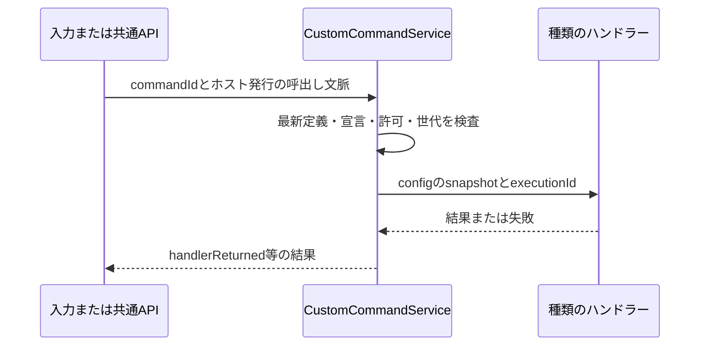

# カスタムコマンド基盤の詳細設計（第1段階）

状態: 設計案・未実装。作成日: 2026-10-18。

[全体概要](mcp-hub-design.md)と[実装計画](mcp-hub-implementation-plan.md)に基づく第1段階の契約。本書中の新規API、設定キー、型、コンポーネント名は実装予定である。現行の0.58.1には存在しない。

## 目的と完了範囲

本体および任意のAppletがコマンドの「種類」を提供し、その種類の設定を持つコマンドを共通UI・共通APIで動的に作成、保存、変更、削除できるようにする。保存したコマンドを既存のカタログ・入力経路・MCP公開へ接続する。

第1段階は種類の登録、永続定義、CRUD、実行、UI、Node/.NET契約、検証までとする。MCP実行種類は第4段階、WindowsToolsの移行とOSコマンド実行種類は別工程。既存の`commands.register`、`host.commands.replace`、`.NET Commands.ReplaceAsync`、manifest.commandsは互換性を維持する。

通常製品に検証用の種類を同梱しない。種類を提供するAppletがない場合は空の管理画面を表示する。この段階だけでMCPツール呼出しが可能になったとは案内しない。

## 用語と責務

| 要素 | 内容 |
| --- | --- |
| 種類（type） | 安定したtypeId、設定Schema、表示情報、外部公開可否を宣言する単位 |
| 提供元（provider） | 種類を宣言して実行ハンドラーを提供する本体またはApplet |
| 定義（definition） | 利用者が保存する1つのカスタムコマンド。種類と固定設定を参照する |
| 実行（execution） | 1回の実行文脈。呼出し元、提供元世代、取消、結果を持つ |
| CustomCommandService | 種類・定義の照合、CRUD、状態投影、実行前検査を行う本体サービス |

本体が定義の保存を所有し、提供元が種類固有の実行を所有する。設定Schemaの検証は本体で行う。保存やdryRunのためにハンドラーを呼ばない。

## 保存形式と識別子

共有settings.jsonの任意ブロック`customCommands`を追加する。ルートの既存`schemaVersion: 1`は維持し、このブロックに独立したversionを持たせる。

```json
{
  "customCommands": {
    "version": 1,
    "items": [
      {
        "id": "a6323167-2370-4da8-a038-c63df70013e1",
        "title": "確認用の操作",
        "typeId": "test.custom-command.echo",
        "owner": { "kind": "applet", "id": "test.custom-command" },
        "configVersion": 1,
        "config": { "message": "sample" },
        "enabled": true,
        "automation": false
      }
    ]
  }
}
```

これは検証用種類を使った保存ブロックの例で、settings.json全体の例ではない。

| 項目 | 契約 |
| --- | --- |
| id | 小文字のUUID。作成時に発行し、名称・設定変更で変えない。公開APIの新規作成では呼出し元がUUIDを用意する |
| commandId | `appdock.custom.<id>`として本体が生成する。保存データには重複して持たない |
| title | 前後空白を除いて1～100文字。表示名の重複は許可し、識別に使わない |
| typeId | 種類宣言のID。作成後は変更不可。別種類への変更は別定義の作成として扱う |
| owner | 作成時に本体が宣言から設定する。CRUD入力では指定・変更不可。実行時は現在の宣言との一致を必須とする |
| configVersion | 種類が宣言する設定形式の版。第1段階の各種類は1つの版だけを扱う。版の更新は全configと同時に明示保存し、IDを保持する |
| config | 種類のSchemaに一致するJSONオブジェクト。スクリプト/関数/実行文脈を保持しない |
| enabled | 定義を実行可能にする指定。省略時true。提供元の起動・許可とは別 |
| automation | 外部のcommands.list/executeへの公開指定。省略時false。種類の宣言を超える公開は不可 |

本体提供のownerは`{kind: 'host'}`、Applet提供は`{kind: 'applet', id: '<実際のApplet ID>'}`とする。保存ownerは未導入時の表示を保つための情報でもあるが、権限の証明には使わない。typeIdと現在のmanifest、本体の登録情報を照合する。

itemsの配列順は管理一覧の順序だけを表す。ショートカットやジェスチャーの実行順は既存の割当順を使う。名前変更や並べ替えでcommandIdと割当を変えない。

このブロックは第1段階では常に共有する。Appletごとの端末専用設定モードからは独立し、DeviceSettingsStoreで共有へ振り分ける。別PCで未導入の種類は保持して利用不可にする。提供元の有効状態は既存の端末別設定を使う。

### 上限と入力検証

| 対象 | 初期上限 |
| --- | --- |
| 保存定義 | 全体256件、1提供元100件 |
| 種類宣言 | 1Applet16件、全提供元合計256件 |
| typeId | 既存の公開IDに使える文字で200文字以内。本体はappdock名前空間、Appletは自身のID配下 |
| config | UTF-8 JSONで16KiB、入れ子16段、JSON値2,048個以内 |
| configSchema | UTF-8 JSONで32KiB、入れ子32段。外部参照、非同期検証、コード評価を禁止 |
| 1回の管理更新 | 32操作以内。MCPでは既存の要求本文64KiB制限も適用 |
| 一覧 | 1ページ最大50件。config/Schema全文を含めない |
| 実行結果 | JSONオブジェクト64KiB以内。画像・音声bytes・任意ファイル参照は第1段階の結果に含めない |

settings.json全体の4MiB制限、設定ページJSONの1MiB制限も維持する。個別上限内でも保存全体の上限を超える場合は保存前に拒否する。prototype系キー、重複ID、他提供元へのなりすまし、予約済みcommandIdとの衝突を拒否する。

## 種類の宣言とハンドラー登録

Appletは新しいcapability `custom-commands`と、manifestの`customCommandTypes`を宣言する。本体提供の種類も同じ内部descriptorへ登録する。本体の処理に特定のApplet IDや種類別if分岐を追加しない。

```json
{
  "capabilities": ["custom-commands", "appdock-api"],
  "customCommandTypes": [
    {
      "id": "test.custom-command.echo",
      "title": "確認用の種類",
      "description": "検証環境で設定した値を返します。",
      "configVersion": 1,
      "automation": true,
      "configSchema": {
        "type": "object",
        "properties": { "message": { "type": "string", "maxLength": 100 } },
        "required": ["message"],
        "additionalProperties": false
      },
      "fields": [
        { "key": "message", "title": "確認用の値", "type": "string", "default": "sample" }
      ]
    }
  ]
}
```

例はmanifestの関連部分だけを示す。minimumHostVersionは第1段階の実装版を指定する。automationは省略時false。この宣言は「この種類の定義を利用者が外部公開できる」という上限であり、定義を自動公開しない。

configSchemaはJSON Schema 2020-12を基本とし、現在使っているSDKのAjv検証器を再利用できるか実装時に確認する。利用するkeywordとローカル`$defs`/`$ref`だけを受け付け、ネットワークからSchemaを取得しない。未知のkeywordや未対応Schemaを黙って無視して保存しない。Schemaはmanifest読込時に上限検査・コンパイルし、実行ごとに再コンパイルしない。

fieldsは既存の設定入力部品を使うための表示宣言。第1段階ではconfig直下のstring/number/boolean/select/jsonを対象とする。required、上限、許容値の正本はconfigSchemaで、fieldsの型・既定値との矛盾は宣言エラーにする。動的なリモートSchemaからフォームを生成する処理は第4段階で設計する。fieldsがない部分は検証付きJSON入力で編集する。

### SDKとRPC

| 入口 | 予定する契約 |
| --- | --- |
| 本体内部 | 種類descriptorと、config・実行文脈を受けるasyncハンドラーを登録する |
| Node | `context.customCommands.register(typeId, handler): Promise<void>` |
| .NET | `context.CustomCommands.RegisterAsync(typeId, handler, token)` |
| 登録RPC | `host.customCommands.register`。自身が宣言したtypeIdのハンドラーを、現在の実行世代へ結び付ける |
| 実行RPC | ホストから提供元へ`customCommand.execute`。definitionId、typeId、configVersion、config、ホスト発行executionIdを渡す |

Nodeのハンドラーは`(config, invocation) => Promise<JsonObject | void>`、.NETはJsonElementと実行文脈/取消tokenを受ける非同期ハンドラーとする。実行元・Window・所有者はホスト発行の文脈から取得し、保存configから受け取らない。

登録はactivate中に許可する。manifestにない種類、別の提供元の種類、同世代の重複登録を拒否する。SDKはローカルのハンドラーを準備してから登録要求し、失敗時に戻す。停止/異常終了で登録を失効させ、次の起動世代が改めて登録する。保存定義は消さない。

外部公開宣言やSchemaを登録RPCの引数で書き換えない。新しい種類の宣言は、通常のApplet導入/更新で反映する。Node/.NETの既存登録APIは変更せず、新しいSDKサービスを追加する。.NETは既存IExtensionContext実装を壊さない既定実装とAssemblyVersionの互換方針を保ち、新APIを使うAppletだけに対応Runtimeと最低ホスト版を要求する。

## 状態とカタログへの投影

CustomCommandServiceが、保存定義と宣言/ハンドラーの現在の状態から単一のカタログを作る。ローカルUIと外部APIの別々の一覧を独立保存しない。

| 条件 | 表示・動作 |
| --- | --- |
| enabled=false | 定義を表示し、実行不可 |
| 種類が未導入 | 保存名・所有者情報を保持し、種類未導入と表示 |
| 宣言はあるが提供元停止/ハンドラー未登録 | 提供元の状態を表示し、実行不可。自動有効化しない |
| configVersion未対応/Schema不一致 | 定義を保持して修正が必要と表示。旧設定を勝手に変換しない |
| 宣言と保存ownerが不一致 | 利用不可。別の提供元へ自動的に付け替えない |
| 条件を満たす | available=true。実行時にも同じ条件を再検査 |

外部カタログには、現在の宣言がautomation=trueかつ保存定義がautomation=trueの項目だけを載せる。公開条件を満たした停止中/無効な定義はavailable=falseと理由を返す。種類が不明で公開上限を確認できない定義は、管理APIからだけ確認できる。

UIのextensionId/外部のappletIdには実際の提供元IDを投影し、本体提供はnullとする。`appdock.custom.*`というIDから本体所有と推測しない。owner条件は提供元の実際の表示・フォーカスに従う。

既存automationCommandsのmanifestコマンド向けフィルターは維持する。新しい定義はCustomCommandServiceで公開判定してから同じカタログへ合流し、既存のApplet ID接頭辞フィルターへ無理に通さない。合流時にcommandIdの衝突を検査する。

削除・利用不可で既存の割当、ピン、トレイ参照を自動削除しない。実行不能な割当として保持し、有効なOSホットキー登録から外す。後に同じIDが同期等で戻った場合だけ再照合する。別IDを同名で作っても割当を継承しない。新規割当では、その入口のassignableCommandsと既存の公開範囲を守る。

## 保存・更新・互換性

1. 操作許可、callerの所有範囲、期待revision、種類宣言とSchemaの識別情報を検査する。
2. 最新設定のコピーへ指定操作だけを適用し、最終状態を検証する。途中状態は保存・公開しない。
3. dryRunなら変更予定と現在revisionを返す。保存、ハンドラー登録、実行、入力割当を行わない。
4. 通常更新は共通の設定保存経路で原子的に保存する。保存前の外部変更/許可変更/宣言変更を再照合する。
5. 保存後の設定をカタログへ投影し、既存の変更通知からUI・入力登録を更新する。

保存前の失敗は設定・カタログとも旧状態を保持する。保存後のOS登録/表示反映失敗は保存成功と区別して状態を返し、保存をなかったことにしない。実行許可の最終判定はカタログキャッシュだけに頼らず、最新の保存値を見る。

外部同期も同じ検証・投影へ通す。端末間の三方向マージは追加せず、現在の「届いた有効な設定を採用する」規則を使う。自端末設定や別ページの内容を共有側へ書き戻さない。

customCommandsがない旧設定は空として読む。初回読込だけで保存しない。未知の種類/設定版は構造・サイズを検査して保持し、実行とconfig編集を停止する。名前変更、削除、無効化は可能とし、有効化・公開追加・config変更は対応する宣言が確認できるまで拒否する。

提供元の更新で旧configVersionが使えなくなった場合は、旧値を参照できる読み取り専用表示と、現行形式の新しい入力を分ける。利用者が現行Schemaに合う全configとconfigVersionを明示保存したときだけ更新する。自動変換は行わず、定義IDと割当は保つ。

未知のcustomCommands.versionはブロック全体を保持し、この機能を読み取り専用・実行不可にする。他ページの保存で消さないようcodecを設計する。JSON破損や既知形式の構造不正は、既存の正常世代/復旧の規則へ渡す。

0.58.1以前のホストは新ブロックを保存時に保持する保証がない。ダウングレードや同期先の旧ホストで新定義を編集する前提を置かず、最低対応版と既存バックアップによる復旧を利用者向け文書に記載する。

## 共通APIとMCPの固定入口

管理用の読取り4操作と、既存commands.executeから呼ぶ管理コマンドを追加する。操作名は単一の操作カタログに宣言する。Appletは既存`context.appdock.call`/`AppDock.CallAsync`、MCPは対応する固定ツールを使う。

| 共通API / コマンド | 主な入力 | 結果 |
| --- | --- | --- |
| `customCommands.types.list` | ownerId?、cursor?、limit? | 種類の概要、owner、configVersion、公開上限、状態、typeRevision、nextCursor |
| `customCommands.types.get` | typeId | 1種類のSchema・fieldsを含むdescriptor、typeRevision |
| `customCommands.list` | ownerId?、cursor?、limit? | 定義の概要とcommandId/状態、設定revision、nextCursor。configは含めない |
| `customCommands.get` | id | 1定義のconfigを含む内容、設定revision、種類のtypeRevision、利用不可理由 |
| `commands.execute`の`appdock.customCommands.update` | expectedRevision、operations、dryRun? | validated/settingsSaved、revision、変更ID、投影状態 |
| `commands.execute`の`appdock.custom.<UUID>` | args省略または空object | handlerReturned、effectVerified:false、任意の制限付きresult |

対応MCP名は`appdock_list_custom_command_types`、`appdock_get_custom_command_type`、`appdock_list_custom_commands`、`appdock_get_custom_command`とする。新しい種類や定義を追加しても、この4ツールと既存実行ツールの名前・Schema・注釈は変えない。管理更新の入力Schemaも種類IDをenumにせず、取得したdescriptorで詳細を検証する。

ownerIdは省略時にcallerが読める全提供元、nullで本体、文字列で実際のApplet IDを指定する。管理コマンドのpermission分類に`customCommands.write`を追加し、専用の検証/保存へ接続する。一般コマンドの空args制約と既存permission分類は維持する。

一覧cursorはcallerの範囲・filter・一覧世代へ結び付ける。途中で対象一覧が変わったらSTALE_CURSORを返して先頭から再取得させる。limitは既定20、1～50。typeRevisionは表示/Schema/公開上限を含むdescriptorの識別情報で、設定revisionとは別。configの作成・変更と公開追加では期待typeRevisionを必須とする。

### 管理更新の操作

| op | フィールドと効果 |
| --- | --- |
| add | itemにid、typeId、title、configVersion、config、任意enabled/automation、外側にexpectedTypeRevision。ownerは本体で設定。既存IDは拒否 |
| update | id、changesにtitle/enabled/automation/config/configVersionの必要なもの。config変更時は全configを置換し、暗黙の深いmergeをしない。configVersion変更は全config・expectedTypeRevisionとの同時指定を必須とする |
| remove | id。存在しないIDはNOT_FOUND。参照する割当は保持 |
| reorder | idsにcallerが管理可能な現在の全IDを1回ずつ指定。表示順だけを変更 |

操作配列は順に評価して最後に1回保存する。重複するadd、削除後のupdate、種類/owner変更、対象範囲外、最終ID集合と一致しないreorderを拒否する。Appletのreorderは自身の定義が占める位置だけを入れ替え、他提供元の順序を保持する。

```json
{
  "id": "appdock.customCommands.update",
  "args": {
    "expectedRevision": "取得した設定revision",
    "dryRun": true,
    "operations": [
      {
        "op": "add",
        "expectedTypeRevision": "取得した種類のtypeRevision",
        "item": {
          "id": "a6323167-2370-4da8-a038-c63df70013e1",
          "typeId": "test.custom-command.echo",
          "title": "確認用の操作",
          "configVersion": 1,
          "config": { "message": "sample" },
          "enabled": true,
          "automation": false
        }
      }
    ]
  }
}
```

revisionは既存SettingsCommandsと同じepoch付きの不透明な値を使い、ホスト再起動前のrevisionを受け入れない。応答消失後は同じUUIDをget/listで確認し、addを新しいUUIDで自動再送しない。dryRun成功は後の保存を予約せず、保存時にも再検査する。

### 許可と所有範囲

操作の許可画面に「カスタムコマンド定義の閲覧・編集」`manageCustomCommands`を追加し、MCP列とApplet列を独立してPC専用保存する。新規・省略時はOFF。設定UIだけが許可自体を変更できる。

| 操作 | 必要条件 |
| --- | --- |
| 管理用types/list/get | read + manageCustomCommands。定義のconfigを読める権限であることをUIに示す |
| 管理更新 | read + execute + write + manageCustomCommands |
| 公開コマンド一覧 | 既存read。管理権限なしでも公開された定義の概要は見える |
| 公開コマンド実行 | 既存read + execute、種類/定義の公開条件、提供元と種類固有サービスの許可 |
| ローカル設定UI | 本体mainFrameの設定ページsession/route検査。外部API用の許可とは分離 |
| ハンドラー登録 | 自身のmanifest宣言 + custom-commands capability + 現在のApplet実行世代 |

Appletの管理読書きは自身が提供する種類・定義だけに限定する。ownerIdを別Appletへ指定して範囲を拡大できない。Appletからのaddはautomation=falseだけを認め、updateでautomationを変更させない。公開設定はローカルUIまたは管理を許可したMCPから変更する。型のmanifest宣言も必須とするため、runtime登録だけで外部アクセスを付与する現行の制限を解除しない。

管理APIはconfigを取得できるため、通常のsettings.getや一般のcommands.listへ同じ情報を追加しない。秘密はPC専用の参照先に分ける。configの任意文字列に秘密が混ざらないことを汎用の文字列検査だけで保証せず、種類提供元が保存/公開に適したSchemaを定める。

## 実行経路と寿命



1. 既存のexecuteCommandでカスタムIDを明示的に解決し、サービスへ渡す。通常のApplet実行や設定コマンドへのfallbackで推測しない。
2. 最新のenabled、宣言、owner、configVersion、Schema、公開条件、許可、提供元世代を検査する。停止中Appletを自動有効化・起動しない。
3. 定義と種類の検証済みsnapshot、実行元、既存のgesture session/Window等をホストの実行文脈へ結び付ける。値をリクエストから偽装できないようにする。
4. 提供元へconfigを渡す。MCP等の外部起点は新しいカスタム実行文脈で保持し、内側のサービスからローカル起点へ格上げできないようにする。
5. 応答を検証し、実行文脈を破棄する。返り値は応答の確認であり、外部への効果確認とはしない。

同一commandIdの実行中の追加要求はBUSYとし、暗黙にキューへ積まない。異なるIDについては既存dispatcherと共通APIの直列化/再入制約を保つ。`BUSY`/`SELF_CALL`を解除してハンドラーから任意コマンドを再帰実行する仕様にはしない。

第1段階のハンドラー待機は最大30秒。Node/.NETのRPC期限と取消を整合させ、タイムアウトで待機を終えても外部効果の停止を保証しない。長時間ジョブは第2段階以降のサービスで受付/状態取得へ分け、全コマンドのタイムアウトを無制限へ変更しない。

| 変更・障害 | 実行中と次回実行の扱い |
| --- | --- |
| 名前・表示順変更 | 実行中は継続、次回表示へ反映 |
| config変更 | 実行中は開始時snapshotで継続、次回から新設定。混在した値を渡さない |
| 無効化・削除・公開解除・必要許可の取消 | 対象の実行へ取消を通知し、新規受付を止める。既に発生した効果は戻さない |
| 提供元停止・更新・異常終了 | 旧世代を失効、取消、未確定なら結果不明。新世代で自動再実行しない |
| gesture取消・対象Window失効 | 既存CommandContextsと同じ取消・対象検査を使う |
| 切断・タイムアウト | 結果不明を明示し、自動再送しない |

通常の設定受信でも同じ規則を適用する。保存済みの定義や名前が戻っても、過去の実行を再開しない。

### 結果とエラー

成功応答の外形は`{id: commandId, completion: 'handlerReturned', effectVerified: false, result?: JsonObject}`。resultは明示的に外部へ返すための値だけとし、生の例外、認証、全configを自動で付けない。voidならresultを省略する。

現在のAppDockApiは通常ハンドラーの戻り値を破棄するため、新しいカスタム経路だけで検証済み結果を取り込む。管理コマンドの非空argsも専用の許可/Schema検証へ分岐し、既存の通常コマンドへ任意argsを許可する変更は行わない。

主なエラーはINVALID_ARGUMENT、NOT_FOUND、CONFLICT、STALE_CURSOR、TYPE_CHANGED、TYPE_UNAVAILABLE、UNSUPPORTED_CONFIG_VERSION、PERMISSION_DENIED、BUSY、CANCELLED、OUTCOME_UNKNOWN。既存APIのエラー分類に合わせて同義コードを整理してよいが、入力不正、競合、実行前拒否、実行後の結果不明を区別する。

種類の内部処理が失敗した場合は安全な公開メッセージへ変換する。共通ログはcommandId・typeId・提供元・実行元・要求ID・状態・所要時間だけを記録し、config/結果本文/生の例外を記録しない。最終失敗は[共通エラー報告](error-reporting.md)、継続した利用不可は[共通警告](warning-notifications-design.md)へ接続し、重複通知と取消の誤通知を避ける。

## 設定UIとJSON編集

本体の設定カタログに「カスタムコマンド」ページを追加する。本体rendererの既存SettingsPageHost/SettingsPageModelへ接続し、Shell専用の保存経路や別Windowを追加しない。

- 一覧は名前、種類/提供元、利用可否、有効状態、外部公開状態を表示する。config全文や秘密参照の値を一覧へ出さない。
- 追加/編集は既存のSettingsListTable、SettingsDialog、設定入力部品を使う。種類、名前、種類別設定、公開設定を1登録としてOKで保存する。
- 有効状態の変更は即時保存。削除は参照が保持されることを説明する共通確認を使う。並べ替えは共通ダイアログで確定し、実行順とは区別する。
- 一時入力はダイアログ内だけに保持し、キャンセル/画面破棄で破棄する。全体の未保存状態、全体保存/破棄ボタンを追加しない。
- 種類がない、停止中、未導入、設定版不一致の状態を区別し、画面を開いただけでは提供元を起動しない。
- 種類が外部公開を認めない場合は公開操作を無効にして理由を示す。公開ONの保存はコマンド実行ではない。
- IME、Enter/blur、Escape、Tab、失敗後の入力保持、明暗、狭幅、長い名前、連続追加後のスクロール/フォーカスを既存の一覧編集規則へ合わせる。

種類descriptorをフォーム表示開始時に固定し、保存時にtypeRevisionを照合する。種類の更新で入力部品が変わっても、一時入力を無断で初期化しない。競合時は入力を保持して再確認させる。

このページのJSON投影はcustomCommandsの管理可能フィールドだけとし、ownerは変更不可。JSON入力もCRUDと同じ検証・保存経路へ変換し、他ページの設定や許可を更新できないようにする。更新中は対象before値を検査し、無関係な外部編集を上書きしない。検索索引は静的な項目説明だけを含み、config値を索引化しない。

保存モードのツールバーは「共有」と分かる固定表示にし、Appletの保存先切替を流用しない。共有モードを選んだ既存Applet設定と端末専用のApplet設定は、今回のページから変更しない。

## 実装の主な影響先

以下は配置案。新規ファイル名は役割に応じて調整できるが、既存機能の別実装を作らない。

| 場所 | 変更する責務 |
| --- | --- |
| src/shared/custom-commands.ts（新規） | 保存型、descriptor、共通検証、カタログ型 |
| src/main/core/custom-commands.ts（新規） | 単一サービス、CRUD、投影、実行前検査 |
| src/shared/contracts.ts、settings-schema.ts | 任意ブロック、互換読込、未知版の保持 |
| src/main/core/device-settings-store.ts、settings-commands.ts | 共有保存の振分け、revision、原子的更新 |
| src/shared/appdock-api.ts、src/main/core/appdock-api.ts、automation-commands.ts | 固定の管理API、管理コマンド、許可、公開カタログへの合流、カスタム結果 |
| src/main/core/extensions.ts、host-api.ts、node-worker.ts | 種類宣言、所有者、登録、RPC、停止時処理 |
| dotnet/AppDock.SDK、dotnet/AppDock.Runtime | 互換性を保つ追加サービス、結果、取消、実行文脈 |
| src/main/index.ts、command-contexts.ts、入力/トレイのカタログ | 同じ一覧と実行経路への接続、所有者、変更通知 |
| settings-catalog.ts、設定ページController、本体renderer/settings-ui | ページ投影、共通一覧/フォーム/JSON、競合表示 |
| tests、tests/fixtures、scripts | 保存/権限/実行の契約、Node/.NET fixture、隔離GUI |

既存の命名ではextensionsとAppletが混在するため、型や内部名の一括改名はしない。WindowsToolsのコードや設定をこの段階で変更しない。

## 検証計画

| ID | 確認対象 | 成功条件 |
| --- | --- | --- |
| C01 | 旧設定/未知版 | 欠落時に空、未知の種類/版を保持、別ページ保存で消さず実行しない。現行版へ明示更新してもID/割当を保持 |
| C02 | 検証と上限 | 重複・衝突・なりすまし・prototypeキー・サイズ/深さ超過・未対応Schemaを拒否 |
| C03 | 原子的CRUD | 複数操作の一部が不正でも保存/投影なし。dryRunも副作用なし |
| C04 | revision/同期 | 外部更新、古いepoch、同期の前後順、保存失敗でデータを上書き/消失しない |
| C05 | 提供元 | 本体/Node/.NETの登録・停止・更新・異常終了で同じ寿命契約を満たす |
| C06 | 公開と許可 | 宣言、定義の公開、MCP/Applet許可の各OFFを直接ID指定でも回避できない |
| C07 | 管理範囲 | Appletは自身のみ、公開設定を変更不可。管理専用configを一般APIから取得不可 |
| C08 | 安定ID/入力 | 名前/config変更でも割当保持。削除/停止で登録解除。所有者・gesture対象・取消を保持 |
| C09 | 実行寿命 | 同一IDの多重実行、再入、30秒timeout、許可取消、旧世代応答を適切に扱う |
| C10 | 結果 | 制限付きresultを返し、サイズ超過・生例外・不正型を安全なエラーへ変換。effectVerifiedはfalse |
| C11 | 固定MCP入口 | 同じ接続で定義/種類を増減し、外側の名前・Schema・注釈が不変、新一覧で実行可否が更新 |
| C12 | UI/JSON | 追加/編集/削除/並替、競合、Schema更新中の入力、IME、明暗/狭幅、検索、JSONの範囲を確認 |
| C13 | 再起動/配布物 | 固定EXEで保存復元、未導入/停止状態、fixture非同梱を確認 |
| C14 | 既存機能 | 固定/動的コマンド、WindowsTools、設定生成コマンド、既存入力/トレイの必要回帰が成功 |

Node/.NET fixtureは隔離profileだけで動かし、実キー送信、実プロセス操作、実MCP接続を代用したと扱わない。実装時の必要なGUI/入力確認を別に選ぶ。ChatGPTでの実接続試験は可能な環境で行い、未確認ならその範囲を残す。今回の文書作成では製品テストを実行しない。

## 第1段階から後続へ渡すもの

- 第2段階へ: 実行元と取消の文脈、共通API/許可の接続方法。MCP通信をカスタムコマンドサービスへ混ぜない。
- 第3段階へ: 固定入口と動的一覧、設定revisionとcatalog世代の区別、管理と実行の権限分離。
- 第4段階へ: 種類の宣言/登録、config保存、安定commandId、入力割当、結果取得。長時間ジョブ/メディアの扱いはその段階で追加設計する。
- WindowsTools移行へ: 提供元の所有者と実行文脈、旧ID/割当を保つ移行の接続点。既存send.<id>をこの段階では変更しない。

具体的なMCP接続設定やWindows実行引数を第1段階の汎用保存型へ固定しない。種類固有の詳細は、それぞれのconfigSchemaと実行サービスで定義する。
