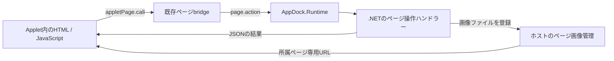

# .NET AppletのHTML/JavaScriptページ連携設計

状態: AppDock 0.66.1で実装（2026-10-19）。設計時の確認基点は0.66.0、main `45f1228441af087bcf7997684ab53d613964c9b3`。本書は追加したAPIと寿命の契約を記載する。実行結果は[検証記録](../VERIFICATION.md)を参照。

現行の表示契約は[Appletページ](applet-pages.md)、登録・入力検証は[動的ページAPI](dynamic-pages-webapplet-design.md)、プロセスと保存領域は[Applet実装ガイド](applet-development.md)と[設定同期](settings-sync.md)を正本とする。最初の適用先は[WallpaperSlideshowの履歴ページ](../../Applet.WallpaperSlideshow.at365/docs/history-page-design.md)。

## 目的と分担

`runtime:dotnet`と.NET製の`runtime:native`の両方で、処理をC#、ページをHTML/CSS/JavaScriptで実装できるようにする。WebContentsView、リボン、表示先、終了時の回収は既存のページ基盤が所有する。追加のNodeプロセス、HTTPサーバー、WebView2、独自RPCは作らない。



| 担当 | 所有するもの |
| --- | --- |
| Appletの.NET処理 | 業務データ、Windows操作、ページ操作の検証と排他、生成画像ファイル |
| AppletのHTML/JavaScript | 本文、ページ内の操作、読込・エラー表示、プレビュー |
| AppDock | ページ登録、リボン、View/Window、送信元検証、画像参照の寿命、共通設定UI |

Applet詳細の説明パネルとローカルページは別の表示先として扱う。ページ用のデータを`ShowPanelAsync`に流したり、説明パネルを隠れた通信路にしたりしない。設定フォームは現在の本体UIを継続する。

## 0.66.0からの追加箇所

- `manifest.pages`と.NETの`Pages.OpenAsync`による固定HTMLページ表示は実装済み。
- 既存の`host.pages.list/replace/open/hide/dispose/openItem`に.NETの型付きラッパーを追加した。
- ローカルUIの`actions.invoke`は、ホストでmanifestの宣言・引数・実行世代を検証して`page.action`を送る。Nodeの`onPageAction`に加え、.NETの`AppletSession`から`IPageActionHandler`へ接続した。
- 説明パネルの`extension.panel.images`から独立したページ別画像登録を追加した。
- ページUIは専用partitionを持つ。defaultSessionだけのprotocol handlerでは画像を配信できない。
- JSON-RPCは1メッセージ1MiB、標準の要求待ちは15秒。画像本体や無制限の一覧をJSONへ詰め込まない。

## 1. .NETのページサービス

既存の`IExtensionContext.Pages`と`IPageService.OpenAsync`を保ち、次を追加する。追加メンバーは既定実装で`NotSupportedException`を返し、既存のSDK利用者・テスト用実装を壊さない。`ExtensionContext`が実装する際は既存のホスト検証を通す。

| .NET API | RPC / 意味 |
| --- | --- |
| `ListAsync(token)` | `host.pages.list`。固定＋実行中ページと登録revisionを返す |
| `ReplaceAsync(pages, expectedRevision, token)` | `host.pages.replace`。動的定義だけを全置換し、新revisionを返す |
| `OpenAsync(id, token)` | 既存の`host.pages.open`。自身のlocalページを開く |
| `HideAsync(id, token)` | `host.pages.hide`。Viewと入力を保持して隠す |
| `DisposeAsync(id, token)` | `host.pages.dispose`。登録を残してViewを破棄する |
| `OpenItemAsync(id, token)` | `host.pages.openItem`。自身の設定由来ページを開く |
| `NotifyChangedAsync(id, token)` | 新設`host.pages.changed`。対象ページへ既存の変更イベントを送る |
| `RegisterImagesAsync(id, files, token)` | 新設`host.pages.images.register`。画像ファイルを登録して参照を返す |
| `ReleaseImagesAsync(id, imageIds, token)` | 新設`host.pages.images.release`。画像参照を失効させる |

一覧結果は`PageListResult { revision, pages }`、置換結果は`{ revision }`とする。動的定義は既存の`id/title/source/ui/icon/defaultDisplay/context`だけを持つ専用DTOにし、一覧にある`openCommand`を置換要求へ送り返さない。省略可能な値はJSONから省略し、`source`は`local`。登録revisionは設定revisionと別で、ホストで安全な整数として検証する。

固定ページ10件、動的ページ64件、contextの16KiB上限、ID衝突・相対UIの包含検査は既存契約を使う。動的登録には`pages`と`dynamic-pages`が必要。固定の1画面だけならmanifest宣言を使い、毎回動的に登録し直す必要はない。

これらの個別上限とは別に、一覧・置換も最終のRPCメッセージを1MiB以内に収める。contextへ大量の本文や画像を置かず、データ取得用の識別子を渡す。上限を超える要求を部分適用しない。

`NotifyChangedAsync`は`{id}`を受け、自身が登録したlocalページだけを対象にする。未生成・非表示のページを開かない。受付と描画完了を区別し、結果は`{accepted:true, delivered:boolean}`。同じ処理中の通知をまとめ、`window.appletPage.onChanged`を再利用する。設定・テーマの変更通知と同様に、UIが必要なデータを取り直す合図とする。

## 2. JavaScriptから.NETへの操作

既存の`manifest.pageActions`と`actions.invoke`の形式を保つ。.NET SDKへ別インターフェースを追加する。

```csharp
public interface IPageActionHandler
{
    Task<System.Text.Json.JsonElement?> HandlePageActionAsync(
        string actionId,
        System.Text.Json.JsonElement input,
        string pageId,
        CancellationToken cancellationToken);
}
```

`AppletSession`の`page.action`がこれを呼び、返されたJSON値をRPC結果として返す。nativeの`AppletSession.RunAsync`とDLL用ExtensionHostは同じ実装を使う。入力の`JsonElement`は非同期処理中も有効な複製を渡す。未実装のAppletには「ページ操作は提供されていません」を返す。

| 境界 | 契約 |
| --- | --- |
| 呼出元 | 既存の`localPageSource`でWebContents・main frame・正確なlocal URLを照合 |
| 入力 | 宣言済みidとstring/number/booleanだけ。未宣言キー・型違い・64K文字超過を既存どおり拒否 |
| 実行 | 起動完了後だけ受付。停止開始・接続終了で取消。別Appletや任意RPCへ転送しない |
| 結果 | JSON値またはnull。.NETは最終のRPCシリアライズ形式で結果部分512KiB以内を検査し、超過はエラーにする。既存の1MiB制限を緩めない |
| 世代 | 応答時にも既存のruntimeSession照合を行い、再起動前の結果をUIへ戻さない |

UIは既存の呼出方法を使う。以下は最小の利用例。実行可能なDLL/native/Nodeのfixtureは`tests/fixtures/dotnet/AppDock.PageProbe`と`scripts/dotnet-pages-ui-test.cjs`にある。

```json
{
  "pageActions": [{
    "id": "items.read",
    "parameters": { "offset": "number", "limit": "number" }
  }]
}
```

```javascript
const result = await window.appletPage.call('actions.invoke', {
  id: 'items.read', input: { offset: 0, limit: 32 }
});
```

大量データはページまたはカーソルで分割する。長い処理は受付後にバックグラウンドで進め、変更通知と状態取得で表示する。タイムアウトを一律延長しない。操作の再送で外部効果が重複し得るため、UIの二重操作を防ぎ、結果不明時の自動再送をしない。

入力中の不正値は現在の画面内で案内する。実行した操作の最終失敗は[共通エラー通知とログ](error-reporting.md)へ接続し、通知・履歴へ生のパスや例外を渡さない。ページ内の必要な対象表示と、通知へ出す安全な説明を分ける。

Runtimeは既存のコマンド・設定の直列化を保つ。ページ操作は同じ実行ロックに接続し、ロック取得待ちにも取消を適用する。タイマー・OSイベント・バックグラウンド処理との排他とSTAへの移送はAppletが所有する。操作ハンドラーから自身のコマンド実行を再入させず、共通の内部処理を直接呼ぶ。初回の画面ロードで.NET側の排他を待つ循環を避け、`OpenAsync`の完了をUIの初期データ取得完了まで待たせない。

## 3. ページ画像の受け渡し

画像は既存の`Ui.GetImageDirectoryAsync`が返すPC専用`cache/panel-images/<Applet ID>/`配下へ生成する。新たな保存先・永続登録ファイル・画像変換設定は追加しない。ホストの登録簿は実行中だけ保持する。

`RegisterImagesAsync`の要求は`{id,files:[{key,file}]}`、結果は`{images:[{key,id,url}]}`。`key`はApplet内の対応付け用、`id`はホストが発行する不透明な参照、`url`は`appdock://page-images/<不透明な参照>`。画像の再圧縮や縮小は行わず、元の生成サムネイルを配信する。

| 項目 | 上限・検査 |
| --- | --- |
| capability | `pages`と`local-images`。自身の固定／動的localページだけ |
| 1要求 | 最大64ファイル、最終RPC形式で256KiB以内。必要なら呼出側で小分けにする |
| 有効な参照 | 1ページ2,000件、1Applet8,000件。上限超過時は要求全体を拒否し、既存参照を保持 |
| ファイル | PNG/JPEG/WebP、1ファイル32MiB以下、各辺2,048px以下。拡張子・実形式・実ファイルを検査 |
| 所在 | 専用キャッシュ内の絶対パス。登録時と配信時に実パスを検査し、リンクによる領域外参照を拒否 |
| 所有 | Applet ID、runtimeSession、localページIDに結び付ける。クライアントにディスクパスを選ばせない |

画像登録は対象のlocal Viewが生成された後に行う。検証中にViewが破棄されたら登録を拒否し、次のViewへ遅延結果を引き継がない。画像の形式・寸法はヘッダー等を使って逐次検査し、登録バッチ全体の画像を一度にメモリへ読み込まない。

画像protocol handlerは対象localページのSessionへ、HTMLロード前に登録する。既存のdefaultSessionのパネル画像配信は継続する。専用Sessionのhandlerはそのページの登録画像だけを解決し、ホストrendererの汎用配信や別ページ・別Appletの画像へフォールバックしない。リモートWebやWebアカウントのSessionには登録しない。

配信はファイルから行い、MIME、`Cache-Control:no-store`、`X-Content-Type-Options:nosniff`を付ける。URLに元画像のパスを含めない。ローカルページのCSPは自分のJS/CSSと必要な画像schemeだけを許可し、リモートスクリプト・任意navigation・新規Window・Node公開を増やさない。

`ReleaseImagesAsync`は自身のページの参照を最大64件ずつ失効させる。既に失効した参照の解放は成功とし、ファイル自体は削除しない。画像交換は「新しい参照を登録 → UIへ渡す → 旧参照を解放 → Appletが旧ファイルを削除」の順とする。1,000枚の新旧交換ができるよう、ページ上限は2世代分を確保する。

`HideAsync`とpage/window間の載せ替えでは参照とViewを保持する。`DisposeAsync`、ページ登録解除、UI資産の差し替え、停止・異常終了では対象参照を失効させる。再open時はUIが参照を再取得する。配信中の読取ハンドルは終了時に閉じ、遅れて完了した登録を次の実行世代へ持ち越さない。Appletは自分が生成したファイルだけを片付け、既存キャッシュ全体を再帰削除しない。

今回、Viewの破棄を.NETへ通知する新たな寿命イベントは追加しない。Applet自身が`DisposeAsync`を呼ぶ場合は、自分のworker・生成物の回収も行う。予期しないView破棄ではホストが参照を即時失効させ、Appletは次回のデータ取得または停止時に残った生成物を回収する。停止中は画像解放RPCを要求せず、ホストによる参照回収と自身のファイル解放に分担する。

## 4. 自身の説明画面へ戻る

独立ページへ移した機能でも既存の「操作に戻る」を維持できるよう、`IUiService.OpenDetailsAsync(token)` / Nodeの`context.ui.openDetails()`を追加する。RPCは`host.ui.openDetails`、引数は空。`ui` capabilityを要し、呼出元自身のApplet詳細を説明タブで開く。別Applet ID、任意route、設定内容は受け付けない。

.NETの追加メンバーにはページサービスと同じ既定の未対応実装を付け、既存の`IUiService`実装を維持する。

ホストの通常ナビゲーションとShellの表示経路を使う。本体の非表示解除と自分の説明タブ指定を明示的な操作として行い、一般のApplet切り替えでタブを保持する契約は保つ。ページ側から必要なら自身の登録コマンドを経由する。`appdock-api`やPC専用の外部操作許可を新たに要求しない。

## 変更対象と互換性

| 対象 | 予定する変更 |
| --- | --- |
| `dotnet/AppDock.SDK/Contracts.cs`と追加DTO | ページサービス、操作ハンドラー、自身の詳細を開くAPI。既定実装を付けた追加 |
| `dotnet/AppDock.Runtime/ExtensionContext.cs` | 型付きRPCラッパーとページ操作の実行ロック接続 |
| `dotnet/AppDock.Runtime/AppletSession.cs` | `page.action`の受付、結果・取消・上限の処理 |
| `src/shared/`、`src/main/node-worker.ts` | 追加APIのNode型とラッパー。既存APIの形式を保つ |
| `src/main/core/host-api.ts`、`applet-pages.ts`、画像管理 | 新規API、対象ページへの通知、Sessionごとの画像配信、破棄との連動 |
| `src/main/index.ts`とナビゲーション | 自身のApplet詳細への接続。ShellへのApplet固有条件は加えない |
| 開発文書・fixture | Node/.NET/nativeの利用例、旧SDK互換、配布したHTML資産の検証 |

Nodeの既存`onPageAction`、説明パネルの`IPanelActionHandler`、他Appletのページと画像は維持する。共通コードにWallpaperSlideshowのID・履歴形式・削除ロジックを置かない。既存の設定、保存先、認証、キャッシュの自動移行は行わない。

本体の実装版は0.66.1。追加APIは互換追加で、設定項目や永続保存ファイルを増減しない。[版更新規則](development-workflow.md#版更新の判断)に従う。新しい画像・変更通知・詳細表示APIを利用するAppletはminimumHostVersionへ0.66.1以上を指定する。

## 実装順と受け入れ条件

1. 共通SDK/RuntimeのページAPIと`page.action`を実装し、DLL/native双方の小さなHTML fixtureで往復と終了を確認する。
2. ページ別通知、画像の登録・Session配信・回収、自身の説明表示を追加する。Nodeからも同じ経路を確認する。
3. [WallpaperSlideshow側の設計](../../Applet.WallpaperSlideshow.at365/docs/history-page-design.md)を適用する。
4. 共通・適用先の差分をレビューし、必要な回帰と固定配布物の隔離GUIを行って各変更モジュールを発行する。コミット・push・Release・実利用deployはそれぞれの依頼に従う。

実装時は次を満たす。

- 固定／動的ページの登録・revision競合・削除・再open、page/window載せ替えで既存Viewと入力を扱える。
- Node、.NET DLL、nativeでページ操作のJSON結果・null・検証エラー・ハンドラーなし・停止中取消・再起動後の遅延応答を確認する。
- コマンド／設定との直列化、初期ロード中のページ操作、処理中の停止でデッドロックしない。
- 画像を説明パネルへ登録せず表示でき、別ページ／別Applet／旧実行世代／領域外／不正画像を配信しない。画像登録の分割と上限、失効URL、page/window切り替え、破棄後の再取得を確認する。
- 旧SDKのAppletと既存パネル画像、Nodeの既存ページ操作が動く。SDK/Runtime変更の影響先native AppletをRelease buildし、接続・停止・表示・設定保存を必要範囲で確認する。
- 参照候補は`tests/applet-pages.test.cjs`、`tests/dynamic-pages.test.cjs`、`tests/panel-images.test.cjs`と既存.NET fixture。新規試験名・コマンドは実装時に確定し、未実行の予定を成功結果として記録しない。
