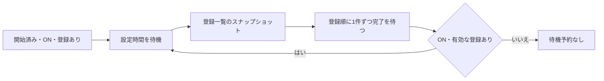

# ファイル監視補助基盤の設計

状態: 基盤と設定画面・本体起動処理・設定/名簿/画像/現行通知音への組み込みを実装済み。通常のファイル監視を残し、定期的な補助確認だけを共通化する。工程の区切り・接続箇所・検証は[組み込み計画](file-watch-assistance-integration-plan.md)にまとめる。現行の保存・受信契約は[設定同期](settings-sync.md)、原画像は[登録画像](registered-images.md)を正本とする。

## 目的と適用範囲

ファイル監視の補助確認を、ホストが所有する1つのループへ登録する。各機能に独立した定期タイマーを持たせず、確認処理を直列に実行し、全件終了後に設定時間だけ待機する。補助確認は既定OFFとし、ONの場合だけ動かす。

この変更は不要な定期アクセスの削減を目的とする。Explorerの遅延と現在の監視処理との因果関係は未測定であり、改善を保証しない。ログ追記、同期ソフト、通常のファイル利用によるI/Oとは分けて測定する。

| 対象                                                      | 本体での扱い                                              |
| --------------------------------------------------------- | ------------------------------------------------------------------- |
| 共有data/settings.json・自端末data/settings-<端末名>.json | `observeFile`を通して補助確認を登録。親フォルダーの`fs.watch`は継続 |
| Webプロフィール名簿                                       | 稼働する`WebProfileStore`の監視を登録                               |
| Webアカウントの共有グループ名簿                           | グループごとの既存監視を登録。複数Appletの購読で重複登録しない      |
| 登録画像                                                  | 通常の`fs.watch`と補助確認を分離し、画像一覧の確認を登録            |
| 通知音の登録一覧                                          | 現行soundsの一覧を通常watch・初期照合・共通基盤へ接続。ライブラリー本体は後続    |
| 旧PC専用データ                                            | 起動時の確認も含めて残存チェック機構を削除。基盤には登録しない      |
| 通知可否・入力・更新確認・音声ジョブ等                    | ファイル監視補助の対象外。既存の寿命・タイマーを一括変更しない      |

基盤は本体mainプロセスの内部サービスとする。Applet SDK/MCPへ任意の処理・任意のパスを登録するAPIは追加しない。停止中のAppletや読み取り専用の設定取得を、この基盤のために起動・初期化しない。

## 設定

本体の「一般」に「ファイル監視」のセクションを設ける。保存設定・画面・MCPは通常設定の共通定義を使う。通常のファイル監視が動くことと、補助確認の対象・待機時間だけを説明し、監視処理の内部情報を設定フォームへ追加しない。

| キー                                      | 表示                   | 値・既定値                                         |
| ----------------------------------------- | ---------------------- | -------------------------------------------------- |
| `host.fileWatchAssistanceEnabled`         | ファイル監視の補助確認 | boolean、既定`false`                               |
| `host.fileWatchAssistanceIntervalSeconds` | 補助確認の待機時間     | 秒単位の有限数、2以上、既定`300`。小数も受け付ける |

- 「待機時間」は全登録処理の終了から次の巡回開始までの時間。各処理の開始間隔や、変更の反映期限ではない。
- UIでは秒単位を表示する。OFF中は間隔の欄を無効にし、保存済みの間隔は保持する。
- 確定後に即時反映する。数値のEnter/blur確定、Escape取消、不正入力・保存失敗時の欄の保持は共通入力部品に従う。2未満や非有限値を黙って補正しない。
- 既定値は保存から省略する。一般ページの既存の共有/PC専用選択、部分JSON、ページリセットに従う。一般ページは現在の既定どおりPC専用で開始し、別の保存ファイルや常時PC専用の特例は追加しない。
- 通常設定の共通登録を使用し、GUI・JSON・MCPの型、既定値、変更許可、revision検査を揃える。新しいMCPツールは追加しない。
- 最小値2秒は選択できる値であり、低負荷を保証する値ではない。短い値を選べば、登録された対象へのアクセスは増える。
- 人為的な最大間隔・登録件数上限は設けない。Nodeのタイマー上限を超える待機は分割予約し、途中のタイマー満了では確認処理を実行しない。巨大な秒数を先にミリ秒へ掛けてオーバーフローさせない。ミリ秒未満の端数は待機が短くならないよう切り上げる。

## 所有と登録API

[file-watch-assistance.ts](../src/main/core/file-watch-assistance.ts)の`FileWatchAssistance`を単体実装済み。`index.ts`が1インスタンスだけ生成し、監視の所有者へ明示的に注入する。テストは同じクラスへ時計・タイマーを注入し、グローバルな定期実行の副作用を持たせない。

内部インターフェースの要点は次のとおり。以下の寿命・完了契約を、後続の接続でも維持する。

```ts
type AssistanceOptions = { enabled: boolean; intervalSeconds: number };
type AssistanceCheck = (context: { signal: AbortSignal }) => Promise<void>;

interface FileWatchAssistance {
  configure(options: AssistanceOptions): void;
  start(): void;
  register(id: string, check: AssistanceCheck): () => void;
  dispose(): void;
}
```

- コンストラクターには必須の`failed(error)`と任意の`clock`を渡す。`failed`は同期/非同期どちらも受け付け、その失敗で他の登録を止めない。通知・ログへ生の例外を出さないアダプターで共通の障害報告へ接続する。
- `AssistanceClock.now()`は単調なナノ秒のbigint、`schedule(callback, delayMilliseconds)`は取消関数を持つ予約を返す。通常はNodeの単調時計とunref済みタイマーを使う。インポートや生成だけではタイマーを作らない。
- `defaultFileWatchAssistanceOptions`と`minimumFileWatchAssistanceIntervalSeconds`を公開し、後続の保存設定定義でも既定値と最小値を共用する。
- `configure`は確定した実効値だけを受ける。同じ2値を再度渡しても、待機の期限や実行状態を変更しない。
- `start`は補助実行の開始を許可するゲートで、繰り返し呼んでもループを増やさない。初期照合はこの関数に含めない。
- 登録は`start`前・OFF中も可能で、登録そのものではファイルを読まない。
- 登録IDは所有者と監視対象の組を区別する内部IDとする。同じ有効IDの重複登録は検出し、暗黙に置き換えない。実パスを含む内部IDを通知・MCP・通常ログへ露出しない。
- 返す解除関数は冪等とし、その登録の世代だけを解除する。同じIDで後から作られた登録を古い解除関数で消さない。
- 解除時は当該登録のsignalを取消状態にする。所有者は既存の世代・closed検査も使い、終了した対象へ遅い結果を反映しない。
- `dispose`は永久停止。待機を取り消し、未開始処理を破棄し、実行中の登録にも停止を伝える。その後の`start`等で再開しない。
- dispose後の`start`と有効な`configure`は何も再開しない。新規登録は拒否し、不正な設定値も引き続き拒否する。

## 巡回と待機



1. 開始ゲート・ON・登録ありの条件が初めて揃ったら、設定時間の待機を開始する。ONや登録だけで即時の全走査を追加しない。
2. 待機満了時点の登録一覧を、登録順でスナップショットする。順序は内部の実行順であり、利用者向けの並べ替え設定にはしない。
3. 各処理の直前にON・停止・登録世代を確認し、解除済みの処理を飛ばす。1件のPromiseが実際に終了してから次へ進む。
4. 成功・失敗のどちらでも、その処理の終了として扱う。失敗の報告後も他の登録を確認する。
5. 巡回の全件終了後に、最新の設定時間で次の待機を予約する。遅れた巡回の埋め合わせや、休止中に経過した回数分の実行はしない。

例: 全件確認に3秒、設定時間が2秒なら、巡回開始から次の開始までは約5秒。登録数やI/O時間が増えれば反映までの時間も長くなる。

基盤が所有する待機タイマーは最大1つ、実行中の巡回も最大1つ。`setInterval`ではなく、巡回終了後の`setTimeout`予約を用いる。長時間待機の分割予約も同じ1枠を使う。経過時間は単調な時計で扱い、時計の手動変更で短い待機へ化けないようにする。

巡回中に追加された登録は次の巡回から実行する。待機中に登録が増減しても期限を延ばさず、最後の登録が消えた場合だけ待機を取り消す。0件から新しい登録が生じ、実行中の処理がなければ、その登録時点から設定時間待つ。解除済みの登録のI/Oがまだ実行中なら、その終了後から待つ。

## 設定変更と停止

| 事象                           | 動作                                                                              |
| ------------------------------ | --------------------------------------------------------------------------------- |
| OFF→ON                         | 実行中の処理がなければ設定時間待って開始                                          |
| 待機中にOFF                    | タイマーを解除し、新規確認を行わない                                              |
| 巡回中にOFF                    | 現在の1件は安全に終了させ、残りの未開始処理を中止                                 |
| OFF後、現在の1件が終わる前にON | 中止済みの巡回を再開しない。現在の1件が終わってから新しい間隔で待つ               |
| 待機中に間隔を変更             | 変更確定時点から、新しい間隔の待機を予約し直す                                    |
| 巡回中に間隔を変更             | 現在の巡回を継続し、全件終了後から新しい間隔を使う                                |
| 同値設定・無関係な設定変更     | 既存の予約・巡回を維持。継続的な設定変更で巡回が先延ばしにならない                |
| 登録解除・対象の停止           | 未開始の確認を飛ばし、実行中なら結果反映を抑止                                    |
| ホスト終了                     | まず基盤の新規実行を止め、その後、各所有者のwatch・読取・購読を既存の順序で閉じる |

停止やタイムアウトの通知だけで、実際のI/Oが終わったとは扱わない。`Promise.race`で待機を打ち切って次の補助処理を開始する実装は、直列性を壊すため採用しない。中断不能なI/Oが残っている間は、OFF→ONでも次の巡回を始めない。

1つのI/Oが応答しなければ後続の補助確認も待つ。この基盤だけでNAS障害の打切りやネットワーク保存対応を保証しない。メインスレッドを同期I/Oで待たせる処理を新たに登録せず、既存の監視読取ワーカーを維持する。

## 通常監視と初期照合との境界

補助監視OFFは定期的な再確認を止める設定であり、通常の`fs.watch`、初期照合、手動の再読込、利用時・保存直前の検証を止める設定ではない。通常の変更通知を、他の対象の遅い補助確認の後ろへ一律に並べない。

- 通常起動時に必要な対象を1巡確認する。遅延生成される名簿等は、その所有者の初期化時に1回確認する。停止中の対象を全列挙して初期化しない。
- 対象または直近の既存親のwatchを先に接続し、その後に初期照合する。照合中の通知は世代・再確認要求へまとめ、接続前後の変更を落とさない。
- 「初期照合1回」は起動全体の照合を1巡とする意味で、安定確認のための2回読取まで1回のI/Oに減らす意味ではない。
- 同じ対象のwatch・補助確認・明示再読込は、所有者の共通実行管理へ接続する。既存の読取と重複して実行しない。
- OS通知のファイル名がない場合や親の到着・再接続時は、当該対象を1回再走査できる。これを独立した定期タイマーへ置き換えない。
- watch登録失敗・実行中のエラーでも補助監視を自動ONにしない。既存の障害報告と、通知や明示操作に伴う再登録を使う。失敗後の短周期再試行ループは作らない。
- 補助OFFで通知を取り逃した変更は、明示再確認・次回初期化等まで反映されない場合がある。全対象の一括再読込ボタンや新しい自動再開条件は今回追加しない。

Node.jsは`fs.watch`のプラットフォーム差・ネットワーク上での不安定さ・Windowsの監視フォルダー自体の移動/改名時の無通知・ファイル名の欠落を説明している。登録時の成功だけでは完全性を判断できない。[公式文書](https://nodejs.org/docs/latest/api/fs.html#caveats)

## 登録する確認処理の完了契約

登録したPromiseは、その回の確認試行と必要な安定待ちが終わるまで完了させない。別タイマーへ読取を渡した直後にresolveして、次の補助処理を開始してはならない。

確認中に対象が更新され、安定した値を採用できなかった場合は、直近正常値を保持してその試行を終了する。外部書込が続く間、同じ登録の中で安定するまで無期限に読み直さない。再確認は通常の通知処理または次の補助巡回へ渡す。これにより、必要な安定確認と「1回の試行の終了」を両立する。

### 設定と名簿

- 現在の60秒statタイマーと5分の独立した内容照合周期を廃止し、共通基盤へ確認を登録する。
- 設定された補助巡回では、JSONの内容も照合する。メタデータが同じという理由で読み飛ばし、設定時間と別の隠れた5分周期を残さない。
- 既知の正常bytesと同じであれば、同じ値を再適用しない。異なる候補の採用には、従来どおり180ms以上を隔てた同一bytesの安定確認を使う。
- watch後の100msの集約、180msの安定待ち、4MiBの読取安全境界、監視読取ワーカー内でのopen/read/closeを維持する。これらは補助監視の設定間隔とは別の処理である。
- 保存・直接再読込・revision照合・バックアップ復旧で進める世代と`invalidate`を維持し、古い読取結果・古い失敗で保存済み値や新しい障害状態を巻き戻さない。
- 破損・欠落・権限エラーでは最後の正常値を保持し、名簿が未到着でも空ファイルを自動生成しない。名簿の受信をアカウント追加やCookie削除として扱わない。

### 登録画像

- 起動時の一覧取得後、2秒ポーリングを廃止する。watch登録をタイマーの有無から独立させる。
- 補助巡回では画像一覧と各画像のメタデータ・安全な実パスを確認する。画像本体の読取・ハッシュ計算・decodeを全件に強制しない。
- 通常通知でファイルを特定できる場合は対象の再確認を基本とし、特定できない場合は当該画像フォルダーを1回走査する。通知をまとめ、走査中の追加変更を完了時に捨てない。
- rootが未到着なら既存祖先のwatchを使い、到着時に通常監視と初期一覧取得へ接続する。初回の2秒ポーリングにwatch登録を依存させない。
- 原画像の保持、参照・分類・順序、転送先の拒否、未到着時の直近正常表示、利用時decode、解除後の遅い結果の拒否を維持する。
- この変更で原画像、キャッシュ、索引用JSON等の保存先やファイルを追加・移動・削除しない。

## 旧データと通知音

旧データの存在確認は起動時も含めて廃止する。monitor・固定パスの検査・状態投影・再確認アクション・専用文言・専用試験を削除し、共通基盤へ移さない。

共通のWarningReporterと警告通知設定は他の機能が使うため維持する。実ファイルやフォルダーを整理・削除する処理は追加しない。

サウンドライブラリーまでのつなぎとして、現行sounds一覧も初期照合・通常watch・共通補助基盤へ接続する。`soundPoll`の独立した2秒確認は廃止する。WebAccountController.startの再呼出しは、成功済みの初期照合を繰り返さない。通常通知は100msで集約し、走査中の通知を次の確認へ残す。補助のPromiseは実際の一覧取得と反映まで待ち、停止では登録とwatchを解放して遅延結果を無視する。watch失敗で補助を自動ONにせず、短周期再登録も行わない。名前一覧の確認でWAV内容は読まず、選択・登録・再生時の検証と既存の保存先・ID・通知キューを維持する。ライブラリーの画面や再生ジョブの生存確認は今回の対象に含めない。

## 障害報告と観測

期待される読取障害は既存の所有者のhealth・警告・共通エラーへ渡す。基盤が同じ障害を重ねて通知しない。登録処理の予期しない失敗は共通ErrorReporterへ安全な原因を渡し、他の登録を継続する。通知本文へパス・生JSON・認証情報・生の例外を追加しない。通知処理の失敗で巡回を壊さない。

計測はテスト用の注入時計・I/Oカウンター・固定EXEの隔離fixtureを使用する。毎巡回のログ出力、監視の生存確認用のファイル書込、永続的な計測ファイルを製品へ追加しない。

タイマーの遅延値には上限があり、上限超過をそのまま渡すと短い待機に置き換わるため、長時間待機は分割する。[Node.jsのタイマー仕様](https://nodejs.org/docs/latest/api/timers.html#settimeoutcallback-delay-args)

## 関連する正本

- [設定基盤と入力契約](settings-foundation.md)、[設定API](settings-api.md)、[共通レイアウト](settings-ui-guidelines.md)
- [設定同期と保存領域](settings-sync.md)、[登録画像](registered-images.md)、[Webアカウント](web-accounts.md)
- [共通エラー](error-reporting.md)、[共通警告](warning-notifications-design.md)
- [未実装の共有保存先設計](shared-settings-location-design.md)。NAS対応・保存先切替は今回の対象に含めない
- [組み込み計画と受入条件](file-watch-assistance-integration-plan.md)
