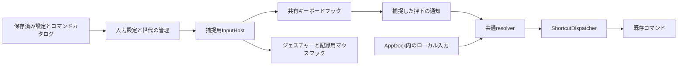

# 条件付きショートカット

入力の条件判定と実行は本体へ集約する。グローバル入力はInputHostの単一ローレベルフックを使い、ローカル入力と同じresolver/dispatcherへ渡す。

「いつ・どこで」とfirst/allをジェスチャーと共通化する変更は[未実装の設計](command-execution-foundation-design.md)を参照。先に基盤を接続し、設定画面の整備は後続工程とする。以下は現在の動作を記載する。

## 設定

`Settings.keybindings`は最大2000件の配列。配列順が実行順で、各行に安定IDを持つ。フォーム/JSON/各Appletの入口は既存SettingsEditorを共用する。
Appletの`extension.json`には`defaultKeybindings`で、自身の`commands`に宣言したコマンドの初期割り当てを指定できる。ID以外の`command`/`key`/`enabled`/`when`を各行へ書き、未宣言のコマンドはmanifest読込時に拒否する。初回発見時だけsettings.jsonにコピーし、適用済みIDは`keybindingDefaultsInitialized`へ記録する。行を消した後の再起動やApplet更新でも再追加しない。
新しいWebAppletは`webApplets.shortcutDefaults`から追加時の保存トランザクションでコピーする。このテンプレートのコマンドは`open`/`reload`/`back`/`forward`/`home`に限定し、コマンドIDの`web.<UUID>.`を追加時に補う。既存WebAppletの行は変更しない。Applet詳細は割り当てごとの追加・編集・削除に対応し、一括初期化の操作は置かない。WebApplet管理項目の新規サイト用テンプレート編集は維持する。
新規割り当ては、対象コマンドに登録元extensionIdがあればowner、なければappを既定にする。既存行のキー変更は条件を保持する。コマンドIDはショートカット表・パレット・ホームのピン留め・トレイ動作選択で完全な文字列を表示し、表示名による検索も維持する。

```json
{
  "id": "binding.example",
  "command": "appdock.commands.search",
  "key": "Ctrl+Tab",
  "enabled": true,
  "when": { "scope": "applets", "appletIds": ["host:settings", "page:example.applet:history"] }
}
```

scopeはglobal/app/pages/owner/applets。globalは常時、appはホスト管理Windowのフォーカス、pagesは本体またはAppletの表示中ページ、ownerはコマンド登録元のAppletページ、appletsは指定ページのいずれかを満たす。UIでは「グローバル」「AppDock全体」「AppDockのすべてのページ」「Gmailなどの提供元名だけ」「AppDockの指定したページ」の順。AppDock本体のコマンドには提供元の選択肢を出さない。ownerは保存したIDやコマンド名の接頭辞から推測せず、現在のコマンドカタログのextensionIdで判定する。提供元がない/不明/ページを持たない場合は一致しない。提供元の名前変更も現在の表示名を使う。applets以外のscopeはappletIdsを空にする。指定ページは1件以上必要。未知の条件を黙って無視せず拒否する。条件追加時はshared/keybindingsの型・検証・評価・UI候補・試験を一緒に追加する。連続キー（chord）とユーザー記述の式は対象外。

### ページ候補と識別

`shared/shortcut-pages`をショートカット・ジェスチャー・公開編集APIの共通候補とする。本体はホーム・画像ライブラリー・設定・ログ・通知センターの5ページ。設定内のカテゴリやApplet設定も「設定」に含む。Appletは`pages`の各`id/title`を使い、ページを持たないAppletを候補へ含めない。停止中・無効でも宣言済みページは選択できるが、入力判定は実際にフォーカスされた表示Surfaceだけに一致する。WebApplet等のcollection子ページも同じ規則で扱う。同名ページには提供元名を添え、同じ提供元内でも重複するときはページIDを添える。

保存する対象IDは本体が`host:<route>`、Appletが既存の`page:<appletId>:<pageId>`。`when.appletIds`のフィールド名とscope IDは保持する。保存済みのApplet IDは、そのApplet内の全ページに一致する指定として保持し、編集時はその意味を表示する。設定の自動変換・削除は行わない。未導入ページの保存済み選択も保持する。新規候補は常にページ単位である。

入力文脈は`appletId`（ownerと保存済みApplet指定用）と`pageId`（ページ指定用）を分ける。本体ページは本体Windowの実フォーカスとnavigationのroute、Appletは実フォーカスされたSurfaceのkeyから決める。独立Windowへの表示切替でも同じページIDを使い、外部Windowではページ条件を満たさない。`shortcuts.get`と`gestures.get`の`pages`で現在の候補を取得し、公開編集APIでは宣言にない新規ページ指定を拒否する。

keybindings未指定時のみ旧shortcuts/globalShortcutCommandsを割り当てへ変換する。旧非グローバルはappとなる。キー編集後はkeybindingsを保存し、旧フィールドはコマンドパレット等の表示用に派生させる。空配列を未指定扱いにして既定割り当てを復活させない。新形式を旧バージョンで編集する往復互換は保証しない。設定全体の1MiB上限・atomic write・revision保護を維持する。

## 入力と実行

- shared/keybindingsのresolverで全候補を保存順に判定し、利用可能なコマンドに絞り、同一IDを重複除去する。
- main/core/shortcut-dispatcherは開始前に全対象を予約する。コマンドによるキー送信の再入・同じキーの実行中再押下を抑止し、逐次awaitする。コマンド失敗は記録して続行し、終了・再起動では打ち切る。
- mainの本体IPCとpageHostShortcutが共通resolver/dispatcherを呼ぶ。PageHostはSurfaceの可視状態と実Windowフォーカスを参照し、別Windowと埋め込み表示で同じApplet IDを使う。Surface破棄時に登録を除去する。native Appletの独自Windowは含めない。
- InputCaptureHotKeyBackendはジェスチャーと同じInputCaptureManagerへ有効なglobalキーを同期する。専用入力スレッドのWH_KEYBOARD_LLで物理押下を一度捕捉し、globalとその時点で一致するローカル行を保存順に評価する。入力の所有キーは実行前に本体と信頼済みpreloadへ同期し、通過入力のDOM／before-input-event経路で再実行や追加抑止を行わない。表示用statusを所有判定へ流用しない。
- 修飾キーはCtrl／Alt／Shift／Winの順。Windows／MetaもWinへ正規化する。左右Winは同じ割り当て。Win+LとCtrl+Alt+Delete等の保護されたglobalキーは新規の画面／外部API割り当てを拒否する。既存の保存行は保持して入力適用エラーを示し、設定全体の読み込みを妨げない。ジェスチャーのキーにWinは追加しない。
- 各行の任意boolean `blockOriginalInput`は省略時true。globalだけに適用し、同じ物理キーに有効で利用可能なglobal行が1つでもONなら、メインキーの押下・反復・解放を止める。全行OFFならWindows／前面アプリへ通す。無効・利用不可・ローカル行はブロック集計から除く。同一コマンドの重複を除く前に集計する。
- OS repeatはコマンドを再実行しない。キー解放まで押下時の通過／抑止を維持する。Win／Altを含む抑止時は自身の入力識別子付きダミー入力で単独修飾キー動作を防ぐ。自身のSendInputは捕捉しない。
- 表示コマンドはrestore/show/focusの後、直近1.5秒の捕捉に対応する内部要求で前面化する。通知workerで必要な入力スレッドを一時接続し、finallyで解除する。前面Windowが押下元から変わった場合は中止する。プロセス起動は実際に起動したPIDと確認できた子孫PIDの可視Windowだけを同じ範囲で対象にし、起動受付の成功と前面化の成否を分ける。常時最前面化、合成Alt、ASFW_ANYは使わない。
- ショートカット編集dialogを開くと誤実行防止のため全グローバル登録を一時解除し、statusesを空にする。dialogを閉じると保存済み設定で再登録する。正常時の「登録済み／未登録」を表示せず、有効なglobal行で利用可能なコマンドの登録エラーだけを示す。空のstatusesは記録/再同期の一時状態でもあるため、直近の非空statusを表示専用に保持し、同じコマンド/キーのエラーを再検査結果が届くまで表示する。エラーの絞り込みも同じ表示statusを使う。無効行/別scope/利用不能コマンドへ古いエラーを表示しない。backendの登録状態/入力判定や設定値へこの表示用キャッシュを戻さない。
- 同じキーの複数割り当ては正常な使い方なので、行ごとの「同じキーの割り当てあり」を表示しない。共通の説明で全一致/順次実行を案内する。一覧には実行順操作・番号を置かず、専用パネルで変更した保存順序で実行する。
- ローカル入力はkeyDownのみ、repeat/IME中/記録中を除く。本体はDOMの入力先判定を保つ。Applet Web画面はCtrl/Alt付きまたはF1〜F24/Pauseに限定して文字入力を守る。リモートへのpreload/IPC追加は行わない。globalはIME状態を参照せず、指定キーが常時対象になる。
- アクティブページの条件は押下時に確定する。コマンドがページやフォーカスを変えても捕捉済みの対象を再評価しない。各コマンド自体の実行先（前面アプリ等）はそのコマンドの実装に従う。

## 検証

`dev.bat exec node scripts/keybindings-ui-test.cjs [win-unpacked EXE]`は隔離profile/local Applet/HTTP WebAppletで本体・埋め込み・別Window・ページ切替・実Windowsキー・非表示・一覧保存を確認する。Fキー単独の既存登録との競合を避け、Ctrl+Alt+F10を試験用に使う。競合時は製品動作と区別する。実Gmail認証を使わず、既存のapplet-pages-ui-testを併用してGmailのオフラインViewを確認する。

実入力ヘルパーは押下中の修飾キーを解除せず、最大3秒待つ。専用GUIは非同期起動したヘルパーの`-ScanCode`でCtrl/Alt/F10をスキャンコードとして送り、Chromiumの合成入力より先に実OS入力を検証する。仮想キー送信が未到達になる試験環境で、この方式の実行を確認した。各押下/解放間に20ms置く。この試験用待機や方式を製品のショートカット処理へ持ち込まない。

## 編集画面と表示順

設定ページは、本体・Applet・各WebAppletの全通常コマンドをまとめた平坦な一覧とする。未割り当ても表示し、キー/提供元のグループ分け、実行順番号、並べ替え、コマンド変更操作を置かない。カタログの順序を保ち、保存済みの配列や実行順を表示の都合で並べ替えない。

検索はコマンド名・完全ID・提供元・キー・条件・globalの入力ブロック／通過を対象とする。空白で区切った語をすべて含むコマンドへ絞り込む。「すべて／割り当て済み／未割り当て／入力の適用エラー」の選択、表示件数、絞り込み解除を上部にまとめる。該当コマンドに複数の割り当てがあればすべて表示する。未確認の保存済みコマンドと割り当て済みのhidden互換別名も一覧に残す。

共通設定画面はShortcutCommandListを使用する。Applet管理から開くと提供元IDで絞り込み、未割り当ての宣言コマンドも表示する。表示用フィルターは実行条件・実行順を変更せず、解除で全体表示へ戻る。入力の適用エラーと再試行の既存契約を維持する。

コマンド横の＋で追加、キー/条件ペアまたはその他メニューの編集で小さなdialogを開く。キー記録、修飾キー付き特殊キー／英数字選択、条件、元入力のブロック、有効状態を編集できる。Win+WもJSON編集なしで記録・選択できる。記録欄が実際にフォーカスされている間だけ、tokenと本体HWNDに限定したネイティブ記録を使い、コマンドとWidgets等を抑止する。ローカル条件ではブロックの値を保持して操作を無効にする。新規はowner/appの既定条件と有効状態で開始する。空キーや対象Appletが0件の条件は適用できない。記録欄のEnter/Delete/Spaceはキー入力、Tabは移動、Escapeは取消。特殊キーからTab/Escapeや修飾キー付きの組み合わせも選べる。

`globalHotKeys.registered`は捕捉設定の適用成功を表す互換フィールド。`backend: "hook"`とキー単位の`effectiveBlockOriginalInput`も取得できる。Windows標準の排他的な予約やコマンドの実効果を保証する値ではない。入力プロセス停止では新規捕捉を解除し、設定保存／「入力を再試行」／再起動で復旧する。通知枠は64件、枠がない新規押下は通し、既に抑止したキーは障害後に再送しない。管理者アプリ、UAC／ロック画面、他の入力フックとの優先順位は通常デスクトップと同一に保証しない。

`scripts/keyboard-hook-ui-test.cjs [単一EXE]`はWin記録・選択・ブロック／通過・重複・プロセス起動・障害再試行・保存再起動と両テーマ3幅を確認する。`tests/InputTests`の`--shortcuts <InputHost.exe>`は実OS入力のdown／repeat／up、左右Win、Pause、自己入力の除外を確認する。

追加/適用は最新の保存済み設定へ反映し、その操作で即時保存する。追加とキー変更は同キー末尾、条件/有効状態だけの変更は位置を保持する。元の割り当てが編集中に外部更新・削除されていたら上書きを拒否する。追加/取消後に一覧を自動スクロールせず、元の操作ボタンへpreventScrollでfocusを戻す。絞り込みで元のボタンが消えた場合は一覧へ戻す。

その他メニューは「編集」「このキーの実行順…」「削除」。設定/通常Appletの削除は確認なしで対象IDを保存済み設定から除き、最後の割り当てを消してもコマンド行は未割り当てとして残る。一括初期化は置かず、利用者が削除した既定割り当てを再生成しない。WebApplet管理項目の将来サイト用テンプレートは既存画面を維持する。

## 実行順の専用パネル

- 設定上部の「実行順…」と、設定/Appletの割り当てメニューの「このキーの実行順…」から開く。コマンド一覧の順序・検索・スクロールは保つ。
- 保存済みの全キーを自然順の選択欄へ表示する。上部からは複数割り当てのある最初のキー、メニューからは対象キーを選択して開く。0件/1件も空状態と説明を表示する。
- 番号、コマンド名、提供元、完全ID、条件、無効/利用不可の状態を表示する。元の検索やAppletの範囲で絞らず、そのキーの全割り当てを保存順に並べる。
- ドラッグ、上下ボタン、つまみでAlt＋上下による並べ替え。異なるキーの間では移動しない。キーを切り替えてもパネル内の変更を保持する。長い一覧では一覧だけをスクロールし、適用/取消を常に表示する。
- 適用時に変更したキーだけを同キーの既存スロットへ書き戻し、安定ID/キー/条件/有効状態と他キーの相対順序を維持する。他キーや他設定の新しい編集は最新の保存済み設定から保持する。変更したキーに外部から追加/削除/条件等の変更/並べ替えが届いた場合は全適用を拒否して開き直しを案内する。
- 適用は既存保存済み設定、その操作で即時保存する。取消/Escape/×はパネル内の変更を破棄。パネルを閉じたらスクロールを伴わず元ボタンへfocusを戻す。表示中のショートカット抑止は既存キー編集と同じ契約を使う。
- 条件一致/無効/利用可能性/同じコマンドの最初の一致を1回実行する仕様は既存resolver/dispatcherのまま。実行順の編集は行数やコマンドを変えない。
## マウスジェスチャーと共通の編集UI

CommandBindingToolbar/CommandBindingList/BindingEditDialog/BindingOrderDialogを共用する。両一覧のメニューは編集・同じ入力の実行順・確認なし削除。追加時のフィルター・表示位置を保ち、自動スクロールしない。適用後に行が非表示になった場合は一覧へpreventScrollでフォーカスを戻す。ジェスチャー固有の入力・条件は[ジェスチャー仕様](gestures.md#コマンド一覧と編集パネル)を参照する。保存形式・revision・JSON・useSettingsEditorの共有を維持する。

主要な回帰はtests/keybindings.test.cjs、scripts/shortcuts-ui-test.cjs（全コマンド一覧とApplet編集）、scripts/keybindings-ui-test.cjs（実OS入力/ページ条件）、navigation/applet-order GUI。発行した単一EXEは隔離コピーで同じ一覧・保存・再起動を確認する。

## キーの表記と判定

- 修飾キーはCtrl／Alt／Shift／Win。既存3修飾キーの順序を維持してWinを末尾へ加え、`Ctrl+Alt+Shift+Win+W`の順で正規化する。Winの入力別名は大文字小文字を区別しない `Win / Windows / Meta`とする。
- 左右の修飾キーは同じ修飾キーとして扱い、どちらか一方でも押されていれば有効とする。左右別割り当て、修飾キー単独、chordは追加しない。
- メインキーは現在対応する英数字、F1〜F24、記号、特殊キーを維持する。追加の修飾キーが押されている場合は別の組み合わせとする。
- ネイティブのキー解析を共通部品にし、文字とVK／暗黙のShift等の対応を一か所で扱う。記号は前面Windowのキーボード配列を参照し、JIS／USや配列変更を試験する。Plus等の文字表現と明示修飾キーの重複を正しく正規化する。
- コールバック時点ではGetAsyncKeyStateが現在イベントを反映していない点を考慮する。左右の押下状態を追跡し、イベント自身を反映してから組み合わせを判定する。開始時・デスクトップ復帰時の押下状態を同期し、既に押されていたメインキーは解放まで新規押下にしない。
- Win+L、Ctrl+Alt+Deleteを含む保護対象は新規の画面／外部API割り当てで拒否する。既存の保存行は保持し、nativeの適用エラーを返す。記録中も奪わず、選択欄で指定した場合は理由を表示する。Fn等、通常のキーイベントにならない入力は追加対象にしない。

## 捕捉プロセスと共有フック

捕捉用InputHostのプロセス・RPC・寿命を共通のInputCaptureManagerへ集約する。現在のGestureManagerのジェスチャー設定・一時停止・取消機能はその入口を使う。入力送信専用NativeInputのworkerは独立のままとし、送信要求だけでフックを登録しない。



キーボードフックは捕捉プロセス内で1つだけ持ち、ジェスチャー・グローバルショートカット・記録モードで共有する。フックと認識状態は専用メッセージループの入力スレッドへ集め、WPFの描画、ファイルI/O、RPC、コマンド実行をコールバックから分離する。ジェスチャーの表示はDispatcherへ非同期に渡す。

キーボードフックの必要条件は、global捕捉対象、ジェスチャーのキー認識、記録、捕捉済み解放待ちのいずれか。マウスフックはジェスチャーまたは記録欄のクリック監視に必要な間だけ持つ。ジェスチャーOFF／一時停止でグローバルショートカットを停止せず、その逆も行わない。

codeが負のイベントは直ちに次へ渡す。本人用マーカーのイベントも、物理押下状態や捕捉済み解放の表を変更せず次へ渡す。その後の優先順位は、捕捉済み押下の解放処理、キー記録、ジェスチャーが既に所有するキー、グローバルショートカットの順とする。ジェスチャーが消費したイベントを二重実行しない。未一致のキーは必ず次へ渡す。

## 入力の同期と二重実行防止

本体は保存済みの設定、利用可能なコマンド、ホストPID、管理Window、表示中Applet、停止・記録状態を捕捉用InputHostへ同期する。設定／カタログの世代とWindow／ページ文脈の世代を分け、単なるfocus変化で有効なglobal入力を破棄しない。既存の40msの文脈同期を共用し、設定変更・停止・記録切り替えは直ちに反映要求を出す。

内部RPCは共通のcapture設定同期と、ショートカット押下通知を追加する。押下通知には世代、押下ID、一致した正規化キーの配列、適用したブロック判定、前面HWND、文脈を含める。入力内容をログへ逐次記録する用途には使わない。

本体は通知の世代・捕捉対象キー・現在のコマンド利用可否を検査する。global行は外部アプリへのfocus移動だけでは取り消さない。ローカル行はネイティブが確認した前面HWNDと通知済みのWindow／ページ文脈が一致した場合だけ加える。文脈の更新境界で一致を確認できないローカル行は加えず、後から新しく一致した行を追加しない。

最初のコマンド開始前にリストを確定し、そのコマンドがページやfocusを変えても残りの条件を再評価しない。終了・記録・オーバーレイによる停止と、既存Dispatcherの実行予約・取消は維持する。前面アプリを対象にするコマンド自体の動作先まで固定する変更は行わない。

InputCaptureManagerは「適用済みglobalキーの所有情報」を管理し、DOM、host IPC、before-input-event、埋め込み／別WindowのPageHostすべてが同じ情報を参照する。そのキーはフック側だけがコマンドを起動し、ローカル経路は再実行も追加のpreventDefaultも行わない。ブロックOFFでAppDockへ届いた元入力も同じ扱いにする。

所有情報には表示用の直近エラーキャッシュを使わない。同期切り替え時は本体と信頼済みrendererへ所有情報の変更を先に通知・受付確認し、ネイティブ設定の適用応答後に有効化する。解除時はネイティブの新規捕捉停止を確認してから所有情報を外す。Window新設時もこの初期化を完了してから入力を受ける。待機中・同期失敗時は新規入力を通し、一時的な取りこぼしを二重実行で埋め合わせない。

## 押下・解放と修飾キー

- メインキーの最初のkeydownで1つの押下IDを作り、解放まで同じ所有者・ブロック判定を保持する。OS repeatではコマンドを繰り返さない。ブロックONではrepeatと対応するkeyupも止め、OFFではそのまま通す。未一致のキーについても押下状態を追跡し、押しっぱなしの途中で修飾キーを加えてもrepeatから新しい割り当てを起動しない。
- メインキーより先に修飾キーを離した場合、途中でfocus・設定・提供元の状態が変わった場合も、捕捉済みのkeyupの処理を途中で変更しない。
- 通常の修飾キーのdown／upを一括して奪わない。左右の押下状態と、OSへ通したイベントの対を維持し、修飾キーを押しっぱなしにする復旧処理を作らない。
- Winを通してWだけを止めると、Win解放時にスタートメニューが出る可能性がある。ブロックしたWin／Altの組み合わせには、本人用マーカーを付けたダミーdown／upで単独修飾キーの動作を抑える。採用値はPowerToysが使用する未文書化VK `0xFF`とし、これはWindowsの保証されたAPI契約ではないため、スタート・メニュー・IMEへの副作用を受入試験に含める。
- ダミー入力は必要な修飾キー周期だけに限定する。元のWin+Wを後から再送したり、前面化のためにAltを送信したりしない。抑止用SendInputの失敗時は新規押下を通し、コマンドを開始せず、安全なエラーへ接続する。
- AppDockの入力送信と抑止用ダミーは共通のInputMarkerを使い、フックでコマンド化しない。外部ツールの合成入力は本人用マーカーと区別し、既存の予約・押下単位の再入防止も併用する。
- Pauseは単発のdownを1回の押下として扱い、通常キーのようにkeyupまで再実行を待つラッチへ入れない。記録側も同じ例外を使う。keyupが必ず届くと仮定せず、既存Pause割り当ての連続押下を受入条件にする。

## キーの記録

ダイアログを開くと、通常のグローバル実行とジェスチャーの実行を停止し、両方の受付応答を待ってから「押して入力」を有効にする。停止だけで標準のWin+WがDOMへ届くとは仮定しない。

記録欄にfocusがある間だけ、所有Windowと一意のtokenに結び付いたネイティブ記録セッションを使う。対応する組み合わせを検出・消費し、信頼済みの本体rendererへキー文字列を通知する。記録でコマンドを実行せず、Widgets等も開かない。ブロック設定がOFFの行を編集している場合も、記録中は実行設定と独立して入力を消費し、Win／Altの単独動作抑止と押下・解放の処理も適用する。

修飾キー単独では値を確定しない。Tab／Shift+Tabは項目移動、Escapeは現在の取消契約に従って通す。Win+Tabなど修飾付きTabは記録できるようにする。Enter／Delete／Spaceは記録欄ではキー入力として扱い、他の項目では通常のUI操作を維持する。

blur、項目移動、クリック、別Windowへのfocus移動、dialog終了、renderer破棄、接続断で記録セッションを解除する。ネイティブ側も前面HWNDとクリック／移動キーを検査し、他の入力欄をグローバルに記録し続けない。古いtokenの通知は破棄する。閉じるときは捕捉済みキーの解放を整えてから保存済み設定の実行を再開し、記録した押下で即座にコマンドを発火させない。

共通のShortcutCaptureFieldを使うジェスチャー、カスタムコマンドの送信キー、WebAppletテンプレートにも、モードごとの対応範囲を渡す。ジェスチャーへWinが漏れないこと、送信キーの既存の文法が変わらないことを確認する。

## 障害・停止・前面化

フック内では待機せず、上限64件の非同期通知枠を使う。通知枠の確保と接続の生存確認ができない新規押下は止めない。確保後の切断やコマンド失敗では既に消費した入力を再送せず、共通エラー報告へ接続する。入力が止まったことをコマンドの成功と扱わない。

フックの初期化失敗、捕捉プロセス終了、同期失敗は対象global行の適用エラーへ反映する。停止中のAppletを自動起動せず、通常方式への無言の代替や自動再試行ループを作らない。既存の再試行操作／設定変更／本体再起動で再接続できるようにする。

設定変更、記録、オーバーレイ、終了処理では新規実行を先に止め、既に消費した解放の処理を維持する。親終了・pipe切断ではフックと表示を解放する。異なるデスクトップへ移った場合は押下状態を再同期し、ロック／UAC画面を通常デスクトップの対象として扱わない。

Windowsはタイムアウトした低レベルフックを通知なしで解除する場合がある。適用応答や周期的な生存応答だけで、実際のキー検知が永久に保証されるとは表示しない。処理を短くし、負荷時・停止復旧の試験と明示的な再適用を用意する。

従来のWM_HOTKEYで得られた前面化の権限は、フックからのAllowSetForegroundWindowでは引き継げないことを実測した。表示／起動コマンドは既存showWindow・ProcessLaunchServiceへ接続する。捕捉に対応する1回限り・1.5秒以内の内部要求だけを受け、通知workerで押下元／対象の入力スレッドを一時接続してSetForegroundWindowを呼び、finallyで両方解除する。主入力の捕捉スレッドでは呼ばない。ホスト表示はホストPIDのWindow、起動はProcessHostが実際に返したPIDとToolhelp snapshotで確認した子孫PIDの可視・非所有Windowに限定し、前面が押下元から変わったら中止する。起動コマンドの完了は従来どおりprocessStarted／effectVerified=falseであり、遅い起動や別プロセスへの引継ぎの前面化は保証しない。ASFW_ANY、常時最前面化、合成Altは追加しない。

管理者アプリとの権限差、別のキーフックとの競合、通常デスクトップ以外の画面は別に検証・案内する。捕捉成功だけで対象アプリの動作成功を判定しない。
