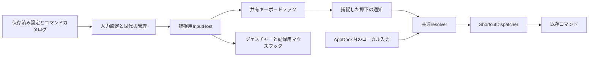

# グローバルショートカットのローレベルフック統一設計

状態: 0.63.0で実装。2026-10-19に本体0.62.5を基準に作成した設計へ実装結果を反映した。現行契約は[条件付きショートカット](keybindings.md)、[ジェスチャー](gestures.md)、[共通入力](appdock-api.md)を参照する。実測と未確認範囲は[検証記録](../VERIFICATION.md)を参照する。

## 目的と採用方針

Windows標準のショートカットをAppDockのコマンドへ割り当てられるようにする。代表例は、Win+Wのウィジェット表示を止め、既存のプロセス起動種類で作った「ターミナルを開く」カスタムコマンドを実行する操作である。ターミナル専用のコマンドを本体へ固定追加する設計ではない。

グローバルショートカットの受信は、InputHostの `WH_KEYBOARD_LL` に統一する。通常のWindows登録とフックを利用者が選ぶ項目、割り当ての `inputMode`、自動フォールバックは設けない。AppDock内のローカルショートカットは、既存のDOM／before-input-event経路と入力欄・IME保護を維持する。

利用者はグローバルの割り当てごとに「元のキー入力をブロックする」を選ぶ。既存の割り当てでは省略値をONとして扱い、従来の操作感を保つ。複数行の実行順、条件、同一コマンド1回、再入防止は共通resolver／ShortcutDispatcherを継続使用する。

Win+L、Ctrl+Alt+DeleteなどWindowsが保護する組み合わせの置換、ドライバー、レジストリによるWidgetsの無効化、管理者権限への自動昇格は対象外とする。

## 現状と変更が必要な箇所

| 現在の実装 | 設計上の変更 |
| --- | --- |
| `src/shared/commands.ts`はCtrl／Alt／Shiftだけを正規化し、イベントのmetaKeyを除外する | Win修飾キーの保存・表示・イベント変換を追加する |
| `ShortcutCaptureField`のshortcutモードはWinを記録・選択できない | ネイティブの記録セッションとWinを含むキー選択を追加する |
| `WindowsHotKeyBackend`と `WindowsHotKeySession`がRegisterHotKeyを使用する | グローバル入力を共有InputHostへ移し、旧受信経路を廃止する |
| `GestureManager`が捕捉用InputHostを所有する | 捕捉プロセスの所有者を共通化し、ジェスチャーとショートカットでキーボードフックを共有する |
| `NativeInput`は別の、フックを持たないInputHostを入力送信に使用する | 送信用workerの分離と寿命を維持する |
| ショートカット編集中はグローバル登録とジェスチャーの実行を停止する | 停止の受付完了と、記録欄だけで使う捕捉モードを分ける |

現在の保存検証とネイティブの登録用parserにもWinがない。画面だけへWinを追加して完了とせず、共有型・JSON・初期割り当て・外部編集・ネイティブ解析を揃える。共通の正規化を拡張しても、ジェスチャーのWin対応は増やさず、既存の除外を明示的な検証で維持する。

## 設定と互換性

`Settings.keybindings`の各行に、任意のboolean `blockOriginalInput`を追加する。省略時の実効値はtrue。falseはグローバル入力を通す明示指定である。

既存の `id / command / key / enabled / when`、2000行上限、保存順、安定IDを維持する。読み取り時に省略値を全行へ書き足す処理や、旧ファイルの一括変換・削除は行わない。parserは指定のない任意項目を省略したまま返し、実効値を取得する共通helperで既定値を解決する。指定されたnull・文字列・数値は検証エラーとする。

次は「ターミナルを開く」カスタムコマンドを別途作成した場合の割り当て例である。コマンドIDは例示なので、実際に作成されたIDを使用する。

```json
{
  "id": "binding.terminal",
  "command": "appdock.custom.00000000-0000-4000-8000-000000000001",
  "key": "Win+W",
  "enabled": true,
  "when": { "scope": "global", "appletIds": [] },
  "blockOriginalInput": true
}
```

| 項目 | 契約 |
| --- | --- |
| 保存先 | 既存の共有settings.json。入力フック専用の保存ファイルは追加しない |
| 省略されたblockOriginalInput | trueとして実行。読み取りだけで保存内容を変更しない |
| ローカル条件の行 | 値を保持するが、この項目は非適用。既存の入力消費・文字入力保護を使う |
| globalとローカル条件の切り替え | 以前の値を保持。既定のowner／app条件は変更しない |
| 初期割り当て・WebAppletテンプレート | 同じ任意項目を検証・保持。既存行の再生成や一括更新はしない |
| 未導入・停止中の提供元 | 割り当てと保存値を保持。コマンドが利用できない間は捕捉対象から外す |
| 旧shortcuts等の表示用派生値 | キーの表示用に維持。新項目を旧フィールドへ逆変換しない |

新しいWin表記や任意項目を旧版で編集して戻す互換性は保証しない。フックへの統一後は、従来Windows登録に失敗していた保存済みのキーが有効になる場合がある。これは保存行の自動変更とは区別し、実装時の利用者向け説明へ記載する。

## キーの表記と判定

- 修飾キーはCtrl／Alt／Shift／Win。既存3修飾キーの順序を維持してWinを末尾へ加え、`Ctrl+Alt+Shift+Win+W`の順で正規化する。Winの入力別名は大文字小文字を区別しない `Win / Windows / Meta`とする。
- 左右の修飾キーは同じ修飾キーとして扱い、どちらか一方でも押されていれば有効とする。左右別割り当て、修飾キー単独、chordは追加しない。
- メインキーは現在対応する英数字、F1〜F24、記号、特殊キーを維持する。追加の修飾キーが押されている場合は別の組み合わせとする。
- ネイティブのキー解析を共通部品にし、文字とVK／暗黙のShift等の対応を一か所で扱う。記号は前面Windowのキーボード配列を参照し、JIS／USや配列変更を試験する。Plus等の文字表現と明示修飾キーの重複を正しく正規化する。
- コールバック時点ではGetAsyncKeyStateが現在イベントを反映していない点を考慮する。左右の押下状態を追跡し、イベント自身を反映してから組み合わせを判定する。開始時・デスクトップ復帰時の押下状態を同期し、既に押されていたメインキーは解放まで新規押下にしない。
- Win+L、Ctrl+Alt+Deleteを含む保護対象は新規の画面／外部API割り当てで拒否する。既存の保存行は保持し、nativeの適用エラーを返す。記録中も奪わず、選択欄で指定した場合は理由を表示する。Fn等、通常のキーイベントにならない入力は追加対象にしない。

## ダイアログと一覧

`AppletShortcutDialog`と既存の共通部品を使い、全体設定とApplet詳細で同じ画面を提供する。

1. ショートカットキー。Winを含めて記録できる。
2. いつ・どこで。現在の5条件と新規行のowner／app既定を維持する。
3. 元のキー入力をブロックする。globalの場合だけ操作でき、新規の実効値はON。説明は「OFFにすると、入力をWindowsやほかのアプリにも渡します。」とする。ローカル条件では「グローバルの割り当てで使用します。」を表示し、値を消さない。
4. この割り当てを有効にする。現在の操作を維持する。

方式選択の項目は置かない。Windows標準キーを置き換える場合はglobalを選ぶことを短く案内する。ローカルのWinキー割り当ては、OSが先に処理する標準操作の上書きを保証する入口にはしない。

特殊キーの選択へWin修飾キーを追加し、英数字を選べる選択欄も用意する。WinとWを選ぶだけでWin+Wを設定でき、物理的なキー記録やJSONの直接編集を必須にしない。ジェスチャーではWinを提示せず、送信キーの既存Win対応も維持する。

一覧の2列構成、検索、追加後の位置、保存順と表示順の分離を保つ。globalの割り当てには「入力をブロック／入力を通す」の短い表示を添え、検索と実行順パネルにも反映する。正常なフック状態の常時表示や、同じキーであることだけの行別警告は増やさない。

追加・適用時の即時保存、キャンセル時の破棄、外部編集との競合検査、focus復帰を維持する。ブロック指定だけの変更で保存順を変えない。

## 同じキーの複数割り当て

グローバルの捕捉対象は「有効で、利用可能なコマンドを指すglobal行」が1行以上あるキーとする。キーごとに一度だけ受信し、その押下に一致した行を共通resolverで保存順に選ぶ。

元入力の扱いは、条件に一致したglobal行について、同一コマンドの重複除去より前に決める。

```text
一致するglobal行がない             → 通常入力。ローカル側は従来の経路で判定
global行のどれかがブロックON       → 元入力を止める
一致するglobal行がすべてブロックOFF → 元入力を次のフック／Windows／対象アプリへ渡す
```

同じキーのローカル行は、従来のグローバル入力と同様、押下時のWindow／Applet条件にも一致した場合だけ、global行と合わせて保存順で実行する。この押下の入力抑止はglobal行で決め、ローカル側の消費処理を二重に適用しない。

| 一致したglobal行 | 元入力 | コマンド |
| --- | --- | --- |
| A=ON | 止める | Aを1回 |
| A=OFF | 通す | Aを1回 |
| A=OFF、B=ON | 止める | 保存順でA、B |
| 同じAへのOFF行とON行 | 止める | Aを1回 |
| ON行は無効／利用不可、OFF行だけ有効 | 通す | 利用可能な対象だけ |
| 有効なglobal行なし | 通す | フックからは実行しない |

実行順パネルには同じキーの全行とブロック指定を表示する。「一致するグローバル割り当てのいずれかがONなら、元の入力を止めます。」を共通説明として置く。

ブロックOFFが保証するのは入力を次へ渡すことまでである。他のフックや、コマンドによるフォーカス変更などにより、Windows側の操作の実効果は変わり得る。コマンド成功を待ってから元入力を通す／止める判断はしない。

## 捕捉プロセスと共有フック

捕捉用InputHostのプロセス・RPC・寿命を共通のInputCaptureManagerへ集約する。現在のGestureManagerのジェスチャー設定・一時停止・取消機能はその入口を使う。入力送信専用NativeInputのworkerは独立のままとし、送信要求だけでフックを登録しない。



キーボードフックは捕捉プロセス内で1つだけ持ち、ジェスチャー・グローバルショートカット・記録モードで共有する。フックと認識状態は専用メッセージループの入力スレッドへ集め、WPFの描画、ファイルI/O、RPC、コマンド実行をコールバックから分離する。ジェスチャーの表示はDispatcherへ非同期に渡す。

キーボードフックの必要条件は、global捕捉対象、ジェスチャーのキー認識、記録、捕捉済み解放待ちのいずれか。マウスフックはジェスチャーまたは記録欄のクリック監視に必要な間だけ持つ。ジェスチャーOFF／一時停止でグローバルショートカットを停止せず、その逆も行わない。

codeが負のイベントは直ちに次へ渡す。本人用マーカーのイベントも、物理押下状態や捕捉済み解放の表を変更せず次へ渡す。その後の優先順位は、捕捉済み押下の解放処理、キー記録、ジェスチャーが既に所有するキー、グローバルショートカットの順とする。ジェスチャーが消費したイベントを二重実行しない。未一致のキーは必ず次へ渡す。

## 入力の同期と二重実行防止

本体は保存済みの設定、利用可能なコマンド、ホストPID、管理Window、表示中Applet、停止・記録状態を捕捉用InputHostへ同期する。設定／カタログの世代とWindow／ページ文脈の世代を分け、単なるfocus変化で有効なglobal入力を破棄しない。既存の40msの文脈同期を共用し、設定変更・停止・記録切り替えは直ちに反映要求を出す。

内部RPCは共通のcapture設定同期と、ショートカット押下通知を追加する。押下通知には世代、押下ID、一致した正規化キーの配列、適用したブロック判定、前面HWND、文脈を含める。入力内容をログへ逐次記録する用途には使わない。

本体は通知の世代・捕捉対象キー・現在のコマンド利用可否を検査する。global行は外部アプリへのfocus移動だけでは取り消さない。ローカル行はネイティブが確認した前面HWNDと通知済みのWindow／ページ文脈が一致した場合だけ加える。文脈の更新境界で一致を確認できないローカル行は加えず、後から新しく一致した行を追加しない。

最初のコマンド開始前にリストを確定し、そのコマンドがページやfocusを変えても残りの条件を再評価しない。終了・記録・オーバーレイによる停止と、既存Dispatcherの実行予約・取消は維持する。前面アプリを対象にするコマンド自体の動作先まで固定する変更は行わない。

InputCaptureManagerは「適用済みglobalキーの所有情報」を管理し、DOM、host IPC、before-input-event、埋め込み／別WindowのPageHostすべてが同じ情報を参照する。そのキーはフック側だけがコマンドを起動し、ローカル経路は再実行も追加のpreventDefaultも行わない。ブロックOFFでAppDockへ届いた元入力も同じ扱いにする。

所有情報には表示用の直近エラーキャッシュを使わない。同期切り替え時は本体と信頼済みrendererへ所有情報の変更を先に通知・受付確認し、ネイティブ設定の適用応答後に有効化する。解除時はネイティブの新規捕捉停止を確認してから所有情報を外す。Window新設時もこの初期化を完了してから入力を受ける。待機中・同期失敗時は新規入力を通し、一時的な取りこぼしを二重実行で埋め合わせない。

## 押下・解放と修飾キー

- メインキーの最初のkeydownで1つの押下IDを作り、解放まで同じ所有者・ブロック判定を保持する。OS repeatではコマンドを繰り返さない。ブロックONではrepeatと対応するkeyupも止め、OFFではそのまま通す。未一致のキーについても押下状態を追跡し、押しっぱなしの途中で修飾キーを加えてもrepeatから新しい割り当てを起動しない。
- メインキーより先に修飾キーを離した場合、途中でfocus・設定・提供元の状態が変わった場合も、捕捉済みのkeyupの処理を途中で変更しない。
- 通常の修飾キーのdown／upを一括して奪わない。左右の押下状態と、OSへ通したイベントの対を維持し、修飾キーを押しっぱなしにする復旧処理を作らない。
- Winを通してWだけを止めると、Win解放時にスタートメニューが出る可能性がある。ブロックしたWin／Altの組み合わせには、本人用マーカーを付けたダミーdown／upで単独修飾キーの動作を抑える。採用値はPowerToysが使用する未文書化VK `0xFF`とし、これはWindowsの保証されたAPI契約ではないため、スタート・メニュー・IMEへの副作用を受入試験に含める。
- ダミー入力は必要な修飾キー周期だけに限定する。元のWin+Wを後から再送したり、前面化のためにAltを送信したりしない。抑止用SendInputの失敗時は新規押下を通し、コマンドを開始せず、安全なエラーへ接続する。
- AppDockの入力送信と抑止用ダミーは共通のInputMarkerを使い、フックでコマンド化しない。外部ツールの合成入力は本人用マーカーと区別し、既存の予約・押下単位の再入防止も併用する。
- Pauseは単発のdownを1回の押下として扱い、通常キーのようにkeyupまで再実行を待つラッチへ入れない。記録側も同じ例外を使う。keyupが必ず届くと仮定せず、既存Pause割り当ての連続押下を受入条件にする。

## キーの記録

ダイアログを開くと、通常のグローバル実行とジェスチャーの実行を停止し、両方の受付応答を待ってから「押して入力」を有効にする。停止だけで標準のWin+WがDOMへ届くとは仮定しない。

記録欄にfocusがある間だけ、所有Windowと一意のtokenに結び付いたネイティブ記録セッションを使う。対応する組み合わせを検出・消費し、信頼済みの本体rendererへキー文字列を通知する。記録でコマンドを実行せず、Widgets等も開かない。ブロック設定がOFFの行を編集している場合も、記録中は実行設定と独立して入力を消費し、Win／Altの単独動作抑止と押下・解放の処理も適用する。

修飾キー単独では値を確定しない。Tab／Shift+Tabは項目移動、Escapeは現在の取消契約に従って通す。Win+Tabなど修飾付きTabは記録できるようにする。Enter／Delete／Spaceは記録欄ではキー入力として扱い、他の項目では通常のUI操作を維持する。

blur、項目移動、クリック、別Windowへのfocus移動、dialog終了、renderer破棄、接続断で記録セッションを解除する。ネイティブ側も前面HWNDとクリック／移動キーを検査し、他の入力欄をグローバルに記録し続けない。古いtokenの通知は破棄する。閉じるときは捕捉済みキーの解放を整えてから保存済み設定の実行を再開し、記録した押下で即座にコマンドを発火させない。

共通のShortcutCaptureFieldを使うジェスチャー、カスタムコマンドの送信キー、WebAppletテンプレートにも、モードごとの対応範囲を渡す。ジェスチャーへWinが漏れないこと、送信キーの既存の文法が変わらないことを確認する。

## 障害・停止・前面化

フック内では待機せず、上限64件の非同期通知枠を使う。通知枠の確保と接続の生存確認ができない新規押下は止めない。確保後の切断やコマンド失敗では既に消費した入力を再送せず、共通エラー報告へ接続する。入力が止まったことをコマンドの成功と扱わない。

フックの初期化失敗、捕捉プロセス終了、同期失敗は対象global行の適用エラーへ反映する。停止中のAppletを自動起動せず、通常方式への無言の代替や自動再試行ループを作らない。既存の再試行操作／設定変更／本体再起動で再接続できるようにする。

設定変更、記録、オーバーレイ、終了処理では新規実行を先に止め、既に消費した解放の処理を維持する。親終了・pipe切断ではフックと表示を解放する。異なるデスクトップへ移った場合は押下状態を再同期し、ロック／UAC画面を通常デスクトップの対象として扱わない。

Windowsはタイムアウトした低レベルフックを通知なしで解除する場合がある。適用応答や周期的な生存応答だけで、実際のキー検知が永久に保証されるとは表示しない。処理を短くし、負荷時・停止復旧の試験と明示的な再適用を用意する。

従来のWM_HOTKEYで得られた前面化の権限は、フックからのAllowSetForegroundWindowでは引き継げないことを実測した。表示／起動コマンドは既存showWindow・ProcessLaunchServiceへ接続する。捕捉に対応する1回限り・1.5秒以内の内部要求だけを受け、通知workerで押下元／対象の入力スレッドを一時接続してSetForegroundWindowを呼び、finallyで両方解除する。主入力の捕捉スレッドでは呼ばない。ホスト表示はホストPIDのWindow、起動はProcessHostが実際に返したPIDとToolhelp snapshotで確認した子孫PIDの可視・非所有Windowに限定し、前面が押下元から変わったら中止する。起動コマンドの完了は従来どおりprocessStarted／effectVerified=falseであり、遅い起動や別プロセスへの引継ぎの前面化は保証しない。ASFW_ANY、常時最前面化、合成Altは追加しない。

管理者アプリとの権限差、別のキーフックとの競合、通常デスクトップ以外の画面は別に検証・案内する。捕捉成功だけで対象アプリの動作成功を判定しない。

## 共通APIと状態表示

`appdock.shortcuts.update`のadd／updateのschemaと厳密な許可項目へ、任意の `blockOriginalInput`を追加する。従来の必須項目を変えず、省略した既存の呼び出しを受け付ける。updateの省略は既存値を保持する。並べ替え・キー変更・初期値コピー・WebApplet追加でも値を落とさない。

既存の取得・revision・dryRun・編集許可・原子的保存を共用する。新しい操作許可や、MCP／Appletからの生キー監視APIは追加しない。保存成功、捕捉設定の適用、キー検知、コマンド成功、OS側の実効果を分ける。

`globalHotKeys`と既存のregisteredフィールドは互換用に残し、`backend: "hook"`とキー単位のboolean `effectiveBlockOriginalInput`を追加する。registered=trueは、共有フックの初期化と当該世代の捕捉設定の適用が成功したことを意味する。RegisterHotKeyを呼んだ証明や、実効果の確認とは扱わない。外部ツールの説明、公開文書、テストも同じ定義へ揃える。

正常な状態は従来どおり一覧へ常時表示せず、適用エラーと再試行だけを示す。既存「登録エラー」フィルターは両立する表示へ整理し、「入力の適用エラー」として文言を揃える。表示キャッシュを実際の捕捉判定へ戻さない。

## 変更対象と実装順

| 対象 | 変更内容 |
| --- | --- |
| `src/shared/commands.ts / keybindings.ts` | Win正規化、任意項目の検証と省略保持、実効ブロックの集約 |
| `src/shared/gestures.ts`と初期値／WebApplet関連 | Winの既存除外、任意項目のコピー・往復 |
| `src/shared/contracts.ts / settings-schema.ts`等 | 保存型・適用状態・入力所有情報。新しい保存ファイルは追加しない |
| `src/renderer/settings-ui` | 共通ダイアログ、記録、Winと英数字の選択、実行順・説明・検索 |
| `src/main/core/shortcut-commands.ts`と外部公開schema | 取得／編集とdryRun、任意項目、状態の説明 |
| `src/main/core/global-hotkeys.ts / gestures.ts`等 | 共通InputCaptureManagerへ所有を集約。単一フック・停止・世代・再接続 |
| `src/main/index.ts`、rendererとPageHost | 全入力経路の所有判定、文脈同期、記録・overlay・終了、前面化 |
| `dotnet/AppDock.InputHost` | 共通フック所有者、専用入力スレッド、キー解析・押下状態・記録・通知 |
| `dotnet/AppDock.Runtime/WindowsHotKeySession.cs`とExtensionHostの入口 | 参照を確認してRegisterHotKey受信と旧 `--hotkeys`専用入口を廃止 |
| 既存の単体／native／GUI試験と文書 | 以下の受入条件を追加し、現行仕様へ反映 |

実装は、(1)専用フックでWin+Wの捕捉・解放・記録・前面化が成立することを隔離確認、(2)保存型と共通判定、(3)捕捉所有者と全受信経路、(4)共通画面と外部API、(5)関連回帰・レビュー・本体のマイナー版更新・既存手順での発行、の順に進める。暫定のフックと旧受信を同時有効にしたまま完成扱いにしない。

設計後の実装依頼により、製品コードと任意の保存項目を追加し、[共通の版更新規則](development-workflow.md#版更新の判断)に従って本体を0.63.0へ更新した。実利用設定は変更せず、既存手順で動作確認用の本体だけを発行する。commit／push／Release／実利用先deployは含めない。

## 受入条件と検証計画

| 範囲 | 確認内容 |
| --- | --- |
| 設定・互換性 | 既存行の省略true、明示false、型エラー、明示的空配列、保存順／安定ID、非移行、再起動後の値、未導入提供元の保持 |
| Win文法 | 正規化／別名／イベント変換、左右Win、追加修飾キー、特殊キー・英数字選択、JIS／US／配列変更、ジェスチャーへの非流入 |
| 複数割り当て | ON／OFF混在、無効／利用不可行、同一コマンドの重複、globalとローカル行、順序、失敗継続・再入防止 |
| 元入力 | ONで対象Windowのメインキーdown／repeat／upが止まる、OFFでそのまま届く、追加修飾キーのある未一致キーは届く |
| 押下状態 | 長押し、左右修飾キー、メインキーと修飾キーの解放順、押下途中の設定変更／停止、Pauseの連続入力、修飾キーの残留なし |
| Win+W | 変更前のWindows動作を確認した環境で、ONならWidgetsを開かずターミナルを1回起動。Win解放後もスタートを開かない。OFFなら元入力も渡ることを別に観測 |
| キー記録 | JSON編集なしでWin+Wを記録・選択・保存。記録中はコマンド／Widgets／スタートを開かない。Tab・Escape・Enter、blur／クリック／dialog終了・古いtokenも確認 |
| 全画面の入力 | 本体・埋め込みApplet・別Window・ローカル／Webページで、OFFでもコマンドが二重実行されず、通常入力欄とIMEの既存動作を保つ |
| 同期と文脈 | 受信経路の切り替え途中・Window新設・設定更新・カタログ更新・focus／ページ変更直後。古いローカル条件で誤実行せず、global行は保持 |
| 共有フック | ジェスチャーOFFでもグローバル動作、ジェスチャー一時停止の独立性、キー付きジェスチャーとの競合・優先順位、送信workerにフックなし |
| 前面化 | 背後／最小化／非表示／デスクトップから本体表示とターミナル起動。入力受付と実HWNDの最前面を分けて検査 |
| 障害 | フック初期化失敗・通知枠上限・pipe切断・helper終了・高負荷・再試行。入力の無言の再送と通常方式への代替なし |
| 外部編集 | 旧schemaの呼び出し、任意項目のadd／update／省略保持、dryRun／revision／権限／順序、公開取得での値と実効状態 |
| 配布物 | 実装後の固定EXEを隔離コピーし、hash一致付きで画面・保存再起動・実OS入力を確認 |

関連する既存入口は `tests/keybindings.test.cjs`、`tests/global-hotkeys.test.cjs`、`tests/gestures.test.cjs`、`tests/shortcut-commands.test.cjs`、`tests/InputTests`、`scripts/shortcuts-ui-test.cjs`、`scripts/keybindings-ui-test.cjs`、`scripts/hotkeys-ui-test.cjs`、`scripts/shortcut-foreground-ui-test.cjs`、`scripts/gestures-ui-test.cjs`とする。実装時に現存する入口と影響範囲を照合し、重複する試験を無条件に全実行しない。

試験は隔離profileと専用Windowで直列に行う。実利用の割り当てやWidgets設定を変更せず、OS入力を生成するfixtureの試験と物理キーボードでの受入を区別する。Widgetsが無効な環境で「表示されなかった」だけを抑止成功の証拠にしない。ターミナル実在と起動前面化、管理者アプリ、他社フック、UAC／ロック画面は、実測と未確認範囲を分けてVERIFICATIONへ記録する。

## 技術的な根拠

- [Microsoft: RegisterHotKey](https://learn.microsoft.com/en-us/windows/win32/api/winuser/nf-winuser-registerhotkey): 既存登録との競合とOS予約。
- [Microsoft: LowLevelKeyboardProc](https://learn.microsoft.com/en-us/windows/win32/winmsg/lowlevelkeyboardproc): 非ゼロによる入力抑止、コールバック前のキー状態、メッセージループ、タイムアウトと専用スレッド。
- [Microsoft: KBDLLHOOKSTRUCT](https://learn.microsoft.com/en-us/windows/win32/api/winuser/ns-winuser-kbdllhookstruct): VK・スキャンコード・合成入力・追加情報。
- [Microsoft: SetForegroundWindow](https://learn.microsoft.com/en-us/windows/win32/api/winuser/nf-winuser-setforegroundwindow): 前面化の条件とAllowSetForegroundWindow。
- [Microsoft: AttachThreadInput](https://learn.microsoft.com/en-us/windows/win32/api/winuser/nf-winuser-attachthreadinput): メッセージキューと入力状態の共有、一時接続の制約。
- [Microsoft: PowerToys Keyboard Manager](https://learn.microsoft.com/en-us/windows/powertoys/keyboard-manager): 保護された組み合わせ、管理者アプリ、他のキーフックとの制約。
- [PowerToysの実装資料](https://github.com/microsoft/PowerToys/blob/main/doc/devdocs/modules/keyboardmanager/keyboardmanager.md): Win／Altの単独動作を防ぐダミー入力と、その未文書化VKへの依存。

設計時の計画と実装後の実測を区別する。上の受入条件すべてを自動的に検証済みとは扱わず、成功した試験・配布物hash・未確認条件をVERIFICATIONへ記録する。
