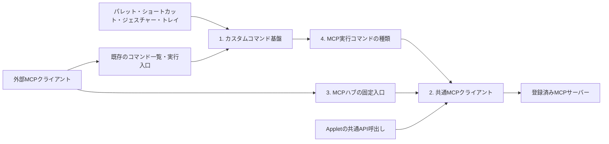

# MCPハブとカスタムコマンドの全体概要設計

状態: 第1〜4段階と接続先の管理APIを実装。製品版0.61.0、更新日: 2026-10-18。実機・配布物の確認範囲は[VERIFICATION](../VERIFICATION.md)を参照。

本書は全体の役割と段階間の契約を定める。[実装計画](mcp-hub-implementation-plan.md)は順序と到達点、詳細設計は[カスタムコマンド](custom-commands-design.md)、[MCPクライアント](mcp-client-design.md)、[ハブ](mcp-hub-relay-design.md)、[保存型MCPコマンド](mcp-command-design.md)へ分ける。

## 目的と利用例

AppDockが外部MCPサーバーのクライアントになり、次の両方を同じ接続・実行基盤で扱う。

- ChatGPT等のMCPクライアントから、AppDockを経由して登録済みの接続先を探し、そのツールを実行する。
- 接続先・ツール・引数を保存したカスタムコマンドを、パレット、ショートカット、マウスジェスチャー、トレイ、MCPから実行する。

利用例は「照明のMCPサーバーを探す → 予約ツールの引数仕様を取得する → 10分後の消灯を予約する設定をコマンドとして保存する → ショートカットを割り当てる」。AIが接続先や引数を選ぶ段階と、保存済みの指定をAppDockが実行する段階を分ける。保存済みコマンドの実行にLLMを必要としない。

接続先のMCPサーバーはAppDockのAppletである必要はない。接続先の登録IDとApplet IDは別の識別子とする。

## 現状と再利用する基盤

当初の調査基準は0.58.1、commit `87d2e02e3f2e500a100c567d9d304edac384824f`。実装はmainの0.59.0、commit `7135a68df661b424eef2e37a296ce79d5f986d2a`から開始し、0.60.0へ版更新した。

| 現行の仕組み | 再利用・拡張の方針 |
| --- | --- |
| 単一のAppDockApiと操作カタログ | MCP、Applet、ローカルUIの業務処理を共用する。MCPは通信アダプターとして扱う |
| `commands.list`と`commands.execute` | 保存済みコマンドの発見とID指定実行の入口を維持する |
| `host.commands.replace`、.NETの`Commands.ReplaceAsync` | 既存の実行中コマンド登録を保持し、保存型のカスタムコマンドを追加する |
| manifestによる外部公開宣言 | 新しいコマンド種類にも宣言を設け、実行中の登録だけで公開権限を取得させない |
| SettingsCommands、DeviceSettingsStore、設定ページ | revision、原子的保存、外部更新、共通の一覧編集を再利用する |
| コマンドカタログ、入力dispatcher、CommandContexts | 所有者、割当、実行元、開始対象、取消を同じ経路で扱う |

従来の動的登録はID・表示名・ハンドラーの登録であり、外部公開はmanifestの個別ID宣言で決まる。この契約を保持し、保存定義のCRUDと種類別ハンドラーを追加した。通常のAppletコマンドと保存型コマンドの戻り値契約を混同しない。

参照: [共通API](appdock-api.md)、[動的コマンド](extensions.md#動的コマンドとキー送信の一覧設定)、[操作カタログ](../src/shared/appdock-api.ts)、[現在の公開判定](../src/main/core/extensions.ts)、[現在の実行経路](../src/main/core/appdock-api.ts)。

## 構成と責務

| 段階 | 所有するもの | 他の段階へ委ねるもの |
| --- | --- | --- |
| 1. カスタムコマンド基盤 | 種類の宣言、保存定義、CRUD、安定ID、公開範囲、カタログ投影、実行寿命、共通設定UI | 各種類固有の処理、MCP通信、Windows操作 |
| 2. MCPクライアント | 接続先名簿、接続・認証、protocol/capability確認、ツール取得、引数検証、呼出し、結果、取消・切断 | 外部への中継公開、コマンドへの保存、入力割当 |
| 3. MCPハブ | 接続先一覧、接続先別ツール取得、指定ツール実行、外部公開の絞込み、呼出し元の許可 | 接続・認証とツール実行の本体処理 |
| 4. MCP実行コマンド | 接続先・ツール・引数を持つ種類、種類固有の設定UI、利用可否判定 | 保存・ID・割当は1、通信と実行は2 |

3は2に依存し、4は1と2に依存する。4から3のHTTP入口へ戻る呼出しは作らない。実装順序は1→2→3→4とし、段階ごとに検証する。

## 先に固定する契約

### コマンド定義と実行処理

カスタムコマンドは「ID・名前・種類・種類別設定・有効状態・外部公開設定」を持つ保存データとする。種類の提供元が設定Schemaとハンドラーを宣言し、本体が保存・検証・実行へ接続する。任意のJavaScriptやシェル文字列を本体が評価する汎用スクリプト機能にはしない。

種類の提供元は本体またはApplet。保存先とカタログの所有者判定は本体が管理し、表示名やIDの接頭辞だけから実行権限・所有者を決めない。第1段階では既存の固定コマンドと実行中の動的コマンドを置き換えない。

保存済みコマンドの実行引数は第1段階では空とし、種類固有の引数は保存定義の中に保持する。MCPの汎用中継は、その呼出しごとに引数を受け取る別の入口とする。

### ChatGPT側のツール更新に依存しない発見

AppDockのMCP `tools/list`に載せる入口と入力Schemaを固定する。接続先・ツール・カスタムコマンドの増減は、入口の返り値に反映する。

| 共通API | 内容 |
| --- | --- |
| `mcp.servers.list` | 外部公開が許可された接続先のID・名前・状態・概要 |
| `mcp.tools.list` | 指定した接続先のツールの概要。ページ分割を持つ |
| `mcp.tools.get` | 必要な1ツールの入力/出力Schema、説明、注釈、定義の識別情報 |
| `mcp.tools.call` | 接続先ID・ツール名・arguments・toolRevision・requestIdでジョブを受付 |
| `mcp.jobs.get/cancel` | 呼出し元に結び付いた状態・結果の取得と待機取消 |
| `mcp.servers.getSettings/updateSettings/inspectTools` | 独立した管理許可の下で接続先を登録・編集し、未公開ツールを確認。詳細は[管理API](mcp-client-design.md#接続先の管理api) |

発見の階層は「接続先 → その接続先のツール」の2段階とする。ツール一覧が大きい場合は概要だけ返し、詳細取得で対象Schemaを読む。すべての接続先の全Schemaを一括で返さない。

接続先ID・ツール名・コマンドIDを、外側の入力Schemaの動的enum、ツール説明、ツール名へ埋め込まない。固定Schemaの文字列・JSONオブジェクトとして受け取り、実行時に最新の定義と許可へ照合する。一覧結果のdescription等は外部データとして扱う。

接続先のツール一覧は対応する変更通知・再取得・キャッシュ期限で更新する。外部AIは必要に応じて一覧を再取得する。古いID、削除済みツール、変更されたSchemaは安全なエラーにし、同名の別ツールや別接続先へ自動で置き換えない。

固定入口の初回導入、名前・Schema等の公開契約の変更にはクライアント側への反映が必要。導入後のデータの追加・変更・削除には入口の更新を必要としない。同じSDK接続でメタデータ不変とツール増減を確認した。ChatGPT本体の実接続・初回反映・Refreshなしの増減は未確認であり、SDK試験と区別する。

### 保存と同期

- カスタムコマンド定義は第1段階の専用ブロックとして共有settings.jsonへ保存する。既存Appletの「このPCで設定を保持する」設定とは独立する。保存先の切替を本機能へ暗黙に継承しない。
- 接続先名簿は安定した接続先IDで参照し、URL・実行パス等のPC差と認証情報は第2段階で分離する。同期したIDを別の接続先へ自動で結び直さない。
- 秘密値は既存のPC専用Secrets/safeStorage系基盤を利用する。コマンド定義へBearer token、パスワード、秘密の環境変数を直接保存する契約は設けない。種類側が必要な秘密を参照先から解決する。
- 操作許可、接続状態、実行ジョブ、キャッシュはPC専用。共通revision、原子的保存、有効な外部更新の採用、未導入種類の定義保持は既存の保存方針に合わせる。

正本: [設定同期](settings-sync.md)、[端末別設定](device-settings-design.md)。

### 公開範囲と操作許可

「接続先を登録する」「AppDock内部で利用する」「外部MCPへ中継する」「コマンドを編集する」「コマンドを実行する」を区別する。接続や登録だけで、外部公開・実行・権限追加は行わない。MCPとAppletの許可は現在どおり独立したPC専用設定にする。

種類のmanifest宣言、保存定義の公開指定、呼出し元の許可、現在の提供元/接続先の状態を実行直前に照合する。保存済みコマンドからの呼出しにも、直接中継と同じ接続先の公開・実行制約を適用する。新しい経路の実行元はホストが発行する文脈から伝え、引数でMCP呼出しをローカル操作に偽装させない。

AppDockへの認証と接続先への認証は別物。受信したAppDock用Bearer tokenを接続先へ転送しない。接続先の認証失効・権限不足・未対応機能は、接続先を特定できる安全な状態として表示する。汎用の実行入口をread-onlyとして宣言しない。

### 実行・失敗・長時間処理

受付、保存完了、ハンドラー応答、接続先の処理完了、実際の効果を区別する。ツールの`isError`や構造化結果を成功の文章へ置き換えず、失敗の意味を保つ。結果の扱いとサイズ上限は、コマンド基盤とMCP中継でそれぞれ定義する。

タイムアウト・切断・応答消失では効果が発生した可能性がある。変更操作を自動再送せず、状態照会や利用者の判断につなげる。取消は伝搬するが、既に発生した効果を取り消したとは扱わない。AppDock自身や他のハブへの接続による循環は拒否するか、有界の経路検査で停止する。

長時間ツールは受付後にjobIdを返す。1接続先1件・全体4件、待ち時間1〜600秒、完了結果は10分保持する。再起動後は再開・再送しない。保存型コマンドのhandlerReturnedはジョブ受付であり、接続先の応答や実効果とは別である。接続先が対応していない継続実行や重複防止を、AppDock側だけで保証しない。

## 今回の範囲と後続の範囲

MCPクライアントの対象はstdioとStreamable HTTP（JSON/SSE応答）、認証なし/Bearer、2025-11-25方式のツール発見・実行。OAuth、旧HTTP+SSE、Resources、Prompts、MCP AppsのUI中継、Eventsの再配信、Sampling、Elicitation、MCP Tasks、2026-07-28だけに対応する下流は初期対象外。AppDock自身の既存MCPサーバー入口の新旧方式対応は維持する。

| 別工程 | 接続する場所・理由 |
| --- | --- |
| 本体のキー送信種類とWindowsToolsの旧機能撤去 | [拡張設計](custom-command-types-design.md)。本体の共通入力を使用し、旧設定の移行・旧ID互換・割当自動付替えは行わない |
| Windowsでコマンド/プロセスを実行する種類 | [拡張設計](custom-command-types-design.md)と[実装計画](custom-command-types-implementation-plan.md)。初期契約は起動受付とし、終了待ち・出力取得は別拡張 |
| AppDock自身の予約実行 | 永続予約・再起動・スリープ・取消を扱う。接続先の予約ツールを呼ぶ場合は4で対応可能 |
| 複数ツールの連結・条件分岐・変数展開 | 単一の保存済み呼出しが安定した後のワークフロー拡張 |
| 初期対象外の認証/プロトコル | 第2段階の対応表と実サービスの必要性に基づいて追加 |

## 全体としての完了像

1. AIが接続先一覧と必要なツール定義を取得できる。
2. 許可されたMCPツールを直接実行し、結果と失敗を判別できる。
3. 同じツール呼出しをカスタムコマンドへ保存し、既存の入力経路へ割り当てられる。
4. 接続先・ツール・コマンドの増減を、固定入口の再登録なしで発見できる。
5. 停止、未導入、認証失効、Schema変更、削除、外部同期、応答消失時に、別の操作へすり替えず理由を表示できる。

段階ごとの実測結果は[VERIFICATION](../VERIFICATION.md)へ記録し、fixtureの成功と実接続での成功を分ける。詳細設計・実装・commit・push・Releaseは、それぞれの依頼範囲に従う。

## 参照した外部仕様

2026-10-18確認。下流クライアントは既存SDK 1.32.0と実接続の対応に基づいて採用版を限定した。

- [採用したMCP Tools仕様](https://modelcontextprotocol.io/specification/2025-11-25/server/tools)、[Transports](https://modelcontextprotocol.io/specification/2025-11-25/basic/transports): 一覧、ページ分割、Schema、呼出し、結果、注釈、変更通知。上記の`mcp.*`はAppDock固有の共通APIであり、標準メソッド名とは区別する。
- [MCP Specification](https://modelcontextprotocol.io/specification/2026-07-28): capabilityと拡張の対応範囲。
- [OpenAI: Connect and test your plugin](https://developers.openai.com/plugins/deploy/connect-chatgpt#refresh-metadata): 直接接続における公開メタデータ変更時のRefreshと、公開プラグインとの差。
