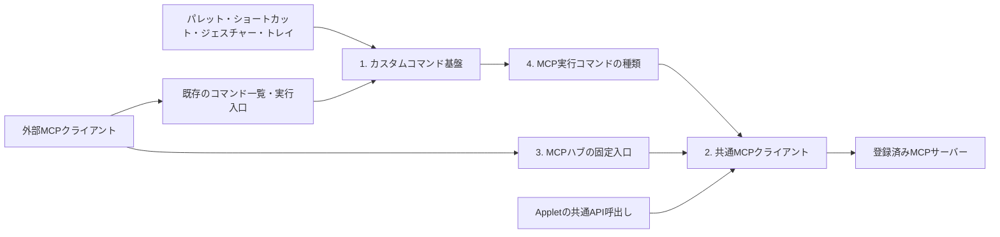

# MCPハブ

## 目的と利用例

AppDockが外部MCPサーバーのクライアントになり、次の両方を同じ接続・実行基盤で扱う。

- ChatGPT等のMCPクライアントから、AppDockを経由して登録済みの接続先を探し、そのツールを実行する。
- 接続先・ツール・引数を保存したカスタムコマンドを、パレット、ショートカット、マウスジェスチャー、トレイ、MCPから実行する。

利用例は「照明のMCPサーバーを探す → 予約ツールの引数仕様を取得する → 10分後の消灯を予約する設定をコマンドとして保存する → ショートカットを割り当てる」。AIが接続先や引数を選ぶ段階と、保存済みの指定をAppDockが実行する段階を分ける。保存済みコマンドの実行にLLMを必要としない。

接続先のMCPサーバーはAppDockのAppletである必要はない。接続先の登録IDとApplet IDは別の識別子とする。

## 構成と責務

| 段階 | 所有するもの | 他の段階へ委ねるもの |
| --- | --- | --- |
| 1. カスタムコマンド基盤 | 種類の宣言、保存定義、CRUD、安定ID、公開範囲、カタログ投影、実行寿命、共通設定UI | 各種類固有の処理、MCP通信、Windows操作 |
| 2. MCPクライアント | 接続先名簿、接続・認証、protocol/capability確認、ツール取得、引数検証、呼出し、結果、取消・切断 | 外部への中継公開、コマンドへの保存、入力割当 |
| 3. MCPハブ | 接続先一覧、接続先別ツール取得、指定ツール実行、外部公開の絞込み、呼出し元の許可 | 接続・認証とツール実行の本体処理 |
| 4. MCP実行コマンド | 接続先・ツール・引数を持つ種類、種類固有の設定UI、利用可否判定 | 保存・ID・割当は1、通信と実行は2 |

3は2に依存し、4は1と2に依存する。4から3のHTTP入口へ戻る呼出しは作らない。実装順序は1→2→3→4とし、段階ごとに検証する。

### コマンド定義と実行処理

カスタムコマンドは「ID・名前・種類・種類別設定・有効状態・外部公開設定」を持つ保存データとする。種類の提供元が設定Schemaとハンドラーを宣言し、本体が保存・検証・実行へ接続する。任意のJavaScriptやシェル文字列を本体が評価する汎用スクリプト機能にはしない。

種類の提供元は本体またはApplet。保存先とカタログの所有者判定は本体が管理し、表示名やIDの接頭辞だけから実行権限・所有者を決めない。第1段階では既存の固定コマンドと実行中の動的コマンドを置き換えない。

保存済みコマンドの実行引数は第1段階では空とし、種類固有の引数は保存定義の中に保持する。MCPの汎用中継は、その呼出しごとに引数を受け取る別の入口とする。

### ChatGPT側のツール更新に依存しない発見

AppDockのMCP `tools/list`に載せる入口と入力Schemaを固定する。接続先・ツール・カスタムコマンドの増減は、入口の返り値に反映する。

| 共通API | 内容 |
| --- | --- |
| `mcp.servers.list` | 外部公開が許可された接続先のID・名前・状態・概要 |
| `mcp.tools.list` | 指定した接続先のツールの概要。ページ分割を持つ |
| `mcp.tools.get` | 必要な1ツールの入力/出力Schema、説明、注釈、定義の識別情報 |
| `mcp.tools.call` | 接続先ID・ツール名・arguments・toolRevision・requestIdでジョブを受付 |
| `mcp.jobs.get/cancel` | 呼出し元に結び付いた状態・結果の取得と待機取消 |
| `mcp.servers.getSettings/updateSettings/inspectTools` | 独立した管理許可の下で接続先を登録・編集し、未公開ツールを確認。詳細は[管理API](mcp-client-design.md#接続先の管理api) |

発見の階層は「接続先 → その接続先のツール」の2段階とする。ツール一覧が大きい場合は概要だけ返し、詳細取得で対象Schemaを読む。すべての接続先の全Schemaを一括で返さない。

接続先ID・ツール名・コマンドIDを、外側の入力Schemaの動的enum、ツール説明、ツール名へ埋め込まない。固定Schemaの文字列・JSONオブジェクトとして受け取り、実行時に最新の定義と許可へ照合する。一覧結果のdescription等は外部データとして扱う。

接続先のツール一覧は対応する変更通知・再取得・キャッシュ期限で更新する。外部AIは必要に応じて一覧を再取得する。古いID、削除済みツール、変更されたSchemaは安全なエラーにし、同名の別ツールや別接続先へ自動で置き換えない。

固定入口の初回導入、名前・Schema等の公開契約の変更にはクライアント側への反映が必要。導入後のデータの追加・変更・削除には入口の更新を必要としない。同じSDK接続でメタデータ不変とツール増減を確認した。ChatGPT本体の実接続・初回反映・Refreshなしの増減は未確認であり、SDK試験と区別する。

### 保存と同期

- カスタムコマンド定義は専用ブロックとして共有settings.jsonへ保存する。既存Appletの「このPCで設定を保持する」設定とは独立する。保存先の切替を本機能へ暗黙に継承しない。
- 接続先名簿は安定した接続先IDで参照し、URL・実行パス等のPC差と認証情報は第2段階で分離する。同期したIDを別の接続先へ自動で結び直さない。
- 秘密値は既存のPC専用Secrets/safeStorage系基盤を利用する。コマンド定義へBearer token、パスワード、秘密の環境変数を直接保存する契約は設けない。種類側が必要な秘密を参照先から解決する。
- 操作許可、接続状態、実行ジョブ、キャッシュはPC専用。共通revision、原子的保存、有効な外部更新の採用、未導入種類の定義保持は既存の保存方針に合わせる。

正本: [設定同期](settings-sync.md)、[端末別設定](settings-sync.md)。

### 公開範囲と操作許可

「接続先を登録する」「AppDock内部で利用する」「外部MCPへ中継する」「コマンドを編集する」「コマンドを実行する」を区別する。接続や登録だけで、外部公開・実行・権限追加は行わない。MCPとAppletの許可は現在どおり独立したPC専用設定にする。

種類のmanifest宣言、保存定義の公開指定、呼出し元の許可、現在の提供元/接続先の状態を実行直前に照合する。保存済みコマンドからの呼出しにも、直接中継と同じ接続先の公開・実行制約を適用する。新しい経路の実行元はホストが発行する文脈から伝え、引数でMCP呼出しをローカル操作に偽装させない。

AppDockへの認証と接続先への認証は別物。受信したAppDock用Bearer tokenを接続先へ転送しない。接続先の認証失効・権限不足・未対応機能は、接続先を特定できる安全な状態として表示する。汎用の実行入口をread-onlyとして宣言しない。

### 実行・失敗・長時間処理

受付、保存完了、ハンドラー応答、接続先の処理完了、実際の効果を区別する。ツールの`isError`や構造化結果を成功の文章へ置き換えず、失敗の意味を保つ。結果の扱いとサイズ上限は、コマンド基盤とMCP中継でそれぞれ定義する。

タイムアウト・切断・応答消失では効果が発生した可能性がある。変更操作を自動再送せず、状態照会や利用者の判断につなげる。取消は伝搬するが、既に発生した効果を取り消したとは扱わない。AppDock自身や他のハブへの接続による循環は拒否するか、有界の経路検査で停止する。

長時間ツールは受付後にjobIdを返す。1接続先1件・全体4件、待ち時間1〜600秒、完了結果は10分保持する。再起動後は再開・再送しない。保存型コマンドのhandlerReturnedはジョブ受付であり、接続先の応答や実効果とは別である。接続先が対応していない継続実行や重複防止を、AppDock側だけで保証しない。

## 参照した外部仕様

2026-10-18確認。下流クライアントは既存SDK 1.32.0と実接続の対応に基づいて採用版を限定した。

- [採用したMCP Tools仕様](https://modelcontextprotocol.io/specification/2025-11-25/server/tools)、[Transports](https://modelcontextprotocol.io/specification/2025-11-25/basic/transports): 一覧、ページ分割、Schema、呼出し、結果、注釈、変更通知。上記の`mcp.*`はAppDock固有の共通APIであり、標準メソッド名とは区別する。
- [MCP Specification](https://modelcontextprotocol.io/specification/2026-07-28): capabilityと拡張の対応範囲。
- [OpenAI: Connect and test your plugin](https://developers.openai.com/plugins/deploy/connect-chatgpt#refresh-metadata): 直接接続における公開メタデータ変更時のRefreshと、公開プラグインとの差。

## 公開と許可

PC専用の接続設定で「MCPへ公開」と公開するツール名の明示リストを保存する。初期はOFF・空リストで、ワイルドカードは使わない。内部AppletのuseMcpと外部MCPのallowUseMcpは独立し、新規環境はApplet側がON、MCP側がOFF。発見にはread/useMcp、実行と取消にはexecuteも必要。MCP用の許可があっても、接続先ごとの公開条件を満たさない一覧・詳細・実行は拒否する。元がMCPのAppletハンドラーにも同じ公開条件を引き継ぐ。

接続先や公開設定は本体設定UIに加え、readで取得し、read + writeで保存する共通APIから管理できる。保存にexecute/useMcpは要求せず、接続・探索・実行はそれぞれの操作で確認する。URL・実行パス・引数は設定の公開対象とし、通常の利用カタログへ含めない。Bearer・環境変数値とその名前の取得・入力・消去は外部設定APIへ公開せず、秘密の結び付け先変更と秘密付き行の削除もローカル操作とする。管理APIと保存条件は[接続先の管理API](mcp-client-design.md#接続先の管理api)を正本とする。

## 固定入口と結果

`appdock_mcp_list_servers` → `appdock_mcp_list_tools` → `appdock_mcp_get_tool` → `appdock_mcp_call_tool`の順で発見・実行する。ジョブは`appdock_mcp_get_job`、取消は`appdock_mcp_cancel_job`。各Schemaは[操作カタログ](../src/shared/mcp-client.ts)を正本とする。

callは受付のjobIdを返し、get_jobで完了と結果を取得する。MCPでは接続先のcontentをネイティブcontentへ、ジョブのメタデータと接続先のstructuredContent/isErrorを外側structuredContentへ投影する。画像等のbase64をJSONテキストへ重複展開しない。Applet共通APIはMcpJob.resultにcontentも含む。`tool-error`は接続先のisErrorを保持し、通信失敗/結果不明のジョブも成功に置き換えない。HTML、リンク、Resourcesを自動取得・表示実行しない。

呼出し元・認証世代に結び付いたジョブだけを読める。1つのAppDock用Bearerを共有するクライアントは同じ権限主体として扱う。token更新や許可取消後のジョブは再利用しない。AppDockに届いたBearer/Cookieを下流へ転送せず、登録した下流Bearerだけを使う。HTTPのredirectとCookie利用を禁止する。

AppDockと名乗るサーバー、およびAppDockハブの入口を持つ下流は接続を拒否する。未知の第三者ハブの内部経路は推測せず、全要求の時間/件数/容量を制限する。双方向機能、MCP Tasks、新仕様だけのサーバーへ暗黙に代替しない。
