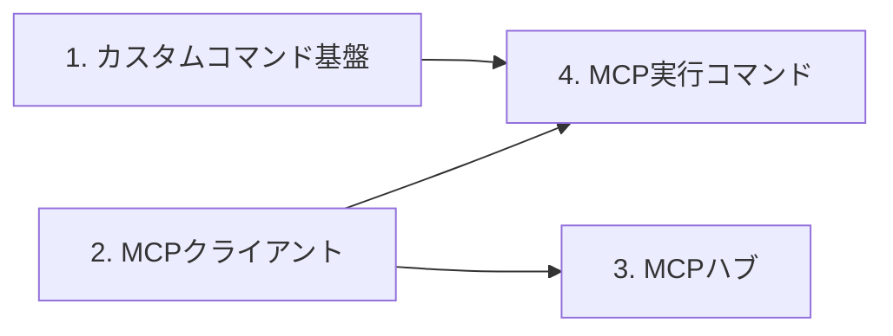

# MCPハブの段階的実装計画

状態: 第1〜4段階と接続先管理の追加を実装。更新日: 2026-10-18。製品版0.61.0。

全体方針は[概要設計](mcp-hub-design.md)。以下の作業単位と受入条件に沿って順次実装した。各条件の実測・未確認は[VERIFICATION](../VERIFICATION.md)を正本とし、実装済みであることだけで全クライアント・全実入力の検証済みとは扱わない。

| 段階 | 到達点 | 詳細契約 |
| --- | --- | --- |
| 1 | 本体/Node/.NET/nativeの種類、保存定義CRUD、共通UI、固定管理入口、既存入力カタログへ接続 | [カスタムコマンド](custom-commands-design.md) |
| 2 | stdio/Streamable HTTP、PC専用認証・許可、探索/検証/ジョブ。本体MCP OFFでの使用とDeepWikiの公開データ読取りを確認 | [MCPクライアント](mcp-client-design.md) |
| 3 | 6つの固定MCP入口、接続先/ツールの明示公開、元callerの許可、画像/isErrorを保持。同じSDK接続で下流ツール追加を確認 | [MCPハブ](mcp-hub-relay-design.md) |
| 4 | appdock.mcp.callの専用入力、固定引数保存、管理API/shortcut設定、受付とジョブ完了、再起動復元 | [保存型MCPコマンド](mcp-command-design.md) |

ChatGPT本体での初回メタデータ反映とRefreshなしの利用、実照明等の操作、物理キー/マウスの全入力経路は今回の確認対象外。実照明の代わりに予約fixtureへ600秒を渡した。WindowsTools移行、OSコマンド、永続予約、複数操作は後続の独立計画のまま。

## 段階と依存関係

追加の接続先管理は、既存の保存基盤へ`getSettings/updateSettings/inspectTools`を接続する。独立した初期OFFの管理許可、秘密の書込み専用化、dryRun、revision競合、未公開ツール確認と通常実行の分離を受入条件とする。UIから利用許可を保存する経路の修正も含む。契約は[管理API](mcp-client-design.md#接続先の管理api)、検証結果はVERIFICATIONへ記録する。

作業順序は1→2→3→4。依存関係上、3と4は同じクライアント基盤の利用者であり、4の内部実行を3へ依存させない。

| 段階 | 完了時にできること | この段階で含めないもの |
| --- | --- | --- |
| 1 | 種類を提供する本体/Node/.NETが、保存型コマンドを共通API・共通UIへ載せ、既存入力経路とMCPから実行できる | 外部MCP通信、WindowsTools移行、OSコマンド実行 |
| 2 | 登録したMCPサーバーをAppDock内部の共通APIから探して呼び出せる | 外部AI向けの中継公開、保存済みMCP実行コマンド |
| 3 | 外部AIがAppDock経由で接続先とツールを探し、そのツールを実行できる | コマンドへの保存、汎用ワークフロー、全MCP機能の中継 |
| 4 | MCPツールの呼出しを保存し、AIによる設定と既存入力への割当ができる | AppDock自身の永続予約、条件分岐、Windows操作種類の追加 |

第1段階の通常製品にはMCP用の種類をまだ含めない。共通UIは導入された種類を表示し、種類がない状態も正常として扱う。本体・Node・.NETの検証用種類で基盤の実用契約を検証し、検証用種類は配布物へ含めない。MCP用の具体的な種類は第4段階で追加する。

## 各段階に共通する進め方

1. 実装開始時のbranch、変更、現行API・設定・版を確認し、別作業を保持する。
2. その段階の詳細設計を更新する。後続段階の内部実装まで先に固定しない。
3. 契約・保存・処理・UI・必要な試験を実装する。
4. 変更範囲のレビュー、修正、必要な再検証を行う。
5. 対象モジュールを版更新・発行し、固定配布物で隔離確認する。
6. 実測、未確認、次の段階へ反映すべき変更をVERIFICATIONと計画へ記録する。

手順と版更新の正本は[共通作業手順](development-workflow.md)。customCommands/mcpServersとPC専用mcp-client.jsonの追加により、実装開始時の0.59.0から0.60.0へマイナー更新した。同じ未公開変更を段階ごとに発行・隔離検証し、最終発行物には全4段階を含める。

commit・push・Release・実利用先へのdeployは実装完了と分け、依頼された範囲で行う。段階を分けること自体を、新たな承認画面や毎回の許可待ちを追加する理由にはしない。

## 第1段階: カスタムコマンド基盤

### 作業単位

| 順序 | 実装する内容 | 主な確認 |
| --- | --- | --- |
| 1A | 種類宣言・保存定義・所有者・上限・Schema検証、設定codec | 未知の種類/版の保持、既存設定との互換性、衝突拒否 |
| 1B | CustomCommandService、CRUD、revision/dryRun、設定受信からの再投影 | 原子的保存、失敗時に旧状態保持、外部更新優先 |
| 1C | 本体/Node/.NETの種類ハンドラー登録と実行文脈 | 設定とハンドラーの分離、寿命、取消、所有者偽装拒否 |
| 1D | 既存カタログ・パレット・入力dispatcher・トレイへの接続 | 安定ID、削除/停止時の利用不可、割当保持 |
| 1E | 管理用API・公開コマンド・操作許可 | 固定tools/list、定義の閲覧/編集と実行の分離 |
| 1F | 本体の設定ページ・一覧・追加/編集・JSON投影 | 即時保存、競合、IME、失敗値、明暗/狭幅 |
| 1G | 回帰・隔離GUI・配布物確認・現行仕様への反映 | 通常機能の維持、fixture非同梱、記録の区別 |

1A～1Gは第1段階内の実装順序であり、個別の製品版や独立した公開を要求しない。

### 完了条件

- 本体、Node、.NETの検証用種類で、追加→名前/設定変更→実行→無効化→削除→再起動の流れが確認できる。
- 保存したコマンドが既存のカタログと入力経路に載り、所有者条件とジェスチャー開始対象が維持される。
- 公開を許可した種類と定義だけが外部のcommands.listへ出る。CRUD権限だけで実行権限を得ない。
- 接続中のMCPクライアントでコマンドを増減しても、外側のtools/listの名前・Schema・注釈が変化しない。
- 設定同期、保存競合、未知の種類、提供元停止、異常終了、取消、応答消失の扱いが詳細設計どおりである。
- 既存の固定/動的コマンドとWindowsToolsは従来APIで動く。移行を行っていないことを確認する。
- 第1段階の契約をappdock-api.md、automation.md、extensions.md、設定/入力関連文書へ反映し、未実装の後続APIを現行API一覧へ混ぜない。

### 検証範囲

保存・Schema・操作許可・カタログ・実行文脈の単体/契約試験、Node/.NET実プロセスfixture、隔離した設定UI、固定EXEでの再起動と入力経路を対象にする。影響のない全回帰を一律には追加しない。具体的な試験表は[詳細設計の検証計画](custom-commands-design.md#検証計画)を参照する。

## 第2段階: 共通MCPクライアント

### 着手時に決めること

- 最初に接続を保証するサーバーと、protocol version/capabilityの対応表。
- stdioとStreamable HTTPの対応順、子プロセスの起動/終了、ネットワーク接続の寿命。
- 認証なし・Bearer・OAuth等の初期対応範囲。対象に必要な方式を確認して決定し、未対応を明示する。
- 接続先ID、共有名簿、PCごとの実行パス/接続設定、秘密参照、接続許可の保存形式。
- ツール一覧のページ分割・キャッシュ・更新検知、Schemaの検証、型や結果サイズの上限。
- 通常呼出しと長時間ジョブ、進捗、取消、タイムアウト、再起動後の状態、応答消失時の判定。

### 実装範囲と完了条件

1. 接続先を共通UIで登録・編集・無効化・削除し、接続状態と必要な対処を確認できる。
2. 本体とAppletが同じ共通サービスからツールを列挙・取得・実行できる。MCPサーバー機能をOFFにしても内部利用できる。
3. stdio/HTTPの採用した対応範囲についてfixtureで検証し、最低1つの実接続で照合する。実接続未確認の範囲を分けて記録する。
4. 接続失敗、認証失効、ツール変更、遅延、取消、異常終了、再接続、結果のエラーを扱える。書込みを勝手に再実行しない。
5. 新規APIは操作カタログでApplet向けに公開し、この段階では外部MCPへの中継を有効にしない。

接続許可・ジョブ方式は第2段階の詳細設計で固定した。OAuthは初期対象外とし、認証なし/Bearerだけを実装した。

## 第3段階: MCPハブ

### 着手時に決めること

- 外部へ公開する接続先・ツールの選択と、内部利用との許可の違い。
- 固定の一覧/詳細/実行/状態/取消入口と、エラー・構造化結果・画像等の公開契約。
- 元の呼出し元を保った許可判定、監査、接続先別の制限、循環検出。
- 初期ツール定義の反映手順と、ChatGPTで検証する接続方式。

### 完了条件

- 接続先一覧→指定接続先のツール一覧→必要なSchema→呼出しの順で操作できる。
- 外部へ許可しない接続先とツールは、一覧・詳細・直接ID指定のすべてで拒否される。
- 接続先のtokenをAIへ返さず、AppDock用tokenを接続先へ転送しない。
- 接続先・ツールを追加/変更/削除しても外側の固定ツール定義は変わらず、一覧を取り直して新しい内容を使える。
- 同じChatGPTの接続を使った増減試験で、追加のRefreshなしに実際に呼べることを確認する。fixtureだけの確認とは区別する。
- 接続先の失敗や未対応の双方向機能が、成功や無応答に置き換わらない。

## 第4段階: MCP実行コマンド

### 着手時に決めること

- 本体提供のMCP実行種類のconfig: 接続先ID、ツール名、固定arguments、確認したSchemaの識別情報。
- 接続先/ツール選択と引数入力UI。JSON入力の範囲、機密値の参照、Schema変更時の修正導線。
- 長時間ジョブの状態表示と取消、定義変更中の実行、接続先削除時の参照保持。
- AIによる作成・変更、dryRun、ショートカット/ジェスチャー編集の利用例。

### 完了条件

1. 共通UIまたは管理APIでMCP実行コマンドを保存できる。保存・dryRunだけではツールを呼ばない。
2. そのコマンドを既存のパレット・ショートカット・ジェスチャー・トレイ・MCPから実行できる。
3. 外部起点の保存済みコマンドにも中継公開の制約が適用され、直接呼出しで拒否された操作を迂回できない。
4. 接続先未設定・認証失効・ツール削除・Schema不一致は、コマンド定義と割当を保持した利用不可状態になる。
5. AIが必要なツール定義を取得し、コマンドを保存し、既存の専用APIで入力を割り当てる一連の流れを検証する。
6. 予約機能を持つfixtureで「10分後の処理を予約する引数」を確認する。実照明等の動作は、別途許可された実機確認と区別する。

## 後続の独立計画

| 対象 | 着手前に設計する内容 |
| --- | --- |
| WindowsTools移行 | 旧send.<id>と新定義の対応、旧設定の共有/端末別保存、固定コマンドの保持、既存割当の移行、再入・対象Window |
| Windowsコマンド実行 | 実行ファイル/引数の扱い、作業フォルダー、環境変数と秘密、許可、標準出力・終了コード、取消・子プロセス寿命 |
| 永続予約 | 時刻、再起動/スリープ、未実行期限、取消、重複防止、実行先の認証失効 |
| 複数操作の連結 | 順序、結果参照、部分失敗、条件分岐、再開と再実行の境界 |

これらを第1～4段階の完了条件へ追加しない。必要になった時点で、共通基盤へ載せる独立の種類またはサービスとして計画する。

## 計画変更の扱い

段階内で判明した変更は、まずその段階の詳細設計へ反映する。ID、保存境界、公開契約、権限、実行結果など段階間の約束を変える場合は、概要設計と後続段階の受入条件も同時に更新する。未決定事項は詳細設計へ移し、完了したときは実測の参照先を残す。

工数や日程は、接続対象・認証方式・実装時点の差分が決まってから見積もる。現段階で未検証の実接続を前提とした完了日を固定しない。
