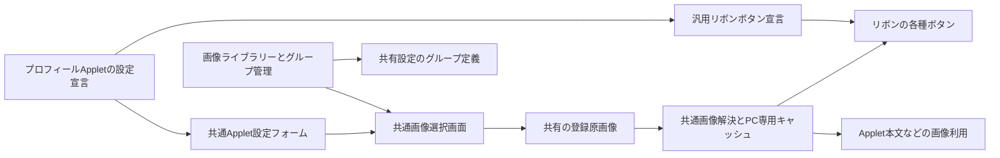

# プロフィールAppletと共通画像ライブラリーの設計

状態: 実装済み（2026-10-20、AppDock 0.69.0 / Profile 0.1.0 / WebApplet 0.3.0）。本書は0.68.1を基準に承認した設計の記録。現行の型・API・保存と追加規則は[共通画像の契約](registered-images.md)を正本とする。

## 目的と採用方針

プロフィールの名前・アバター設定・設定画面・リボンへの登録を独立したAppletへ移す。本体は汎用の設定、画像ライブラリー、リボン投影とナビゲーションを担当する。プロフィールのApplet IDや設定キーを本体へ固定しない。

画像ライブラリーはリボン以外にも使う登録原画像の共通基盤とする。用途別のグループを設定でき、同じ画像を複数のグループで整理できる。グループはリボンのボタングループと別の概念であり、表示・操作・アクセス許可を決めない。

| 対象 | 設計する動作 |
| --- | --- |
| プロフィール | 名前とアバターの両設定をAppletへ移す。共通のApplet設定フォームで編集する |
| プロフィールのリボン | 初期状態は画像だけ、下寄せ。ボタン名・ツールチップ・アクセシブル名は「プロフィール」。ユーザー名や名前の頭文字を出さない |
| 画像の再利用 | 登録原画像を共有ライブラリーに1回保存し、複数の用途から同じ参照を使う |
| ライブラリーのグループ | 名前付きの複数グループ。「すべて」「未分類」は仮想の一覧。グループ名変更・所属変更で画像参照は変わらない |
| リボン画像 | プロフィール、グループ、コマンドボタン、通常Appletページ、WebAppletの各ボタンを同じ解決処理へ接続する |
| リボン以外の画像 | 元の解像度・縦横比・透過を保ち、プレビューやApplet本文にも利用できる。64pxのアイコン用画像へ原画像を置換しない |
| 既存データ | 自動移行・コピー・移動・削除は行わない。旧設定と原画像を保持し、新しい参照と旧Webアイコンを読み分ける |
| 実装範囲 | 本体、独立Profile Applet、WebAppletを実装。検証・発行物は[検証記録](../VERIFICATION.md) |

## 設計時の現状と分離する境界

- `src/shared/contracts.ts`と`settings-schema.ts`が本体の`profile.name/avatar`を定義する。`ProfileEditor.tsx`と`SettingsForm.tsx`が専用フォームを描画する。
- `src/main/core/profile.ts`の`saveUserSettings`は画像検証、`data/assets/profile/<元ファイル名>`への登録、設定保存をまとめている。`src/main/index.ts`は画像の読取・hash監視・`appdock://host/avatar.png`配信を持つ。
- `ui-presentation.ts`は`profile`だけを特別扱いし、画像、名前のツールチップ、頭文字、プロフィール設定への遷移を投影している。
- 現行のAppletページはリボンへ登録できるが、設定画面だけを開くために空のHTMLページを作る契約にはしない。汎用の宣言型ボタンを追加する。
- グループとコマンドボタンは共通の`RibbonIconPicker`で7種類の固定アイコンを選ぶ。登録画像への拡張余地は[既存設計](ribbon-customization-design.md#固定アイコンと登録画像)にある。
- WebAppletは選択・取得した画像を32pxのPNG data URLにしてレコードの`icon`へ保存し、`PageCollections`がリボン用の`iconImage`へ投影する。これは互換読取として残す。
- 既存の`images.normalize`、一時的な`pages.registerImages`、共有原素材のライブラリーは用途と寿命が異なる。既存APIの名前・制約・権限を勝手に置き換えない。

## 構成



本体は宣言と参照を検証し、保存済みの有効な設定を投影する。Appletから本体内部をimportせず、Default Shellと追加Shellは同じ表示APIを使う。画像用途ごとの専用保存・配信・監視を増やさない。

## 登録原画像と参照

### 保存先と形式

```text
<共有ルート>/
  settings.json                    プロフィールAppletの共有設定、画像グループ、リボン設定
  data/assets/images/<元ファイル名>  共通の登録原画像

<従来のPC専用root>/
  cache/registered-images/...       内容hash別のサムネイル、アイコン、読取キャッシュ
```

現行の共有ルートはEXE隣である。[共有先指定の未実装設計](shared-settings-location-design.md)を実装する場合は、選択したsettings.json隣のdataへ同時に接続する。AppletがEXE隣を直接組み立てず、ホストに渡された素材rootを使う。キャッシュキーは共有先の識別子・参照・内容hash・変換条件を含め、別の共有先の同名ファイルを混同しない。

```ts
type RegisteredImageRef = { file: string };
// fileはimages直下の検証済みファイル名。例: { file: 'blue-flower.png' }
// ファイル名とグループは独立し、参照にグループ名・任意パス・URLを含めない。
```

- ライブラリー内の画像一覧は実ファイルから作る。画像IDとパスの対応台帳を作らない。後述のグループ情報だけを設定に保存する。
- PNG / JPEG / WebP、原画像5MiB以下、各辺8192px以下、総画素16Mi以下。拡張子・シグネチャ・デコード結果を照合する。SVG、外部URL、アニメーション形式は初期対象外。
- ファイル名は既存の`assetFilename`を使い、禁止文字・予約名・末尾空白/点・パス区切りを拒否する。rootと実ファイルの転送・リンク・包含関係も検査する。
- 上限512画像。同名は大文字小文字を区別せず照合し、同名同内容は再利用、同名別内容は拒否する。自動上書き・連番作成をしない。
- 書込は共通排他内で一時ファイルを完成させ、同期してから最終名へ上書きなしで公開する。途中ファイルを一覧・配信に使わない。キャッシュにだけ縮小・マスク・透過変換を行い、原画像を変更しない。
- 参照の構造検証と、現在ファイルを読めるかの検査を分ける。画像未到着・一時切断・削除で保存済み参照をnullへ置換しない。
- 「画像を外す」はその利用箇所の参照解除だけ。グループから外す、グループ削除、Applet停止・削除でも原画像を消さない。初期実装に原画像の物理削除・一括pruneは含めない。

### 画像のグループ

グループは共有`settings.json`の`imageLibrary.groups`へ保存する。画像ファイルをグループ別フォルダーへ移さず、多対多の所属として扱う。グループがなくても登録画像は利用できる。

```json
{
  "imageLibrary": {
    "groups": [
      {
        "id": "icons",
        "name": "アイコン",
        "images": [{ "file": "blue-flower.png" }]
      },
      {
        "id": "backgrounds",
        "name": "背景",
        "images": [{ "file": "blue-flower.png" }]
      }
    ]
  }
}
```

これは設定の抜粋。新規IDは安定したランダムIDとし、名前変更で作り直さない。例の読みやすいIDも同じ英数字・ハイフンの文法に従う。

- グループは64件まで、名前は前後空白除去後1〜80文字・制御文字なし。大文字小文字を無視した同名のグループを拒否する。所属はグループ内重複なし、全体4096参照までとし、既存のJSON容量上限も検証する。
- 同じ画像を複数グループへ追加できる。画像ごとの所属編集は複数選択。「未分類」は、保存されたどのグループにも属さない実画像をその都度求める。
- 「すべて」「未分類」は専用の表示キーであり、保存グループの名前やIDで識別しない。グループの順序は配列の順序。画像はファイル名順とし、独自の並べ替え状態を初期追加しない。
- グループ削除の確認は「グループと所属だけを削除し、画像と使用先は残る」ことを示す。別グループに属さなくなった画像は未分類へ現れる。
- 所属編集は選択対象の差分だけを共通revision付きで保存する。他のグループや他画像の所属を古い一覧で上書きしない。削除・名前変更・同じ所属への外部変更は競合として入力を保持する。
- グループ設定が先に届いた場合は、未到着の画像も所属として保持し「画像がありません」と表示する。元画像到着後に自動回復し、起動時に空のファイルを生成しない。
- グループは検索・整理だけに使う。アクセス制御、画像の物理的な所在、Appletの所有権、表示変換を兼ねさせない。

## 共通画面

本体の設定へ「画像ライブラリー」を追加し、左インデックスでは「リボン」の直前に置く。画像の登録・検索・プレビューと、グループの作成・名前変更・所属編集・削除をここへ集約する。リボンやプロフィール設定からも同じ画像選択部品を開けるようにする。

- 一覧の絞り込みは「すべて」「未分類」「保存したグループ」、検索対象はファイル名。画像のプレビューとファイル名を並べ、未到着・読取失敗も区別する。
- グループ管理は[共通の一覧＋SettingsDialog](settings-list-editing.md)を使う。グループの表示順は共通の並べ替えダイアログで変更し、OKで順序だけを確定する。所属編集ではチェックで複数グループを選び、OKで対象画像の所属を確定する。ページ全体の保存ボタンは追加しない。
- 画像選択画面は共通部品`RegisteredImagePicker`とし、グループ選択、検索、サムネイル、選択中のプレビュー、「ライブラリーに登録」「画像を使う」「キャンセル」を提供する。
- 「ライブラリーに登録」は画像原本を追加する独立した確定操作。外側のグループ/コマンド/WebApplet編集をキャンセルしても登録原画像は残る。この扱いは操作ヒントで説明する。所属への追加や利用箇所の参照変更は、各編集の確定時まで保存しない。
- 既存画像の選択は外側のダイアログへ参照を返すだけ。グループ・コマンド・WebAppletの登録はそのダイアログのOKで保存する。通常のApplet画像設定では「画像を使う」で即時保存する。取消とnullへの参照解除は別の結果型にする。
- グループ・検索・選択・スクロールは画面の表示状態とし、共有設定へ書かない。選択画面を開く初期グループは任意で指定でき、所属や画像利用の制約にはしない。
- 設定検索、ヒント、テーマ、狭幅、キーボード、フォーカス復帰は既存の設定基盤を使う。ファイル名のテキスト入力や任意パス欄で画像参照を作らせない。
- 通常のApplet本文は原画像の縦横比を保って表示できる。アイコン用の正方形プレビュー、プロフィール用の丸型マスクは表示上の選択であり、ライブラリーのグループや原画像形式へ混ぜない。

## Appletの設定・画像利用契約

共通設定型`registered-image`を追加し、値は`RegisteredImageRef | null`とする。通常設定とobject-list内フィールドの両方で同じ検証・選択部品を使う。JSON編集・自己設定APIも参照の形を検証し、ファイル未到着だけで保存を拒否しない。

共通一覧の`list.imageKey`にこの型のフィールドを指定できるようにし、現在のdata URL用`iconKey`と区別する。両方がある場合は新しい参照を優先する。設定本文、Applet詳細、Web管理一覧は同じ解決処理を使う。

| 入口（新規案） | 契約 |
| --- | --- |
| 本体の画像サービス | 一覧・グループ別絞り込み・登録・安全な解決・変換・変更通知を一元管理する |
| ローカルApplet UIの`registeredImages.pick` | 明示操作でホストの共通選択画面を開き、選択/解除/取消を区別して返す。任意のホスト設定は更新しない |
| ローカルUIの画像プレビュー | 生存中の対象Viewに結び付いた不透明URLで配信する。共有パスや本体の認証情報を渡さない |
| Node/.NETの`registeredImages.import` | `registered-images` capabilityを新設。filenameとbase64画像を受け、共通ライブラリーへ登録して参照を返す。任意パスと任意URLの読み込みは受け付けない |
| Node/.NETの`registeredImages.copyToCache` | 宣言済み`registered-image`設定で自Appletが参照している原画像またはサムネイルを、自Appletの専用画像キャッシュへコピーする。戻り値はそのPC内のキャッシュパス。共有原画像へ書き込ませない |

Node/.NETは同じRPCと値検証を使う。`copyToCache`が返すファイルは`ui.imageDirectory`と同じ検証済み領域内に置き、既存の`pages.registerImages`やパネル画像へ接続できるようにする。`local-images`等の既存capabilityも必要な利用先で宣言する。設定参照の照合はmanifestの型情報と有効な保存先に基づき、任意JSON中の同じ文字列やID接頭辞で所有を推測しない。object-listは各レコードの宣言フィールドをたどる。

新しいcapabilityなしで、既存の`images.normalize`や`local-images`に共有ライブラリーの一覧・書込・グループ管理権限を付けない。グループの変更・削除APIは初期段階では本体のローカル設定UIだけ。画像参照の外部公開も既存のautomation宣言・許可に従い、画像ライブラリーの書込APIをMCPへ自動公開しない。

### 通信サイズと画像の寿命

`JsonLinePeer`は1メッセージ1MiBである。5MiB原画像を数値配列やbase64としてそのままNode/.NET RPCへ送らず、この上限を緩めない。

- ファイル選択による5MiBまでの登録は、ホスト所有のファイルダイアログからホストの画像サービスへ直接渡す。ローカルApplet UIも共通選択画面を使う。
- `registeredImages.import`は初期契約としてデコード後512KiB以下のbase64に限定する。既存WebAppletの取得上限256,000 bytesを扱える。SDK・ホスト双方で実際のJSON行サイズも検証する。
- 大きい原画像の利用は`copyToCache`やViewに限定した配信で行い、RPCの戻り値へ画像全体を入れない。大容量のプログラム登録やchunk転送は今回追加しない。
- 一時URLと利用先キャッシュは停止・View破棄時に失効/回収できる。登録原画像とグループは利用先の寿命に結び付けない。キャッシュ回収はこのサービスが生成したファイルだけを対象とし、同じAppletの他のパネル/ページ画像を削除しない。
- ローカルAppletからホストの選択画面を開くときは、Shellバーに加えて呼出元AppletのWebContentsViewの暗化・入力停止・復帰を設計対象にする。既存のHostModalLayerがApplet本文まで覆うと仮定しない。同じViewを保持し、閉鎖後のフォーカスと取消結果を復帰させる。呼出元停止・削除後の遅延結果は破棄する。

## プロフィールApplet

予定repoは`A:\30.PROJECT\Applet.Profile.at365`、IDは`at365.profile`。独立したNode Appletとし、ホスト内部やElectronを直接参照しない。以下は新しい宣言項目を含むmanifestの抜粋である。

```json
{
  "id": "at365.profile",
  "displayName": "プロフィール",
  "capabilities": ["settings", "ribbon-items"],
  "settings": [
    { "key": "name", "title": "ユーザー名", "type": "string", "default": "ユーザー", "minLength": 1, "maxLength": 80 },
    { "key": "avatar", "title": "アバター画像", "type": "registered-image", "default": null }
  ],
  "ribbonItems": [
    {
      "id": "main",
      "title": "プロフィール",
      "action": "settings",
      "icon": "user",
      "imageSetting": "avatar",
      "imageShape": "circle",
      "iconOnly": true,
      "defaultPlacement": "bottom"
    }
  ]
}
```

- 設定は`extensions.at365.profile.settings`に保存し、共有/このPC専用の切替は他Appletと同じ既存契約を使う。名前は前後空白除去後1〜80文字とし、文字列の`minLength/maxLength`を汎用の設定制約として追加する。
- 本体の「プロフィール」カテゴリと専用フォームを撤去する。全体設定のAppletインデックスとApplet詳細の設定タブは同じフォームを使う。名前の値はこの設定欄で確認し、リボンのラベル・ツールチップ・文字代替へ渡さない。
- リボン押下ではこのAppletの設定タブを開く。設定用の空ページや別のプロフィール専用Windowを作らない。表示だけのための定期処理・画像監視をAppletに重複実装しない。
- 画像なし・未到着時は汎用の`user`アイコン。名前の頭文字は使わない。丸型マスクは原画像を切り取らず、ホストの汎用画像変換で描画用PNGを作る。
- Node runtimeは通常のactivate/deactivateに従う最小構成でよい。設定とリボン表示はmanifestから投影でき、処理のための別ランタイム種別は増やさない。

## ページを持たない汎用リボン項目

manifestの`ribbonItems`と`ribbon-items` capabilityを追加する。初期契約は、自Appletの設定タブを開く`action: settings`に絞る。既存のページ宣言・利用者が追加するコマンドボタンは維持する。

- 最大16件、安定したローカルID・80文字以下のtitle。リボンIDは`applet:<owner>:<id>`とする。page/group/buttonのIDと衝突させない。
- `imageSetting`は自Appletの宣言済み`registered-image`型のキーだけ。ホストはそのPCの有効設定から参照を解決する。名前や画像を設定JSONとは別のruntime状態で二重管理しない。
- `icon`は汎用カタログ（今回`user`を追加）、`imageShape`はsquare/circle、`iconOnly`と`defaultPlacement`は宣言上の既定値。利用者の既存の別名・表示/非表示・配置編集を優先する。
- `ribbon.itemOverrides[id].placement`を任意追加し、宣言既定の下寄せから上へ移した選択も表現する。親グループの配置、明示override、既存bottom指定、宣言既定の順で解決する。明示的な配置編集はoverrideへ保存し、同じ項目のbottom重複指定を除く。未編集の既存項目の配列は書き換えない。
- 無効化中は実リボンから隠し、設定カタログと配置を保持する。有効であれば開始待ち/故障中も設定への入口を使える。ホストが設定画面を開く操作なので、押下でAppletを自動起動・有効化しない。
- 所有Appletと設定タブはホストの登録情報から求める。外部から任意のApplet IDや内部ルートをアクションへ注入しない。既存の入力確定・NavigationCoordinator・requestId重複抑止を使う。
- 本体に`at365.profile`の固定一覧、特別なfallback、専用アクションを追加しない。未導入なら項目を表示しない。

## リボン全体への画像の適用

保存用の`image: RegisteredImageRef | null`を追加する。`iconImage`は既存の表示用data URLの意味を維持し、保存用の参照として流用しない。

| 対象 | 保存・入力する場所 |
| --- | --- |
| リボングループ | `ribbon.groups[].image`。現行の組み込み`icon`と色・展開方法を保持 |
| コマンドボタン | `ribbon.buttons[].image`。実行先・名前・iconOnlyと独立 |
| 通常Appletページ/宣言型項目/本体ボタン | `ribbon.itemOverrides[id].image`。提供元の設定や実行先を書き換えない |
| プロフィールの提供画像 | `ribbonItems[].imageSetting`が指す自Applet設定 |
| WebAppletの提供画像 | サイトレコードの任意`image`フィールド。既存`icon`は互換表示用として維持 |

表示優先度は利用者のリボン画像override、グループ/コマンド自身のimage、提供元の新しい画像参照、旧Webアイコン等の提供画像、組み込みアイコンの順。参照先が未到着なら次の表示可能な候補へ進み、上位の保存値は保持する。画像を選び直さなくても到着後に戻る。

null/未指定はその層の画像指定なしとし、下位の提供元表示へ戻す。提供元の画像自体を外す操作はプロフィール/WebApplet側の画像設定で行う。リボン上のoverride解除で提供元画像が削除されたように見せない。

`RibbonIconPicker`を固定アイコン＋共通画像選択へ拡張する。グループ・コマンドの既存ダイアログ順序は維持し、アイコン欄の中に画像の選択・解除・プレビューを置く。通常項目の編集にも同じ欄を追加し、セパレーターには画像設定を作らない。

ホストは表示可能な小さいPNG/WebPを生成し、既存`UiPresentation`の`assetId`、`ui.assets.get`、`ui.actions.invoke`でShellへ渡す。原画像のファイル名・パス・グループ・ユーザー名を表示モデルに含めない。画像1件1MiB以下を維持し、既存schema 1/2に同じ画像経路で対応する。丸型は画像の透明部分として表現し、ShellにプロフィールIDの判定を追加しない。バッジ、色の左バー、持続/一時グループ、フォーカスの既存契約を保つ。

## WebAppletの接続

- 手動アイコン選択は共通ライブラリーの選択画面を使い、新しい`image`参照を保存する。既存のdata URL `icon`を自動変換・削除しない。新しいimageを解除すると既存iconまたは組み込みアイコンへ戻る。
- `registered-image`型のフィールドと共通一覧の`imageKey`を用い、ホスト側の設定一覧とWebApplet管理画面の両方から同じ画像を扱えるようにする。
- Webからの推奨設定取得は現行の取得先・origin・256,000 bytes等の制約を維持する。取得結果の画像は編集画面の候補として保持し、最終OKの保存処理で共通importを使う。既存の手動選択や保存済みimageを取得だけで上書きしない。
- 取得画像に元ファイル名がない場合は、ホストが検証形式と内容hashから`web-<sha256>.<ext>`を作り、同内容の再取得を再利用する。グループ名をファイル名へ含めず、特定グループも自動作成しない。
- リボン設定のoverrideとサイト自身のimageは別の編集層。どちらを解除しているかを対象の画面で明確にする。画像選択でURL・accountId・ページID・Cookie・sessionを変更しない。

## 同期・失敗・既存設定

- 原画像は共有data、グループは共有settings.json。プロフィールの名前/参照は既存のApplet単位の共有/PC設定に従う。このPC専用の参照でもライブラリー原画像とグループは共有という境界を設定画面の説明へ揃える。
- フォルダーwatchと既存の2秒pollを併用し、設定が変わらず原画像だけが届く場合も表示を更新する。読取・デコード・hashを同期I/Oの2秒ループで全原画像へ毎回実行しない。変更検出と必要画像の非同期処理、内容hash別キャッシュ、サイズを抑えた列挙を使う。
- 同じファイル名の内容変更も検出し、新hashで再検証・キャッシュ更新する。転送中の不完全ファイルは配信しない。読取不能の継続中は同一共有先の直近正常キャッシュまたはfallbackを使い、参照とグループ所属を保持する。
- 登録完了後に設定保存が失敗しても、既存設定と原画像を壊さない。再利用できる未使用の登録原画像は残す。失敗した参照保存・グループ保存を成功表示せず、入力を保持する。
- 共有先が未確定・オフライン・読取専用のときは登録/所属保存を拒否して状態を表示する。結果不明の書込や保存操作を自動再送しない。[共有先指定設計](shared-settings-location-design.md)の排他・参照先別の復旧契約へ接続する。
- 本体の旧`profile`ブロックは読取/再保存で不透明な既存データとして保持する最小の互換処理だけを残し、既定値生成・内容検証・画面・投影・画像配信へ使わない。新Appletへの値の転記はしない。旧原画像も移動・削除しない。移行なしで新Applet側の名前/画像を設定する方針を、実装時の利用者向け説明へ明記する。
- 旧リボンID`profile`は「廃止済み組み込みID」の汎用保持枠で受け付け、保存済みの配列やoverrideを自動で置換しない。実リボンへ旧項目を復活させず、新しい宣言型IDと区別する。既存の未登録項目の明示削除から整理できるようにする。
- 新項目を含む設定と旧ホストの双方向利用は対応しない。更新・バックアップ・必要ホスト版を揃える。新APIのminimumHostVersionは実装時の本体版へ合わせる。

## 実装順序と変更対象

全体を次の順で実装し、各段階の到達点を記録する。画像のグループと原画像の汎用利用は最初の基盤に含め、リボン専用ライブラリーを先に固定しない。

1. **共通画像基盤**: `RegisteredImages`サービス、参照型、画像グループの設定/検証、一覧・登録・変換・監視、共通選択/管理画面、`registered-image`設定型。専用登録処理を増やさず、Node/.NETとローカルUIの同じ契約を用意する。
2. **リボンの共通化**: imageの各保存先と解決優先度、汎用宣言型項目と明示配置、組み込みuserアイコン、両Shellへの画像投影。既存のグループ・コマンドの編集へ接続する。
3. **プロフィールの分離**: 独立repoとmanifest、共通設定フォームへ移し、本体の専用UI・カタログ・初期値・保存入口・snapshot.avatarUrl・URL配信・監視・Shell分岐・旧スモークを整理する。前項の不透明データ/廃止ID保持だけを互換境界とする。
4. **WebAppletの接続**: サイト設定と管理画面、推奨画像のimport、旧icon読取、共通一覧の画像表示。新画像機能の最低ホスト版を両repoへ揃える。
5. **検証と発行**: 影響範囲の試験・レビュー・版更新・変更モジュールだけの通常発行。新Appletの配布/同梱は既存の独立repo検出へ接続し、本体へ固定一覧を追加しない。

本体の主な対象は`src/shared/{contracts,settings-schema,setting-definitions,applet-pages,ribbon,ribbon-layout,shell}.ts`、`src/main/core/{profile,ui-presentation,host-api,page-collections,data-paths}.ts`、`src/main/index.ts`、`src/preload/`、`src/renderer/settings*`、`shells/default`、`dotnet/AppDock.SDK`と`dotnet/AppDock.Runtime`。新しい画像サービスと共通部品は各層へ追加する。実装時に参照箇所を再検索し、既存APIと内部名の混同を防ぐ。

現行文書の更新先は[設定基盤](settings-foundation.md)、[保存領域](settings-sync.md)、[Applet API](extensions.md)、[Appletページ](applet-pages.md)、[リボン](ribbon-customization-design.md)、[Shell API](shell-api.md)、[WebApplet](web-applets.md)、usage.mdの機能・操作・設定の入口。共有先指定設計の素材一覧にも共通画像とグループ設定の境界を追記する。今回はこれらの現行仕様を書き換えない。

## 受け入れ条件と検証計画

| 分類 | 必要な確認 |
| --- | --- |
| プロフィール | 本体のプロフィールカテゴリなし。Applet設定の共用と即時保存、名前制約、共有/PC切替、画像の選択/解除、未導入/無効化。リボンの文字・tooltip・accessible name・fallbackに保存されたユーザー名が出ない |
| 画像グループ | 作成/名前変更/所属追加と解除/複数所属/並べ替え/削除、すべて/未分類、ID不変、重複名、上限、外部競合、画像未到着、再起動。分類変更でボタン表示と画像参照が変わらない |
| 画像登録 | 形式・5MiB・寸法・同名同内容/別内容・大小文字・禁止名・リンク・root逸脱、並行登録、途中書込、取消、設定保存失敗、原画像保持。全用途が同じサービスを使う |
| 汎用画像利用 | 長方形/高解像度/透過の原画像を保持し、リボン以外のlocalページとパネルで利用。64pxキャッシュと原画像を混同せず、停止でURLだけ失効 |
| リボン | グループ/コマンド/通常ページ/Webボタン、画像優先度/解除/fallback/後着回復、上下/グループ内配置、名前/色の左バー/バッジ、明暗と狭幅、追加Shell、schema 1/2の互換 |
| 宣言型項目 | owner/設定型/IDの検証、下寄せ既定から上への変更と再起動保持、有効な開始待ち/故障中の設定入口、無効中の非表示、二重押下と古いアクションの拒否 |
| Node/.NET/UI | capabilityなしの拒否、自己設定参照以外のcopy拒否、512KiBのimportとJSON行上限、5MiBのローカル登録、ページbridgeの送信元/寿命、Applet本文のモーダル背景とフォーカス |
| WebApplet | 新imageと旧iconの両方、管理画面/本体設定の一致、ユーザー選択の取得による上書き防止、保存取消/失敗、画像切替でページ/ログイン維持 |
| 保存と同期 | 2配置への設定/画像/グループの異なる到着順、参照先別キャッシュ、破損/切断/読取専用/外部更新、設定と原画像の保持。旧profileと旧ribbon配列の再保存保持 |

既存のsettings-editing/settings-page/settings-sync/registered-sounds、ribbon-customization/ribbon-groups/ui-presentation、dynamic-pages/web-applets/page-images、Node/.NET APIの回帰から影響範囲を選ぶ。新サービスと参照/所属検証の単体試験を追加する。固定EXEと対応Appletの隔離GUIで実際の登録・表示・保存・再起動を検査し、原画像ファイルと設定の前後を照合する。OSファイル選択、実SMB、別PC同期、実サイト認証はそれぞれ実施した範囲を記録し、fixtureの成功から推定しない。

## 実装時の確定事項

原画像の初期格納先と分類方式は本設計どおり。縮小画像はメモリーに保持し、Appletへのコピーは既存の自己imageDirectoryへruntime世代別に生成・回収する。別の登録画像用キャッシュrootは追加しなかった。Node/.NETの入口はimport/copyToCache、列挙・選択・previewはローカルUI限定。登録の完成ファイルはflush後の排他的linkで公開する。プロフィール専用Editor、saveUserSettings、avatar URL・監視・HostSnapshot属性は撤去した。旧値・旧ファイルの自動移行と削除は行わない。実NAS・物理ファイル選択の証明は今回の自動試験に含めない。
