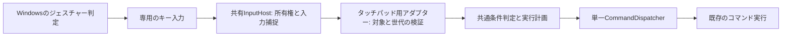

# タッチパッドジェスチャーとWindows設定の接続設計

状態: **実装済みの仕様**（0.85.2）。共通コマンド実行基盤・設定基盤へ接続する。Windowsが認識した3本指・4本指のジェスチャーを、専用のキー入力でAppDockへ接続する。

以前の設計用worktreeにあった「開始キー＋二本指をAppDockで認識する方式」から、共通条件・実行基盤との接続方針を引き継いだ。本書を今後の設計の正本とする。以前の捕捉パネル・独自の移動量判定・指を離した時の判定は、この方式へ組み込まない。

## 1. 目的と対象

- Windowsの3本指・4本指それぞれのタップ、上・下・左・右の移動、計10種類を扱う。
- 割り当ては「コマンドトリガー」の共通一覧で編集し、「タッチパッドジェスチャー」ページには機能とWindows接続の設定だけを置く。
- 接続用のキーはジェスチャーごとに1つ持つ。同じジェスチャーに複数コマンドを割り当て、登録順と「最初の1つ／すべて」で実行する。
- 接続中の入力は専用扱いにし、条件に合うコマンドがなくても元の入力をブロックする。
- ジェスチャーの成立時点、方向、移動量、指の数の判断はWindowsに従う。AppDock独自のしきい値や「指を離したとき／方向が成立したとき」の選択は設けない。
- 機能は端末ごとに既定OFF。Windowsへの初回設定は明示的なONや割り当て操作を契機に行い、通常の再起動・同期・再ONでは勝手に修復しない。
- Windows側の変更はジェスチャー単位で検出し、対象だけ制御を止め、既存通知基盤と設定画面に警告する。

2本指スクロール、独自の3本指・4本指認識、2段階移動、Windows側のコマンド直接起動、CLI起動、元のWindows設定への自動復元は対象外。マウスジェスチャーの機能・設定・認識器は独立して維持する。

## 2. 確認範囲と検証の境界

[ミニ検証アプリの記録](../../TouchpadGestureKeyProbe.at365/VERIFICATION.md)には、4本指タップへF13を設定し、実機で検証アプリ・Edge・デスクトップ上の受信と、AppDockのF13割り当てによるエクスプローラー起動が成功した利用者報告がある。これをWindows判定から既存キー入口への接続の根拠とする。

| 区分         | 根拠・扱い                                                                                                          |
| ------------ | ------------------------------------------------------------------------------------------------------------------- |
| 実機で成立   | 4本指タップ → F13 → AppDockの既存ショートカット → コマンド実行                                                      |
| 試験で確認   | ミニアプリ0.1.0の18件、人工入力のGUI smoke、特定Windows版の内部キャッシュの非昇格読み取り。実機入力の証拠とは分ける |
| 実機で未確認 | 製品での10種類の指操作、修飾キーの全組み合わせ、別のWindows版、実際のスワイプ共通モード切替による他方向への影響     |
| 製品の実装   | 所有キーの捕捉、条件と実行、端末別の接続状態、変更監視、競合対応、設定・公開API                                     |

ミニアプリの実機報告では実行時の昇格状態、復元、Windows設定画面の表示を個別に確認していない。一般ユーザーのHKCUを対象とし、自動昇格はしない。権限不足は接続できない理由として返す。10種類のモデル・共通モード保存・失敗時復旧は偽の設定ストアで検証し、現在のWindows記述24項目の解決と読取、専用キーの実フックを通常権限で確認する。製品で10種類すべてを実際に設定して指で操作する検証は、実機確認項目として残す。

Windows設定の変更部分には、公開APIだけでは完結しない内部設定・キャッシュへの依存がある。検証済みの形式を識別できない環境では読み書きを止め、未対応と表示する。4本指タップの成功を他の9種類や将来のWindows版へそのまま一般化しない。

## 3. ジェスチャーと接続用キー

ジェスチャーIDは表示名から生成せず、固定カタログに定義する。表示と既定の対応は以下とする。表示名は本体の翻訳リソースで管理し、指の本数と操作をコロンと半角空白で区切る。

コマンドリスト内の割り当てもこのカタログ順とし、3本指、4本指の順で、それぞれタップ、上、下、左、右を表示する。同じ入力の行順を維持し、表示のために保存配列や実行順を並べ替えない。

| ID            | 表示          | 既定キー |
| ------------- | ------------- | -------- |
| `three.tap`   | 3本指: タップ | F13      |
| `three.up`    | 3本指: 上     | F14      |
| `three.down`  | 3本指: 下     | F15      |
| `three.left`  | 3本指: 左     | F16      |
| `three.right` | 3本指: 右     | F17      |
| `four.tap`    | 4本指: タップ | F18      |
| `four.up`     | 4本指: 上     | F19      |
| `four.down`   | 4本指: 下     | F20      |
| `four.left`   | 4本指: 左     | F21      |
| `four.right`  | 4本指: 右     | F22      |

ミニアプリの「4本指タップ＝F13」は検証用の固定値であり、製品の既定割り当てを意味しない。保存済みWindows設定をこの表へ自動変換しない。

- トップレベルの折りたたみ「接続用キー設定」で各ジェスチャーのF13～F24と、Ctrl・Alt・Shift・Winの組み合わせを選べる。修飾キーの既定はなし。キー変更は他のジェスチャーの対応を自動でずらさない。
- 第1段階ではF13～F24以外を候補に含めない。仮想キー値の存在だけを根拠に、Windowsが生成可能な接続キーと扱わない。
- 修飾キーは左右を区別しない。Windows内部形式への変換は名前付きフラグから行い、Winは対応確認済みの表現へ正規化する。
- 10種類の接続キーは正規化した組み合わせで一意とする。異なるジェスチャーを同じキーへ接続しない。
- AppDock内の通常ショートカットとの重複は、割り当ての追加・キー変更時に拒否する。既存設定は自動削除せず、対象を表示して変更を促す。未割り当ての既定キーを表示するだけでは予約しない。
- 設定画面で重複による保存拒否が起きたら、共通のエラー通知に重複キーと「接続用キー設定」で変更する案内を表示する。エラーコードは`TOUCHPAD_KEY_CONFLICT`。保存前に拒否し、既存の割り当てとWindows設定を保つ。
- フォームの保存拒否時は一覧を保存済みの割り当てへ戻す。新規なら「未割り当て」、編集なら元の割り当てを表示し、未保存の入力とそれを含む受付待ち編集を破棄する。キー変更などの後続操作へ失敗した割り当てを持ち越さない。JSONの失敗入力は画面内に保持する。
- 同期・読込によって重複が発生した場合も無言で優先順位を決めず、競合する入口を停止する。タッチパッド側の警告で重複を示し、通常ショートカット側から専用キーを実行しない。
- キーの物理入力、マウスのキー割り当て、Windowsジェスチャーは同じ組み合わせなら同じ入口に届く。入力元の識別を接続条件にしない。

設定画面には「接続用のキー入力をブロックします。同じキーを使う他の機能にも影響します。」と説明する。Winを一律禁止せず、既存入力基盤の保護規則と対応確認範囲に従う。

## 4. Windowsを書き換えるタイミング

「割り当てあり」は、そのジェスチャーを参照する保存済みの行が1件以上ある状態を指す。行の一時的な無効、条件不一致、Applet停止やコマンド不在では0件と扱わない。

| 操作・契機                                             | Windows設定                                                | AppDockの動き                                                  |
| ------------------------------------------------------ | ---------------------------------------------------------- | -------------------------------------------------------------- |
| 初回起動、既定OFF                                      | 変更しない                                                 | 割り当てを準備できる                                           |
| OFF中の割り当て・接続キー編集                          | 変更しない                                                 | AppDock設定だけ保存                                            |
| このPCで初めてON                                       | 割り当てがあり、接続を試みた履歴がないジェスチャーだけ設定 | 接続前検査、書込み、反映、再読取後に対象を有効化               |
| 割り当て0件でON                                        | 変更しない                                                 | ONを保存し、割り当て追加を待つ                                 |
| ON中、未接続のジェスチャーへ初めて割り当て             | そのジェスチャーだけ設定                                   | 保存と接続の成否を別々に表示                                   |
| ON中、既存ジェスチャーにコマンドを追加・編集・並べ替え | 変更しない                                                 | 共通実行計画の設定だけ更新                                     |
| ON中、正常接続しているジェスチャーの接続キーを明示変更 | 対象の対応だけ変更                                         | 旧入力の受付を止め、新しい設定を確認して切り替える             |
| 競合中・未接続中の接続キー編集                         | 変更しない                                                 | 希望値を保存し、「Windowsの設定を再設定する」で明示接続        |
| OFFへ変更                                              | 変更しない                                                 | 受付・ブロック・未開始の実行を停止し、割り当てと履歴を保持     |
| 接続履歴がある状態で再ON、起動・再開                   | 読取と比較だけ                                             | 一致すれば再開。不一致は警告して停止                           |
| そのジェスチャーの最後の行を削除                       | 変更しない                                                 | 予約・受付・ブロック・警告監視を解除                           |
| 以前使ったジェスチャーへ再び割り当て                   | 読取と比較だけ                                             | 一致なら再開、不一致なら明示再設定を待つ                       |
| 「Windowsの設定を再設定する」を選ぶ                    | 選択したジェスチャーだけ設定                               | 成功確認後に警告解除・受付再開                                 |
| 設定ファイルの同期・インポート・復旧                   | 変更しない                                                 | 現在値を照合し、一致・接続履歴・有効状態に応じて再開または停止 |

既定OFFは**このPCの有効状態**であり、共有割り当てが届いただけではONにしない。通常起動でWindowsを書き換えることはない。設定だけ届いて接続履歴がない場合は「未接続」とし、このPCのON操作または明示再設定が必要となる。

ON操作は対象一覧を決める契機であり、10種類を一括で上書きする意味ではない。接続済みの履歴がある対象は、同じON操作の中でも読取・比較だけにする。失敗した対象をOFF/ONで無条件に再上書きしない。

OFF・AppDock終了・最後の割り当て削除後も、Windowsは接続用キーを送る設定のまま残る。設定ページにこの説明と「Windowsのタッチパッド設定を開く」を置く。自動復元用の常設バックアップ機能は設けない。

## 5. 保存モデルと設定の境界

[設定同期と保存領域](settings-sync.md)の共有設定・端末別JSON・PC専用rootを使う。共有設定と端末設定を合成したモデルにenabledが現れるが、保存先は以下のとおり分離する。

| 保存先                                                       | 保存する内容                                                                                  |
| ------------------------------------------------------------ | --------------------------------------------------------------------------------------------- |
| 共有`settings.json`の`touchpadGestures`                      | 10種類の接続キー、コマンド割り当て、実行方法                                                  |
| 自端末の`settings-<端末名>.json`の`touchpadGestures.enabled` | このPCで有効にするか。省略時false。他端末の値は使わない                                       |
| PC専用rootの`touchpad-bridge-state.json`                     | schemaVersion、ジェスチャー別の接続試行履歴・確認済み希望値、完了前のWindows設定操作のjournal |
| メモリー                                                     | 現在の読取結果、競合理由、InputHost世代、進行中入力、監視購読、WarningReporterのepisode       |

共有設定の概念形:

```ts
interface TouchpadGestureSettings {
  connections: Record<
    TouchpadGestureId,
    {
      key:
        | 'F13'
        | 'F14'
        | 'F15'
        | 'F16'
        | 'F17'
        | 'F18'
        | 'F19'
        | 'F20'
        | 'F21'
        | 'F22'
        | 'F23'
        | 'F24';
      modifiers: Array<'Ctrl' | 'Alt' | 'Shift' | 'Win'>;
    }
  >;
  executionMode: 'first' | 'all';
  bindings: Array<{
    id: string;
    command: string;
    gesture: TouchpadGestureId;
    enabled: boolean;
    when: GestureBinding['when'];
  }>;
}
```

- `TouchpadGestureId`は10種類の固定IDのunion、`CommandCondition`は[共通基盤](command-execution-foundation-design.md)のモデルを使う。実保存への投影も既存のページID・Applet ID・exe条件と揃える。
- `bindings`は安定IDと保存順を持つ。実行方法の既定は`all`。ブラウザ環境は`Settings.commandTriggerOptions`をキー・マウスと共用する。
- 初期値は10種類のキー対応と空の割り当て。既存の通常ショートカットを自動で取り込まず、削除した行を復元しない。
- `blockOriginalInput`は割り当てごとの可変設定にしない。接続中の専用入力の固定規則とする。
- PC専用履歴には、接続操作前に`attempted`と希望値の指紋を永続化する。途中終了や失敗を「未使用なので初回上書きしてよい」と判定しない。
- 履歴はOFF・最後の行削除・ページリセットでも保持する。配置先変更や新しいPCでは既存rootの履歴を探して移行せず、未接続として扱う。
- 履歴が破損・未知版・読取不能の場合は保持して接続を停止する。現在値を読み、利用者が明示再設定した操作の範囲で回復する。警告の既読管理を別途永続化しない。

### 編集・リセット・外部受信

ショートカット側には、タッチパッド由来の所有情報を付けた**読取専用の投影**を渡す。通常の`keybindings`へ複製して保存しない。タッチパッド側の行を削除すれば投影も消える。

通常ショートカットの削除・リセット・公開編集APIは、この所有行を変更できない。タッチパッドのページリセットはこのPCをOFFにし、共有のタッチパッド設定を既定値へ戻すが、Windowsと接続履歴は変更しない。共有割り当てを消すため、既存の共通リセット確認にその対象を表示する。全設定のリセットも同じ境界を通る。

OS変更を伴う処理は設定ファイルの`changed`イベントから起動しない。通常のUI保存・公開操作と外部受信の原因を分離し、外部受信では読取照合と入力所有権の再構築だけを行う。希望キーが変わった場合は旧キーを停止し、すでにWindowsも希望値と一致するなら履歴を確認して再開、不一致なら警告する。

## 6. ジェスチャーごとの状態

状態は全体ON/OFF、割り当て、Windowsの実効値、PC専用履歴、入力基盤の利用可否から生成する。画面の表示文字列を状態の正本にしない。

| 状態               | 条件                                                  | コマンド受付・元入力ブロック                      |
| ------------------ | ----------------------------------------------------- | ------------------------------------------------- |
| 割り当てなし       | 保存行が0件                                           | しない。警告監視の対象外                          |
| OFF                | このPCがOFF                                           | しない。既存の履歴は保持                          |
| 未接続             | 履歴がなく、明示接続待ち                              | しない                                            |
| 確認中・設定中     | 起動照合、明示設定、変更検出後の再照合中              | しない                                            |
| 接続中             | 希望値と実効値が一致し、InputHostへの所有権反映が成功 | する。条件不一致・利用可能コマンド0件でもブロック |
| 競合               | Windowsの設定不一致、キー重複                         | しない。割り当てと警告は保持                      |
| 利用不可・確認失敗 | 未対応、機器不在、読取不能、InputHost障害など         | しない。原因を区別して表示                        |

初回設定の一部が失敗した場合も、正常なジェスチャーは利用できる。全体ONは利用を希望する状態として保持し、接続件数と要対応件数を区別する。成功数だけを根拠に全件成功と返さない。

競合の修復後、またはWindows側が手動で希望値へ戻ったことを確認した後は、ON・割り当てあり・接続履歴ありの条件で再開できる。「AppDockで制御しない」は競合を無視して利用を続ける設定ではなく、**現在の競合を未対処のまま停止しておく操作**とする。永続的な追加OFFフラグは設けない。

## 7. Windowsの読取・設定アダプター

mainの`TouchpadBridgeManager`が設定・状態・監視・警告を管理する。Windows固有処理は.NET側の`WindowsTouchpadSettings`に閉じ込め、共有のInputHost IPCを通す。低レベルキーフックのcallback内でCOM・レジストリー・ファイル操作を実行しない。

### 対応表と実効値

- 対象は現在のWindowsユーザーの`HKCU\Software\Microsoft\Windows\CurrentVersion\PrecisionTouchPad`。任意のレジストリーパスや任意の設定IDをUI・外部APIから受け取らない。
- 10種類のアダプター対応表は、gesture IDごとのキー値・操作値・有効モード・共有スワイプモードへの依存を持つ。キー値だけが残っていても、Windowsの操作が別機能なら接続中にしない。
- ミニアプリで確認した4本指タップは`CustomFourFingerTapKeyParams=0x007C0000`、`CustomFourFingerTap=7`、`FourFingerTapEnabled=0xFFFF`。この例を他の9種類へ機械的に複製しない。
- キー値の高WORDが仮想キー、低WORDが修飾キーとなる形式は検証したWindows版のもの。Windows側のCtrl=1、Shift=2、左Win=4、右Win=8、Alt=16と、AppDock側の修飾フラグ値は異なる。名前から明示変換し、数値を直接転用しない。
- 内部キャッシュの設定識別子は、検証アプリと同様にWindows自身の設定記述とパス・値名を照合して解決する。特定版でのID 39/38/16、DLLアドレス、固定件数探索を製品定数にしない。
- 反映手段を確認できない場合は、レジストリーだけ先に変更して成功扱いにしない。Explorerの強制終了やWindows設定プロセスの強制操作を反映手段にしない。

### スワイプの共有モード

Windowsが3本指・4本指それぞれの上下左右を共通プリセットで管理している場合、1方向の接続でも共通モードの変更が必要になる可能性がある。**未割り当ての他方向の実効動作を維持することを必須**とする。

事前に同じ指本数の全方向を読み、他方向を保てる書込み計画を作る。必要なら現在の動作を等価な個別設定として保持するが、意味を検証できない値や未対応プリセットがあれば書込み前に止める。無条件に「カスタム」へ切り替えたり、他方向を無効化したりしない。計画上の保存値が複数でも、利用者が指定していない方向の動作は変更しない。

### 書込みと完了判定

1. 現在のAppDock revision、全体ON、対象行、キー競合、OS対応、Windowsの実効値、共有モード依存を確認する。操作対象と希望値を固定する。
2. 同じWindowsユーザー内で変更処理を直列化する。複数配置のAppDockが同時に同じ入力を制御しないよう、接続の所有権もユーザー単位で排他にする。後から来た配置は奪取せず停止理由を返す。OFF・終了では捕捉済み入力を整理して所有権を解放する。
3. 対象の新規入力を停止し、進行中の押下/解放を整理する。PC専用journalへ操作ID・対象・直前値・希望値・世代・接続試行を原子的に保存する。保存できなければWindowsへ書かない。
4. 書込み直前に現在値が計画の前提と一致するか再読取する。不一致なら古い計画では書かず、競合として返す。
5. 検証した順序で対象値を更新し、Windowsのキャッシュへ反映する。途中の監視イベントを自己書込みだからという理由で丸ごと捨てない。
6. 実効値を再読取し、希望値との一致と非対象方向の動作保持を確認する。設定・世代がまだ有効ならInputHostへ所有権を渡し、反映応答後に「接続中」にする。
7. 完了をjournalへ記録する。共有設定保存・Windows反映・入力捕捉反映の結果を分けて返し、通常の保存成功通知を追加しない。

Windowsにはこの操作全体の原子的な比較更新APIがあるとは扱わない。最後の照合と書込みの間の外部更新を完全に防げるとはせず、事後照合で相違を検出したら停止する。共通モードの検証・復旧のために一時停止が必要な場合、書込み操作の間だけ専用キーを一時停止し、完了後に照合済みのジェスチャーを再開する。

複数ジェスチャーを初回接続する場合、キーの重複と非対象動作の保持は、操作全体の予定結果でも検査する。依存する共通モードをまとめた単位で適用し、途中の一時値を接続中として公開しない。1回の接続要求を1つの変更計画とjournalで扱う。途中失敗では、その要求で変更した値を所有比較付きで戻す。既に接続済みの要求外ジェスチャーは、再照合して継続する。

途中失敗では、今回変更した値がまだ今回の書込み値と一致するときだけ、操作直前値へ戻す。第三者が変更した値を上書きして復旧しない。これは失敗した**1回の設定操作**の復旧であり、OFF・削除時に元設定へ自動復元する機能ではない。

異常終了後はjournalを読み、現在値・最新希望値・世代を照合する。全値が意図した結果なら完了を確定できる。未完了の書込みを起動時に続行せず、部分失敗や判定不能は停止して明示再設定を待つ。古い操作結果で新しい設定や警告を上書きしない。

未完了journalは操作単位の計画と未解決ジェスチャーを保持する。1つのジェスチャーを再設定しても、別のジェスチャーの未解決記録を消さない。明示再設定した対象だけを新しい操作へ置き換え、完了した対象から記録を解決する。

## 8. 変更監視と競合時の操作

Windows設定の対象キーを監視し、変更通知後に購読を張り直して再照合する。起動・ON・スリープ復帰・ユーザーセッション復帰・設定ページ表示でも照合する。通知漏れの補完として、ON中は2秒間隔を初期値に読取照合する。フック内では確認済みの状態だけを参照する。

変更通知を受けたら、影響が未確定な対象の受付を先に止める。共有スワイプモードの変更は依存する方向を再評価する。比較が終わり一致した対象から再開する。通知から停止までの遅延や、通知・読取間の外部変更をゼロにはできない。

未割り当て方向も接続キーの重複検査に必要な範囲で読み取る。別のWindowsジェスチャーが接続中と同じキーを生成する設定になった場合、入力から出所を識別できないため、そのキーを持つAppDockジェスチャーを競合停止する。監視対象に含めることを、未割り当て方向の書込みや独自警告を増やす理由にしない。

競合は以下の3操作をジェスチャーごとに提供する。

| 操作                                   | AppDock設定                              | Windows設定            | 警告と入力                                         |
| -------------------------------------- | ---------------------------------------- | ---------------------- | -------------------------------------------------- |
| AppDockで制御しない                    | 保持                                     | 変更しない             | 警告を残し、そのジェスチャーの実行・ブロックを停止 |
| Windowsの設定を再設定する              | 保持                                     | 現在の希望値を明示適用 | 再読取・捕捉反映の成功後に再開                     |
| このジェスチャーの割り当てをすべて解除 | 対象の全行を削除。他のジェスチャーは保持 | 変更しない             | 予約・監視・警告を解除                             |

警告を無視した場合も「AppDockで制御しない」と同じ停止状態。競合中のキーを通常ショートカットの別経路で拾って実行しない。全行解除は、現在の検索結果や条件一致行だけでなく、そのgesture IDを持つ全行が対象となる。実行前に件数・gesture ID・revisionを確定し、削除されたキーをWindows側から消さない。

読取不能、機器不在、未対応、入力基盤停止は「Windowsの設定が変更された」と断定しない。再確認で回復できる状態と、利用者の明示書込みが必要な不一致を分ける。

### 通知と設定画面

- [WarningReporter](warning-notifications-design.md)の既存警告種類を使い、gesture IDを含む安定した発行元キーでepisodeを管理する。同じ状態の再照合で再通知しない。
- 通知から「タッチパッドジェスチャー」を開き、対象ジェスチャーへ移動する。閉じる・期限切れは状態解消として扱わない。原因・対処は短く、内部設定IDや生のレジストリー値は診断ログへ置く。
- 設定画面には対象の表示名、希望キー、確認できたWindowsの操作、停止理由、上記操作を出す。重要な警告は共通レイアウトの`description`へ渡し、ヒント非表示でも読めるようにする。
- 機能OFF中は監視・制御を止めるが、OFFを競合の修復とは扱わない。保持した要対処情報は設定画面に残し、再ON時に現状を読んで判定する。最後の行削除は管理対象から外れたものとしてepisodeを終了する。
- 設定失敗・通信失敗は[共通エラー](error-reporting.md)へ接続する。警告と同じ原因のエラーを毎回重複通知しない。入力不正・revision競合・明示取消は既存分類に従う。

## 9. 入力の所有権と共通実行基盤



既存の[入力エンジン](../dotnet/AppDock.InputHost/InputCaptureEngine.cs)、[入力スレッド](../dotnet/AppDock.InputHost/InputCaptureThread.cs)、[キーcodec](../dotnet/AppDock.InputHost/ShortcutCodec.cs)と[InputCaptureManager](../src/main/core/gestures.ts)へ所有権の種類を追加する。別プロセス・別フック・別のRegisterHotKey実行経路は作らない。

### 捕捉の契約

- 「接続中かつ保存行あり」のキーを、条件評価より前に専用所有キーとして認識する。OS照合結果・設定revision・native世代をまとめて投影する。
- 現在の通常ショートカットは条件に一致した有効・利用可能な行でブロックを合成する。本機能は条件不一致でも止めるため、通常行を生成するだけでは実現しない。専用所有権を追加し、通常ショートカットの不一致通過仕様は維持する。
- 主キーの最初のkeydownで1入力IDを作り、オートリピートは重複実行しない。対応するkeyupで寿命を閉じる。ジェスチャーの成立と指離れをAppDockで待ち直さない。
- Windows由来の合成キーは受け入れる。injectedフラグだけで全入力を捨てず、AppDock自身の識別付きキー送信のみ自己入力として除外する。
- 捕捉した押下と解放は同じ所有者で処理する。変更・OFF・競合検出後は新しいkeydownを受け付けないが、すでに捕捉したキーの対を完了させる。物理的に押されている別の修飾キーをまとめて解放しない。
- Ctrl/Alt/Shift/Winの単独動作・キー状態の整合は既存フックの方式を再利用する。Windowsから送られる修飾キー列と物理入力の混在を実機で検証する。対応できない列を正常捕捉として報告しない。
- global/localの所有権を一本化し、本体renderer・WebContents・通常ショートカット入口で二重実行しない。キー記録中は共通記録モードが所有し、タッチパッドのコマンドを実行しない。
- InputHostやIPCの障害時は実行を停止し、捕捉が有効と報告しない。フック側の既存fail-openと鍵の対の後始末を維持する。

### 条件と実行

[共通基盤](command-execution-foundation-design.md)と[CommandDispatcher](../src/main/core/command-dispatcher.ts)を使い、独自の条件判定・登録順選択・実行ループは持たない。

1. 専用キーのkeydown時点で、前面HWND・プロセス・デスクトップ判定と、本体の実フォーカス・表示ページ・Appletを取得する。指が触れた時点の情報は取得できる前提にしない。
2. mainが入力ID、所有元gesture ID、設定revision、接続世代、nativeの生存状態を検証する。入力時の事実を共通`TriggerContext`へ投影する。
3. 当該gesture IDの保存行を順序付きで渡し、「いつ・どこで」と利用可能性から共通の実行計画を1回だけ作る。未知・停止中コマンドの扱いも共通化する。
4. `executionMode`に従い、同一コマンド重複除去・全トリガー共通の再入防止・取消・エラー処理を行う。firstの候補がBUSYの場合に後続へすり替えない。
5. 前面化・キー送信は入力元invocationを伴う既存のキー入力経路へ接続する。本体を開く処理の一度限りの権限・対象検証を守り、旧マウスの接触sessionを偽造しない。

Windows設定変更・機能OFF・行削除・世代失効では未開始の処理を取り消す。すでに実行したコマンドを巻き戻さない。条件判定に入力後の別ウィンドウを代用せず、実行前の対象消失・対象変更と後続実行の取消は共通の入力元検証に従う。

## 10. 設定画面とショートカット画面

[設定基盤](settings-foundation.md)、[共通レイアウト](settings-ui-guidelines.md)、[一覧編集](settings-list-editing.md)を使う。設定ナビゲーション・検索・ページID・公開投影のカタログへ`touchpad-gestures`を追加し、独自のページ描画基盤は作らない。

| 領域                            | 内容                                                                                                                 |
| ------------------------------- | -------------------------------------------------------------------------------------------------------------------- |
| ページ先頭のタイトルなしSection | 有効切り替えとこのPCだけに適用する説明、続いて実行方法                                                               |
| 「ジェスチャー共通の設定」      | キー・マウスと同じ`Settings.commandTriggerOptions`を参照するブラウザexeとChromiumウィンドウ条件。group表示は付けない |
| 「Windowsとの接続」             | 常に展開する。Windows設定を開くボタンを共通Fieldへ配置。接続の注意・競合状態・各ジェスチャーのキーと修飾キーを集約   |
| コマンド一覧                    | このページには置かず、[コマンドトリガー](command-triggers.md)へ集約                                                  |
| 割り当て編集                    | ジェスチャー選択、行の有効状態、「いつ・どこで」。接続キーは表示し、接続用キー設定への導線を置く                     |
| 競合対象                        | 対象の共通行/グループのdescriptionと操作。通知からその位置へ移動できる                                               |

- [CommandBindingList](../src/renderer/settings-ui/CommandBindingList.tsx)、[共通ツールバー](../src/renderer/settings-ui/CommandBindingToolbar.tsx)、[実行方法フィールド](../src/renderer/settings-ui/CommandExecutionModeField.tsx)を利用する。編集・実行順・削除は共通の32px角ボタンを使う。
- 同じジェスチャーに異なるコマンドが2件以上ある場合は実行順ボタンをアクセント色にする。表示上の並べ替えを実行順へ流用しない。割り当てマークで完全一致の絞り込みを行う。
- 10種類のキー一覧は、ジェスチャー名、F13～F24のドロップダウン、Ctrl・Alt・Shift・Winのラベル付きチェックボックスを横並びに表示する。正常なOS登録状態を各コマンド行へ重複表示しない。
- 接続用キーは、常に展開した「Windowsとの接続」で全10種類を表示し、変更ごとに検証・即時保存する。重複する接続キーは拒否し、共通のエラー表示に理由を出す。OFFならWindowsを書かず、ONでは既存の接続境界に従う。ページ全体の未保存ドラフトは作らない。
- ON操作は対象を計画して接続する。操作中表示・二重押下防止は共通ボタンの機構に渡す。不要な確認ダイアログを重ねない。既存値を書き換える意味は操作前の説明で分かるようにする。
- 単一割り当ての削除は共通ダイアログで対象名・入力・条件を確認してから即時保存する。競合メニューの全解除も対象ジェスチャーの全件に限定し、コマンド自体や他方式の割り当てを削除しない。
- 重要な状態は`description`、任意の操作のコツは`hint`へ渡す。独自の通知欄・ステータスカード・`SettingsHint`を追加しない。入力エラーは対象IDとともに共通レイアウトの既設`SettingsError`へ渡す。
- 接続用キーを通常のキー割り当てへ重複表示しない。タッチパッドの割り当ては統合一覧で編集し、キー側の実行方法をこの入力へ適用しない。
- Windows設定を開くボタンは`ms-settings:devices-touchpad`を既存の外部起動経路で開く。Windowsの機能を元へ戻す操作は利用者が行う。

## 11. 内部契約・公開API・権限

接続設定と通常ショートカットを別の正本として保存し、公開API・JSON編集・リセットを通しても所有保護を迂回できないようにする。新規割り当て可能なコマンドの列挙と検証には既存のassignableCommandsを使う。

公開操作:

| 操作                                   | 内容と副作用                                                                                              |
| -------------------------------------- | --------------------------------------------------------------------------------------------------------- |
| `touchpadGestures.get`                 | 保存revision、端末有効状態、10種類、割り当て、接続状態、assignableCommandsを安全な形式で返す              |
| `appdock.touchpadGestures.update`      | 行の追加・更新・削除・順序、実行方法、ブラウザ環境、接続キーの希望値を編集。これだけではWindowsを書かない |
| `appdock.touchpadGestures.set-enabled` | このPCのON/OFF。ONによる初回接続を含むことを入力schemaと説明に明記                                        |
| `appdock.touchpadGestures.reconnect`   | 指定gesture IDを現在の希望値でWindowsへ設定。競合時も明示操作として扱う                                   |
| `appdock.touchpadGestures.clear`       | 指定gesture IDの全割り当てを解除。Windowsへは書かない                                                     |

ローカルUIの「ON中の初回割り当て」「接続中のキー変更」は、設定更新と必要な接続操作を調停する内部の明示操作として実装する。公開updateは設定変更だけを行い、Windowsへ反映する場合はset-enabled/reconnectを明示的に指定する。外部設定編集の暗黙のOS副作用を避け、UIとAPIの差を操作カタログに記載する。

- [共通操作API](appdock-api.md)にread/execute/writeと専用`editTouchpadGestures`を使用し、Applet/MCPの各PC専用許可で独立管理する。新規専用許可の既定はfalse。Windows変更を含む許可であることを説明する。
- `expectedRevision`、`dryRun`、原子的保存を使う。端末状態とWindows観測の世代も確認し、dryRunでWindowsやjournalへ書かない。dryRunの成功を後続操作の現在値保証にしない。
- 通常のショートカット編集許可では所有投影を変更できない。共有設定の保存やインポートだけではWindows変更の権限が与えられない。
- ローカルUIを含めmainの同じ操作サービスを通す。任意Windows設定ID、任意パス、別端末名、外部から渡された前面HWNDを設定操作の権限として受け取らない。
- 結果には設定保存、Windows反映、入力捕捉反映、gesture IDごとの成功/失敗/未実施を区別する。応答消失時は状態と操作IDを照会し、無条件に書込みを再送しない。

## 12. 追加・変更する実装箇所

実装の分担は以下とする。

| 層                     | 変更内容                                                                                                              |
| ---------------------- | --------------------------------------------------------------------------------------------------------------------- |
| shared                 | 新規touchpad-gesturesモデル・10種類カタログ・正規化・所有キー投影・共通計画へのアダプター                             |
| SettingsStore/端末設定 | 保存schema・既定値・ページ投影・リセット・外部受信・revision競合。PC専用履歴とjournal                                 |
| main                   | 新規TouchpadBridgeManager、Windows設定操作の調停、監視・episode、専用入力から共通Dispatcherへの接続                   |
| InputHost              | OSアダプター、読取/書込/監視IPC、専用キーの所有権、keydown/up・記録・停止の統合                                       |
| renderer               | 共通コマンド一覧の追加ページ、動作設定、所有キーの読取専用投影、対象別の警告と対処                                    |
| API/permissions        | 操作カタログ、専用許可、expectedRevision/dryRun、所有保護、状態結果                                                   |
| 文書                   | keybindings/gestures/usage/settings-foundation/settings-sync/appdock-api/automationの該当仕様・入口を実装と同時に更新 |

## 13. 検証計画と実装順

### 自動試験・隔離fixture

| 対象           | 必須の検証                                                                                                                        |
| -------------- | --------------------------------------------------------------------------------------------------------------------------------- |
| カタログとキー | 10種類、F13～F24、修飾の正規化、一意性、Windowsとのフラグ変換、未知形式の拒否                                                     |
| 共通計画       | 条件fixtureの一致、first/all、登録順、同一コマンド1回、他トリガーと同じBUSY予約、対象固定と取消                                   |
| 所有権         | 条件不一致/全行無効でも捕捉、OFF/競合/最後の削除で通過、通常キーへの影響なし、global/local二重実行なし                            |
| 入力寿命       | Windows合成入力、自己入力除外、repeat、keydown/up途中の停止、修飾キー混在、記録モード、IPC障害                                    |
| 有効化         | 既定OFF、OFF中編集、初回ON、0件ON後の追加、部分成功、再ON/再起動で不一致を上書きしない                                            |
| 保存と同期     | 端末間のON分離、外部受信でOSを書かない、配置変更、履歴破損、試行後失敗、削除後の再追加、リセット時の履歴保持                      |
| OS更新         | 正確な対象値、共通モードの非対象方向保持、キャッシュ反映失敗、外部競合、部分書込み、比較付き復旧、異常終了journal、複数配置の排他 |
| 監視と警告     | 操作モードだけの変更、重複キー、通知再購読、poll補完、自己書込み中の外部更新、閉じても停止、対象だけ再設定/全解除、別対象の継続   |
| 公開API        | 専用許可、割当可能コマンド、revision/dryRun、投影の編集拒否、updateのOS副作用なし、結果・操作ID照会                               |
| GUI            | 4列・編集/順序/削除・検索保持・読取専用導線・ヒントOFFでも警告表示・明暗/狭幅/拡大・フォーカス・Windows設定起動の失敗             |

実OS値への書込みはunit/GUI fixtureの副作用にせず、独立したテストストアと設定アダプターで検証する。入力注入やfixtureの成功を物理タッチパッドの成功と扱わない。

### 実機で確認する項目

1. 10種類それぞれを本体・Edge・デスクトップで操作し、Windowsが認識した方向・回数と、キー受信・コマンド実行が一致する。1回のキー列で1回実行する。
2. F13～F24と選択可能な修飾キーを通常権限で設定・反映できる。Windowsの設定表示と有効値が一致し、非対象のジェスチャーは従来動作を保つ。
3. 接続中の条件不一致、全行無効・コマンド不在では実行せず、接続キーの元入力も通らない。OFF・競合ではAppDockの受付・ブロックが解除される。
4. Windows設定から1種類だけ変更すると警告と停止が出て、他の接続は動く。無視、再設定、対象全解除、希望値への手動復帰を確認する。
5. 削除・OFF・終了でWindows設定が残る。再ONや再起動で変更済みのWindows設定を上書きしない。3/4本指の共通プリセット変更も照合できる。
6. スリープ・サインイン・タッチパッドの有無の変化、AppDock/InputHost異常終了、設定変更中の外部編集、物理修飾キーとの混在で状態・押下が残らない。

別OS版・UAC境界・他フックとの組み合わせは、実施環境と未実施範囲を分けて記録する。実機で検証していない項目を「対応確認済み」と表示しない。

実装順は、(1) 10種類のWindows設定アダプターと非対象動作保持の検証、(2) 保存・履歴・監視・状態機械、(3) 専用入力所有権と共通実行接続、(4) 共通設定UI・公開API、(5) 結合・実機・発行とする。段階1で維持できないWindows形式を発見した場合は未対応として止め、他方向を変更する仕様へ黙って切り替えない。

## 14. 参照

- [共通コマンド実行基盤](command-execution-foundation-design.md): 条件・実行計画・取消の正本。
- [キージェスチャー](keybindings.md)、[マウスジェスチャー](gestures.md): 既存入力との境界。
- [ミニ検証アプリの開発資料](../../TouchpadGestureKeyProbe.at365/DEVELOPMENT.md)、[実測記録](../../TouchpadGestureKeyProbe.at365/VERIFICATION.md): 内部設定の調査と4本指タップの実機結果。兄弟repoにある補助資料。
- [Microsoft: Touchpad gestures](https://www.microsoft.com/en-us/windows/learning-center/touchpad-gestures): Windowsのジェスチャーと設定。
- [Microsoft: Virtual-Key Codes](https://learn.microsoft.com/en-us/windows/win32/inputdev/virtual-key-codes): F13～F24等の仮想キー。
- [Microsoft: Launch Windows Settings](https://learn.microsoft.com/en-us/windows/apps/develop/launch/launch-settings#devices): タッチパッド設定の起動URI。
- [Microsoft: RegNotifyChangeKeyValue](https://learn.microsoft.com/en-us/windows/win32/api/winreg/nf-winreg-regnotifychangekeyvalue)、[LowLevelKeyboardProc](https://learn.microsoft.com/en-us/windows/win32/winmsg/lowlevelkeyboardproc): 変更監視と入力フックの公開契約。内部のジェスチャー設定形式の保証とは区別する。

## 実装の入口

モデルは`src/shared/touchpad-gestures.ts`、状態とjournalは`src/main/core/touchpad-bridge.ts`、Windows記述の照合はInputHostの`TouchpadWindowsCache.cs`、計画・書込・比較付き復旧は`WindowsTouchpadSettings.cs`。キー入力は既存InputCaptureEngine、割り当て編集はGesturesEditorと共通ダイアログを共有する。設定インデックスではマウスジェスチャー直下に置き、アイコンは先頭の固定幅欄へそろえる。

Windows変更通知でnativeの世代を無効化し、mainは2秒ごとの読取でも補完する。短い変更検出中は専用入力の受付を止める。接続中のキー変更でも、書込直前のWindows値が従来キーと異なれば上書きせず、明示再設定を要求する。

自動検証と実機確認の実施状況は[検証記録](../VERIFICATION.md)を正本とする。
